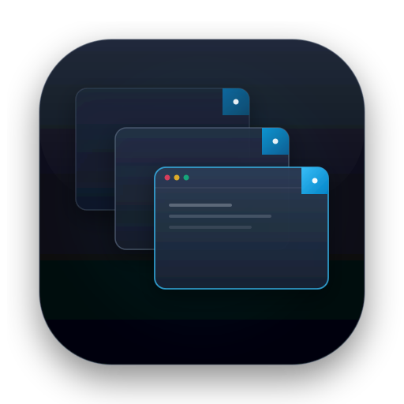

# Cascade

<p align="center">
  
</p>

<p align="center">
  <a href="https://apple.com/macos"></a>
  <a href="https://opensource.org/licenses/MIT"></a>
  <a href="VERSION"></a>
</p>

Native macOS window manager that maximizes application window size while guaranteeing every window remains clickable with the mouse pointer at all times.

## Features

- **Maximizes Window Area:** Applications occupy 75% to 98% of your display—no rigid tiling or tiny split panes.
- **Two Invariant Layout Styles:**
  - **Quad-Edge (Perimeter):** Cycles windows along Top, Right, Bottom, and Left screen borders for maximum screen coverage (94%+ display area) and full-edge click strips.
  - **Diagonal Cascade:** Staggers windows diagonally with guaranteed unoccluded top-right and bottom-left click tabs.
- **Ultrawide & Multi-Monitor Splits:** Partition displays or split ultrawide monitors into 1, 2, 3, or 4 virtual columns with independent cascades and automatic window rebalancing.
- **Flexible Window Ordering:** Most Recently Used (MRU), Spatial (left-to-right), Alphabetical, or custom Preferred Application Order.
- **Application Ignore List:** Exclude background utilities, menu bar apps, or specific tools from layouts.
- **Menu Bar App & CLI:** Native macOS status bar item with global hotkey (`⌥⌘C`), native Settings panel, and scriptable CLI (`cascade`).
- **Persistent Code-Signing:** Zero permission invalidation across rebuilds via persistent local keychain certificates.

## Quick Start

### 1. One-Line Install (Apple Silicon & Intel)

```bash
curl -fsSL https://raw.githubusercontent.com/brunobrise/cascade/main/install.sh | bash
```
*Automatically detects CPU architecture, downloads the matching pre-built release, and installs both `cascade` CLI and `Cascade.app`.*

### 2. Download Pre-built Installers (.dmg)

Download native drag-and-drop installers and standalone CLI binaries from [GitHub Releases](https://github.com/brunobrise/cascade/releases/latest):
- **Universal Installer (.dmg):** Works natively on all modern Macs (Apple Silicon & Intel)
- **Architecture-Specific (.dmg & .tar.gz):** `arm64` (M1–M4) and `x86_64` (Intel)

### 3. Build from Source

Requires macOS 11.0+ and Xcode Command Line Tools (`xcode-select --install`).

```bash
make cert       # Provision persistent self-signed certificate (one-time setup)
make install    # Build and install CLI (~/.local/bin) and App (~/Applications)
make dist       # Build all dual-arch binaries, DMGs, and release packages
```

Launch the menu bar app: `open -a ~/Applications/Cascade.app` (or `make run`).

## Usage

### Menu Bar & Shortcut

- **Hotkey:** Press `Option + Command + C` (`⌥⌘C`) to cascade the monitor under your mouse cursor.
- **Menu Bar Icon:** Click to cascade current display, cascade all displays, toggle **Auto-Rearrange**, or open **Settings** (`⌘,`).
- **Settings Modal:** Configure Layout Style (Diagonal / Quad-Edge), Window Order, Column Splits, Margin (Delta), Ignore List, and Launch at Login.

### Command-Line Interface (`cascade`)

| Task | Command |
| :--- | :--- |
| **Apply layout** | `cascade --apply` *(add `--plan` for dry run)* |
| **Layout style** | `cascade --layout quad-edge --apply` *(or `diagonal`)* |
| **Display targeting** | `cascade --screen all --apply` *(or `--screen active`, `--screen "Display Name"`)* |
| **Ultrawide splits** | `cascade --split 3 --apply` *(splits screen into 3 virtual columns)* |
| **Window order** | `cascade --order preferred --apply` *(or `mru`, `spatial`, `alpha`)* |
| **Application filter** | `cascade --only "Cursor,Google Chrome" --apply` |
| **Ignore list** | `cascade --set-ignore "Slack,Spotify"` *(or `--get-ignore`)* |
| **Watch mode** | `cascade --watch` *(continuous auto-rearrange on window open/close)* |
| **Save defaults** | `cascade --set-layout quad-edge && cascade --set-split 2` |
| **View preferences** | `cascade --get-preferences` |

*Run `cascade --help` for the full list of options, or `make help` for developer build targets.*

## Documentation

For technical specifications, architectural proofs, and project stories:

- [Documentation Index](docs/index.md) — Comprehensive index of all 20+ feature stories and specs.
- [Window Cascade Engine Spec](docs/specs/01a0f7ec7c122619-window-cascade-engine.md) — Mathematical proofs and geometry invariants.
- [Multi-Screen & Splits Spec](docs/specs/ab844179246d4c2d-multi-screen-support.md) — Display partitioning and coordinate spaces.
- [Persistent Code Signing Spec](docs/specs/01a0fc7ed70771c2-persistent-code-signing-and-tcc.md) — TCC and Designated Requirement anchoring.
- [Brand & Identity Spec](docs/specs/01a0fc49a5197278-minimalist-identity-and-icon-system.md) — Vector identity and [interactive showcase](resources/brand/brand-preview.html).

## License

MIT License. See [LICENSE](LICENSE) for details.
