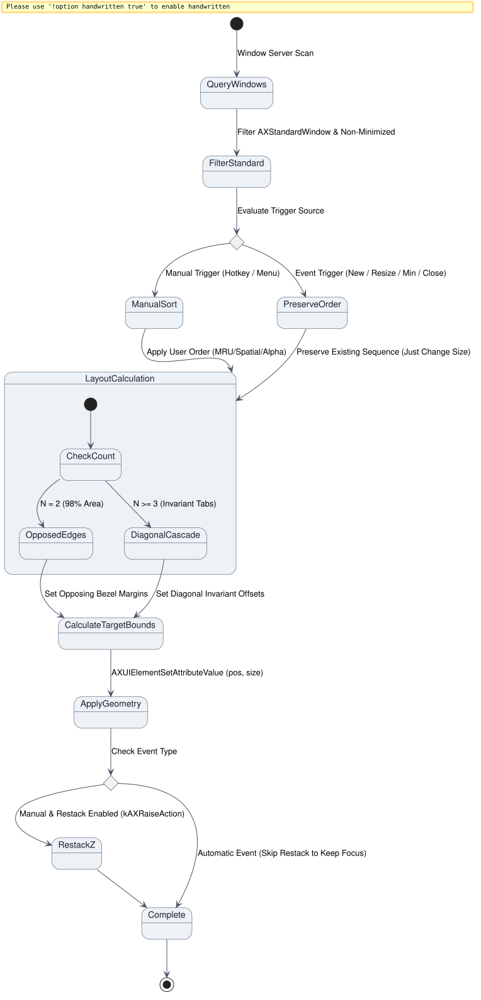

# Window Cascade Engine Specification

## 1. Problem Statement & Goals

Modern multitasking on macOS often leads to cluttered workspaces where windows overlap randomly. When a window is brought to the foreground, it frequently covers background windows entirely, requiring users to use keyboard shortcuts (Cmd+Tab), Mission Control gestures, or hunt through the Dock to refocus background tasks.

The goal of the **Window Cascade Engine** is to:
1. Maximize usable window area for each application (achieving 73% to 98% screen area per window).
2. Mathematically guarantee that every window exposes a permanently unoccluded, clickable click target at all times, regardless of which window currently holds focus or sits on top of the Z-stack.
3. Provide flexible ordering mechanisms (Most Recently Used, Spatial Left-to-Right, and Alphabetical).

## 2. Architecture & Data Flow

Below is the state lifecycle of the window cascade process from discovery to geometric application:



*Figure 1: High-level pipeline from WindowServer enumeration, through ordering and geometry computation, to AXUIElement execution.*

## 3. Mathematical Foundations

### 3.1 Two-Window Opposed Edge Geometry ($N = 2$)
For $N = 2$ windows on usable screen width $W$ and height $H$ with clickable margin $\delta$:
- **Window 1 (Left-anchored):** Origin $(0, 0)$, Dimensions $(W - \delta, H)$.
- **Window 2 (Right-anchored):** Origin $(\delta, 0)$, Dimensions $(W - \delta, H)$.
- **Coverage:** $\frac{W - \delta}{W} \times 100\%$ (typically $\ge 97\%$).
- **Permanent unoccluded tabs:** Full vertical edge of size $\delta \times H$.

### 3.2 Invariant Diagonal Cascade ($N \ge 3$)
For $N \ge 3$ windows:
- **Origin of window $i$:** $X_i = (i-1)\delta, \quad Y_i = (i-1)\delta$.
- **Dimensions:** $w = W - (N-1)\delta, \quad h = H - (N-1)\delta$.
- **Permanent Top-Right Tab:** $P_i = [X_i + w - \delta, X_i + w] \times [Y_i, Y_i + \delta]$.
  - $\forall j > i: Y_j \ge i\delta > Y(P_i)$, so no window above $i$ in index occludes $P_i$.
  - $\forall j < i: X_j + w \le (i-2)\delta + w < X(P_i)$, so no window below $i$ in index occludes $P_i$.
- **Result:** $P_i \cap R_j = \emptyset \quad \forall j \neq i$. Permanent unoccluded target of size $\delta \times \delta$.

## 4. API & Data Structures

```objc
typedef NS_ENUM(NSInteger, CascadeOrderMode) {
    CascadeOrderModeMRU = 0,         // Front-to-back (WindowServer Z-order)
    CascadeOrderModeSpatial = 1,     // Left-to-right (origin.x)
    CascadeOrderModeAlphabetical = 2 // Alphabetical (localizedName)
};
```

Core class: `CascadeEngine`
- `+ (CGRect)usableScreenFrameWithTopInset:(CGFloat *)outTopInset;`
- `+ (NSArray<CascadeWindow *> *)collectStandardWindowsWithOnly:(NSArray<NSString *> *)onlyApps exclude:(NSArray<NSString *> *)excludeApps;`
- `+ (NSArray<CascadeWindow *> *)calculateLayoutForWindows:(NSArray<CascadeWindow *> *)windows orderMode:(CascadeOrderMode)orderMode delta:(CGFloat)delta;`
- `+ (void)applyLayoutToWindows:(NSArray<CascadeWindow *> *)windows restackZ:(BOOL)restackZ;`

Helper class: `LoginItemManager`
- `+ (BOOL)isStartAtLoginEnabled;`
- `+ (BOOL)setStartAtLoginEnabled:(BOOL)enabled error:(NSError **)outError;`
- `+ (NSString *)launchAgentPlistPath;`

Watcher class: `WindowWatcher`
- `- (instancetype)initWithDelegate:(id<WindowWatcherDelegate>)delegate;`
- `- (void)startWatching;`
- `- (void)stopWatching;`
- `- (void)scheduleDebouncedChange;`

## 5. Acceptance Criteria

1. On a screen with dimensions $W \times H$ and inset $T$, calculated window origins never exceed screen boundaries.
2. For $N=2$, window widths equal $W - \delta$ and heights equal $H$.
3. For $N \ge 3$, all windows share identical dimensions $(W - (N-1)\delta, H - (N-1)\delta)$.
4. The top-right $\delta \times \delta$ tabs of all windows in the calculated layout are mutually disjoint.
5. In MRU mode, windows preserve the exact global Z-order returned by `CGWindowListCopyWindowInfo`.
6. In Spatial mode, windows are ordered strictly by ascending $X$ coordinate.
7. In Alphabetical mode, windows are ordered strictly by ascending application name.
8. Toggling start-at-login registers the application via `SMAppService` with fallback to `~/Library/LaunchAgents/com.brunobrise.cascade.plist`.
9. The status bar menu dynamically displays a checkmark reflecting active login item registration.
10. The CLI command `--start-at-login <enable|disable|status>` provides scriptable login item management.
11. `WindowWatcher` attaches accessibility observers for `kAXWindowCreatedNotification`, `kAXUIElementDestroyedNotification`, `kAXWindowMiniaturizedNotification`, and `kAXWindowDeminiaturizedNotification` across all active applications.
12. Detected lifecycle changes are debounced over 350ms to ensure animation completion and prevent rapid UI flicker.
13. Status bar menu toggle "Auto-Rearrange on Open / Minimize / Close" and CLI `--watch` flag enable continuous automatic re-cascading.

## 6. Test Plan

- Unit test layout mathematics across $N=1, 2, 3, 5, 8$ windows with various screen sizes ($1920 \times 1080$, $1800 \times 1130$, $3840 \times 2160$).
- Unit test disjointness invariants for top-right and bottom-left click tabs.
- Unit test sorting algorithms for MRU, Spatial, and Alphabetical modes.
- Unit test login item registration, verification, disabling, and state restoration (`tests/test_login.m`).
- Unit test `WindowWatcher` observer registration, debouncing, and teardown (`tests/test_watcher.m`).
