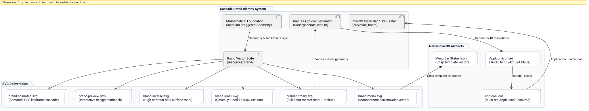

# Minimalist Brand Identity and Native Icon System Spec

## Problem and Goal

The initial application icon in Cascade relied on an overly literal, noisy skeuomorphic metaphor: three faux windows rendered in Objective-C with drop shadows, traffic-light dots (red, yellow, green), artificial text content lines, and gradient tabs. Furthermore, the status bar relied on a generic SF Symbol (`macwindow.on.rectangle`) rather than a proprietary mark, and the repository lacked an official vector brand suite (SVG variants, monochrome vector, favicons, interactive preview, and animation).

The goal of this specification is to establish a world-class, minimalist brand identity and icon system for Cascade that:
1. Translates Cascade's core mathematical invariant—staggered cascade geometry with permanent, unoccluded click tabs—into a clean, minimalist vector mark.
2. Provides a full production SVG suite (`brand-primary.svg`, `brand-mono.svg`, `brand-inverse.svg`, `brand-small.svg`, `brand-animated.svg`, `brand-preview.html`, `brand-rationale.md`).
3. Re-architects `tools/generate_icon.m` to generate high-fidelity, Apple Human Interface Guidelines (HIG) compliant macOS application icons (`AppIcon.icns`) across all required resolutions (16px to 1024px) reflecting this minimalist geometry.
4. Enhances status bar and menu bar icon rendering to use Cascade's proprietary mark.

## System Architecture

The following diagram illustrates the relationship between the mathematical foundation, the vector SVG deliverables, the native macOS icon generation pipeline, and the runtime application bundle:

*Figure 1: Architecture of the Cascade brand identity and native icon build pipeline.*

## Mathematical Geometry & Visual Specifications

### 1. Invariant Cascade Form
The mark is constructed from three precision-proportioned planar window frames:
- **Aspect Ratio:** Golden-ratio derived rectangular planes ($1.45 : 1$).
- **Offset Cadence ($\delta$):** Equal spatial displacement along the diagonal axis ($X_{i+1} = X_i + \delta, Y_{i+1} = Y_i - \delta$).
- **Unoccluded Tab Highlighting:** The top-right click target of each underlying plane remains visible and highlighted, embodying Cascade's mathematical guarantee of permanent clickability:
  $$\forall i \ne j, \quad P_i \cap P_j = \emptyset$$
- **Negative Space Channels:** In the monochrome mark, hairline negative-space knockout gutters (3.5% stroke width) separate overlapping planes, allowing the mark to reproduce on any medium without tonal ambiguity.

### 2. Palette & Contrast
- **Canvas:** Deep space obsidian `#0B0F19` to `#020617`.
- **Primary Accent (Cyan / Electric Cobalt):** `#00F2FE` $\to$ `#4FACFE` and `#38BDF8` representing active click tabs.
- **Planes:** Neutral dark glass `#1E293B` to `#0F172A` with luminous inner borders (`#94A3B8` at 20% opacity).
- **Monochrome:** Pure `currentColor` with zero dependencies on opacity or color channels.

### 3. Deliverables Scope

1. `resources/brand/brand-primary.svg`: Full-color master mark with optional typographic logotype.
2. `resources/brand/brand-mono.svg`: Single-color `currentColor` vector for light/dark embedding.
3. `resources/brand/brand-inverse.svg`: High-contrast vector optimized for dark interfaces.
4. `resources/brand/brand-small.svg`: Optically tuned 16–32 px favicon and app-switcher icon.
5. `resources/brand/brand-animated.svg`: Semantic CSS-animated SVG illustrating the cascading layout.
6. `resources/brand/brand-preview.html`: Interactive HTML testbench demonstrating all variants, dark/light themes, and responsive scales.
7. `resources/brand/brand-rationale.md`: Identity brief, mathematical rationale, and usage guidelines.
8. `tools/generate_icon.m`: Modernized native icon generator for macOS `AppIcon.icns`.
9. `tests/test_icon_generator.m`: Test suite validating icon generation integrity.

## Acceptance Criteria

- [ ] All five SVG variants (`brand-primary.svg`, `brand-mono.svg`, `brand-inverse.svg`, `brand-small.svg`, `brand-animated.svg`) are valid XML, contain `viewBox`, `<title>`, `<desc>`, and `role="img"`.
- [ ] Monochrome SVG works with `currentColor` and contains no hardcoded color fills.
- [ ] Animated SVG respects `prefers-reduced-motion` and contains no external scripts or remote fonts.
- [ ] `brand-preview.html` opens standalone in any browser and displays all sizes (16px, 24px, 32px, 64px, 128px, 256px) across light and dark backgrounds.
- [ ] `tools/generate_icon.m` compiles cleanly with clang and produces a full 10-file `AppIcon.iconset` (16x16 through 512x512@2x).
- [ ] `make icon` produces a valid `resources/AppIcon.icns` without warnings.
- [ ] `make test` includes icon validation and passes all checks.
