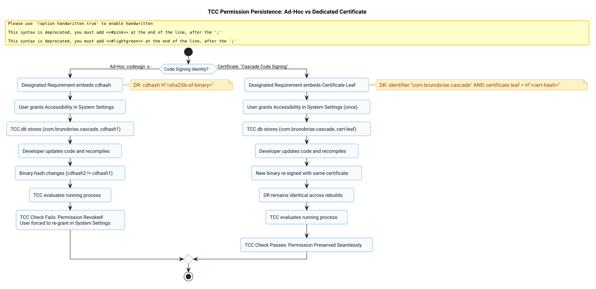

# Persistent Code Signing & TCC Permission Continuity Spec

## Problem and Goal

On macOS, Accessibility permissions governed by Transparency, Consent, and Control (TCC) are tied to an application's cryptographic code signing Designated Requirement (DR). When applications are compiled with ad-hoc signing (`codesign --sign -`), the absence of a digital certificate forces macOS to bind the Designated Requirement to the binary's exact Code Directory Hash (`cdhash`):

$$\text{DR}_{\text{adhoc}} = \texttt{cdhash } H\texttt{"<binary-sha256>"}$$

Consequently, whenever Cascade is updated, recompiled, or reinstalled (`make install`), the Mach-O binary hash changes. TCC evaluates the running process against the stored permission record in `TCC.db`, detects a hash mismatch, and revokes accessibility authorization. The user is forced to manually re-grant or toggle permissions in **System Settings > Privacy & Security > Accessibility** after every update.

The goal of this specification is to:
1. Eliminate the need for users to re-grant accessibility permissions across application rebuilds and updates.
2. Automate the generation, import, and trust configuration of a local, dedicated code-signing certificate (`Cascade Code Signing`) in the user's login keychain.
3. Integrate dynamic signing identity discovery into `Makefile` so `make build` and `make install` automatically sign executables with this persistent identity.
4. Establish a stable Designated Requirement anchored to the certificate leaf:
   $$\text{DR}_{\text{cert}} = \text{identifier } \texttt{"com.brunobrise.cascade"} \land \text{certificate leaf} = H\texttt{"<certificate-hash>"}$$

## System Architecture

The following diagram contrasts how TCC treats ad-hoc signatures versus certificate-anchored signatures across application updates:

*Figure 1: TCC evaluation lifecycle comparing ad-hoc signing (revocation on rebuild) against persistent certificate signing (permanent trust retention).*

## Technical Specification

### 1. Automated Certificate Provisioning (`tools/setup_signing_cert.sh`)
- **Key Generation:** 2048-bit RSA key pair generated with `openssl`.
- **Certificate Attributes:** Self-signed root certificate valid for 3650 days (10 years) with Common Name `Cascade Code Signing`.
- **Extended Key Usage (EKU):** Marked critical with `codeSigning` (`1.3.6.1.5.5.7.3.3`).
- **Keychain Storage:** Imported directly into `~/Library/Keychains/login.keychain-db`.
- **Trust Domain:** Added to user trust settings via `security add-trusted-cert -r trustRoot -p codeSign`.
- **Partition Access:** Configured via `security set-key-partition-list -S apple-tool:,apple:,codesign: -s -k ""` so that `codesign` accesses the private key without interactive keychain password prompts.

### 2. Build System Integration (`Makefile`)
- **Identity Discovery:** Automatically queries `security find-identity -v -p codesigning` for `Cascade Code Signing` or `Apple Development`.
- **Fallback Grace:** If no valid identity exists, falls back to `-s -` (ad-hoc) with a diagnostic banner pointing to `make cert`.
- **Target `make cert`:** Runs `tools/setup_signing_cert.sh` idempotently.
- **Target `make reset-permissions`:** Runs `tccutil reset Accessibility com.brunobrise.cascade` to cleanly clear orphaned ad-hoc hashes from the TCC database.
- **Atomic Installation:** Replaces `rm -rf` bundle deletion with clean synchronization and signing to preserve bundle attributes.

## Acceptance Criteria

- [ ] `tools/setup_signing_cert.sh` generates and imports `Cascade Code Signing` into the login keychain without errors.
- [ ] `security find-identity -v -p codesigning` reports `Cascade Code Signing` as a valid signing identity.
- [ ] `make build` compiles `Cascade.app` and signs it using `Cascade Code Signing`.
- [ ] `codesign -d -r- build/Cascade.app` confirms the Designated Requirement contains `certificate leaf = H"..."` and no `cdhash`.
- [ ] `codesign -v -vvvv build/Cascade.app` verifies that the bundle is valid on disk and satisfies its Designated Requirement.
- [ ] Recompiling the binary and re-running `make install` preserves the exact same Designated Requirement.
- [ ] Unit tests validate code signing identity integrity and Designated Requirement stability.
