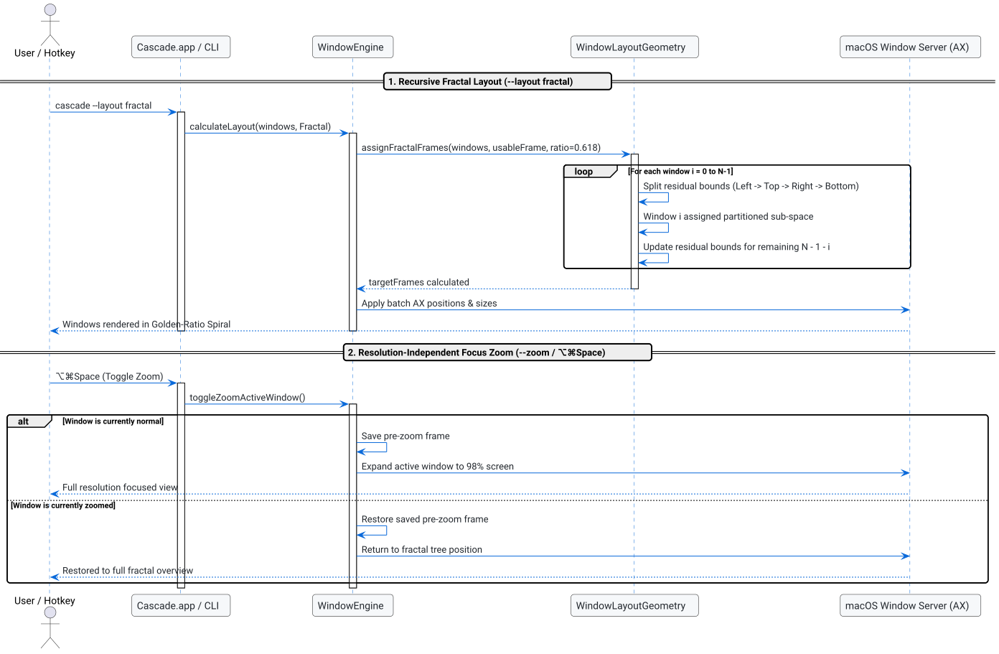

# Fractal Window Management & Focus Zoom Specification

## Problem and Goal

Traditional tiling window managers force rigid, flat grids that treat all applications equally, while conventional overlapping cascading stacks quickly obscure secondary reference windows. As modern display setups expand to 4K, 5K, 6K, and ultrawide resolutions (e.g. 5120x1440 or 5120x2880), users require a spatial hierarchy that mirrors how human attention operates: a primary focal task, nested contextual workspaces, and seamless transitions between macro-level overview and micro-level focus.

TrellisWM demonstrated the cognitive appeal of "fractal" nesting and zooming. However, implementing TrellisWM via an invasive GPU video compositor (`ScreenCaptureKit`) introduces persistent battery drain, screen recording permission prompts, and coordinate latency.

The goal of this specification is to:
1. Introduce a mathematically sound **Fractal Golden-Spiral Layout (`--layout fractal`)** based on recursive subdivision ($r \approx 0.618$) that scales to arbitrary window counts $N$.
2. Implement **Recursive Fractal Edge Docking (`--dock [left|right|top|bottom]`)**, allowing the primary focused window to dock to an edge while dynamically nesting all remaining windows into the residual space.
3. Deliver **Resolution-Independent Focus Zoom (`--zoom` / `⌥⌘Space`)**, allowing any window in the fractal hierarchy to instantly expand to 100% usable screen resolution for deep work, and toggle back to its exact fractal position with 0ms latency.
4. Maintain 100% native Accessibility API execution with zero external dependencies, zero ScreenCaptureKit recording requirements, and full backward compatibility.

## System Architecture

The following sequence diagram illustrates the lifecycle of fractal layout calculation and the resolution-independent Focus Zoom toggle:

### Diagram: Fractal Layout & Focus Zoom

This diagram shows how `WindowLayoutGeometry` and `WindowEngine` execute recursive spatial partitioning and zoom state transitions. Read it when implementing or debugging layout assignments, CLI docking flags, or AppKit zoom shortcuts.

- Main entities: `CascadeEngine` manages window collection and zoom state persistence; `WindowLayoutGeometry` calculates deterministic fractal bounds; `main_bar.m` and `main_cli.m` expose the interface.
- Flow: 1. User invokes `--layout fractal` or `--dock`. 2. Geometry partitions screen space recursively down to leaf nodes. 3. User toggles `⌥⌘Space` to zoom active window to 98% display area, or restores original fractal geometry.
- Failure/edge paths: Single window degenerates to full screen; display disconnection restores stored bounds safely; app minimum size constraints clamp gracefully.
- References: [`WindowLayoutGeometry.m`](../../src/WindowLayoutGeometry.m), [`WindowEngine.m`](../../src/WindowEngine.m), [`main_cli.m`](../../src/main_cli.m), [`main_bar.m`](../../src/main_bar.m).

## Technical Specification

### 1. Mathematical Formulation of Fractal Layout

Given usable display bounds $B_0 = (X_0, Y_0, W_0, H_0)$, a window count $N \ge 1$, and golden ratio division factor $\phi = \frac{\sqrt{5}-1}{2} \approx 0.6180339887$:

For window index $i = 0, 1, \dots, N-1$:
- If $i = N - 1$ (the last leaf window), Window $i$ receives the entire remaining bounding box $B_i$.
- Otherwise, $B_i$ is partitioned along direction $D = i \pmod 4$:
  - $D = 0$ (Left): Window $i$ takes left fraction $W_i \cdot \phi$. Residual box $B_{i+1}$ takes right fraction $W_i \cdot (1 - \phi)$.
  - $D = 1$ (Top): Window $i$ takes top fraction $H_i \cdot \phi$. Residual box $B_{i+1}$ takes bottom fraction $H_i \cdot (1 - \phi)$.
  - $D = 2$ (Right): Window $i$ takes right fraction $W_i \cdot \phi$. Residual box $B_{i+1}$ takes left fraction $W_i \cdot (1 - \phi)$.
  - $D = 3$ (Bottom): Window $i$ takes bottom fraction $H_i \cdot \phi$. Residual box $B_{i+1}$ takes top fraction $H_i \cdot (1 - \phi)$.

Every window $i$ maintains visible edge tabs along the perimeter of the spiral, guaranteeing instant point-and-click focus recovery.

### 2. Recursive Fractal Docking (`--dock [left|right|top|bottom]`)

When the user specifies `--dock <edge>`:
1. The active/focused window is identified.
2. The active window is pinned to the requested edge of the target screen:
   - `left`: $x = X_0, y = Y_0, w = W_0 \cdot \alpha, h = H_0$. Residual: $x = X_0 + W_0 \cdot \alpha, y = Y_0, w = W_0 \cdot (1 - \alpha), h = H_0$.
   - `right`: $x = X_0 + W_0 \cdot (1 - \alpha), y = Y_0, w = W_0 \cdot \alpha, h = H_0$. Residual: $x = X_0, y = Y_0, w = W_0 \cdot (1 - \alpha), h = H_0$.
   - `top`: $x = X_0, y = Y_0, w = W_0, h = H_0 \cdot \alpha$. Residual: $x = X_0, y = Y_0 + H_0 \cdot \alpha, w = W_0, h = H_0 \cdot (1 - \alpha)$.
   - `bottom`: $x = X_0, y = Y_0 + H_0 \cdot (1 - \alpha), w = W_0, h = H_0 \cdot \alpha$. Residual: $x = X_0, y = Y_0, w = W_0, h = H_0 \cdot (1 - \alpha)$.
   (Default $\alpha = 0.5$, or configurable).
3. The remaining $(N-1)$ windows are recursively cascaded/arranged inside the residual bounding box using the active layout style (Diagonal, Quad-Edge, or Fractal).

### 3. Resolution-Independent Focus Zoom (`--zoom` / `⌥⌘Space`)

- **State Model:** `CascadeEngine` tracks zoom state for the active display/window.
- **Zoom In:** Active window expands to `usableFrame` (inset by 8px padding), elevated to top of Z-stack.
- **Zoom Out:** Active window returns to its stored layout frame, and all windows re-verify geometry.
- **Resolution Independence:** Users can nest as deeply as desired; whenever fine text editing or full visibility is needed, a single keystroke (`⌥⌘Space`) delivers 100% native monitor resolution.

### 4. User Interface & CLI Integration

- **CLI Commands:**
  - `cascade --layout fractal --apply`
  - `cascade --set-layout fractal`
  - `cascade --dock left --apply`
  - `cascade --dock right --apply`
  - `cascade --zoom`
- **Menu Bar (`main_bar.m`):**
  - Added menu items: `Toggle Focus Zoom (⌥⌘Space)`, `Dock Left`, `Dock Right`.
- **Settings Modal (`SettingsWindowController.m`):**
  - Added `Fractal (Golden Ratio)` to the Layout Style popup menu.

## Acceptance Criteria

- [ ] `CascadeLayoutStyleFractal` correctly assigned and persisted in user preferences.
- [ ] Mathematical fractal golden spiral computes unoccluded frames for $N = 1, 2, 5, 8, 12$ without NaN or frame inversion.
- [ ] CLI supports `--layout fractal`, `--dock [left|right|top|bottom]`, and `--zoom`.
- [ ] Focus Zoom toggles active window between maximized focus bounds and previous fractal coordinates.
- [ ] Edge docking pins the active window to specified edge and cascades remaining windows in residual child space.
- [ ] Status bar menu and Settings window allow configuring and triggering fractal features.
- [ ] Zero external dependencies; 100% native Accessibility API execution.
