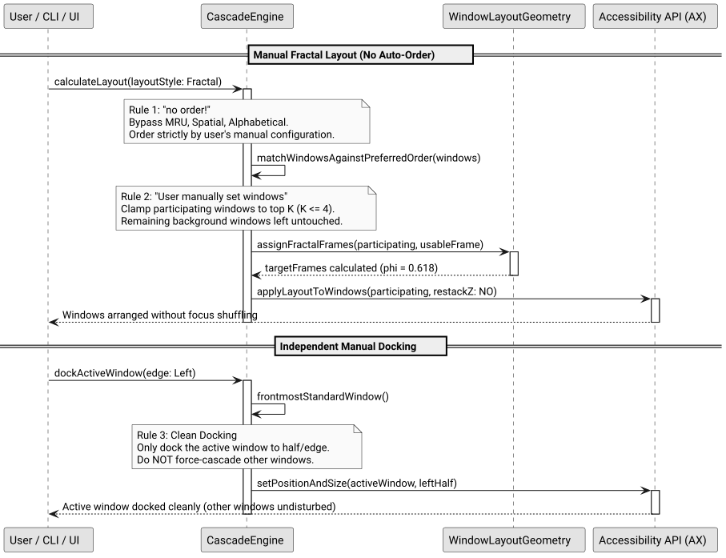

# Manual Fractal Layout and Independent Edge Docking Specification

## Problem and Goal

The initial implementation of `CascadeLayoutStyleFractal` automatically sorted all open desktop windows using the active `CascadeOrderMode` (e.g. MRU, Spatial, Alphabetical) and recursively subdivided them down to $N$ leaf windows. 

While mathematically functional, this model has critical ergonomic flaws:
1. **Exponential area decay ($\phi^k$):** In a fractal layout, Window 0 takes 61.8% of the display, Window 1 takes 23.6%, Window 2 takes 9.0%, and Window 3 takes 3.4%. By $N = 5$ or $N = 10$, windows are reduced to unusable sub-pixel slivers.
2. **Auto-sort chaos:** When `CascadeOrderModeMRU` is active, clicking on any background window elevates it to Window 0, demoting the primary editor to a small slot and scrambling the user's workspace.
3. **Forced residual cascading during docking:** Previously, `--dock [left|right|top|bottom]` docked the active window to half the screen and forced *all other desktop windows* into an unwanted cascade in the residual space.

The goal of this specification is to align Fractal management with TrellisWM's true paradigm:
1. **No Auto-Order for Fractal:** In Fractal mode, bypass all automated sorting algorithms (`MRU`, `Spatial`, `Alphabetical`). Order is strictly defined by the user's manual configuration (`preferredOrder`). Windows never swap positions upon focus change.
2. **User Manually Set Windows (Max Depth $K \le 4$):** Only user-configured windows participate in the fractal layout (up to $K \le 4$ windows). Unassigned or excess background windows remain undisturbed in their existing positions.
3. **Independent Clean Docking:** `--dock [left|right|top|bottom]` tiles only the active window to the requested edge/half without disturbing or cascading other windows on screen.
4. **Settings UI Alignment:** When Fractal layout style is selected, Window Order displays "Manual (User Set)" with direct access to the configuration panel (`AppOrderWindowController`).

## System Architecture

### Diagram: Manual Fractal Layout & Independent Docking

This diagram illustrates the separation between manual fractal ordering and independent docking execution. Read it when modifying layout calculation or docking dispatch.

- Entities: `CascadeEngine` enforces the manual order bypass; `WindowLayoutGeometry` calculates deterministic fractal bounds for $K \le 4$; AX sets geometry.
- Flow: 1. User invokes Fractal layout. 2. Engine filters and sorts only user-set windows. 3. Clamps depth to $K \le 4$. 4. Other windows remain untouched. 5. Docking commands tile only the focused window.
- References: [`WindowEngine.m`](../../src/WindowEngine.m), [`WindowLayoutGeometry.m`](../../src/WindowLayoutGeometry.m), [`SettingsWindowController.m`](../../src/SettingsWindowController.m).

## Technical Specification

### 1. Fractal Layout Bypasses Auto-Order

In `CascadeEngine.m` within `calculateLayoutForWindows:orderMode:preferredOrder:delta:layoutStyle:onUsableFrame:`:
- When `layoutStyle == CascadeLayoutStyleFractal`:
  - Ignore `orderMode` (MRU, Spatial, Alphabetical).
  - Use `preferredOrder` / user manual order. If `preferredOrder` is empty, preserve the window sequence without sorting.
  - Limit the participating windows to $K = 4$ max (Primary 61.8%, Secondary 23.6%, Tertiary 9.0%, Quaternary residual).
  - Calculate target frames only for participating windows.

### 2. Independent Edge Docking

In `CascadeEngine.m` within `dockActiveWindowWithEdge:layoutStyle:delta:`:
- Identify active window.
- Calculate target docked frame for active window:
  - `Left`: $x = X_0, y = Y_0, w = W_0 / 2, h = H_0$.
  - `Right`: $x = X_0 + W_0 / 2, y = Y_0, w = W_0 / 2, h = H_0$.
  - `Top`: $x = X_0, y = Y_0, w = W_0, h = H_0 / 2$.
  - `Bottom`: $x = X_0, y = Y_0 + H_0 / 2, w = W_0, h = H_0 / 2$.
- Apply frame to active window only.
- Do NOT re-cascade or modify other windows.

### 3. Settings UI Synchronization

In `SettingsWindowController.m`:
- When `layoutStyle == CascadeLayoutStyleFractal`:
  - Disable automatic order selection or display "Manual (No Auto-Order)".
  - Keep "Configure..." button enabled so user can manually order apps.

## Acceptance Criteria

- [ ] Fractal layout ignores MRU / Spatial / Alphabetical sorting modes and strictly follows user's manual configuration.
- [ ] Windows in Fractal layout never shuffle or swap slots when a window receives focus.
- [ ] Fractal layout clamps to a maximum of $K \le 4$ participating windows to prevent unusable micro-slivers.
- [ ] `--dock [edge]` moves only the active window to the target screen half, leaving other windows untouched.
- [ ] Settings modal shows Manual window order when Fractal layout is selected.
- [ ] All test suites pass cleanly.
