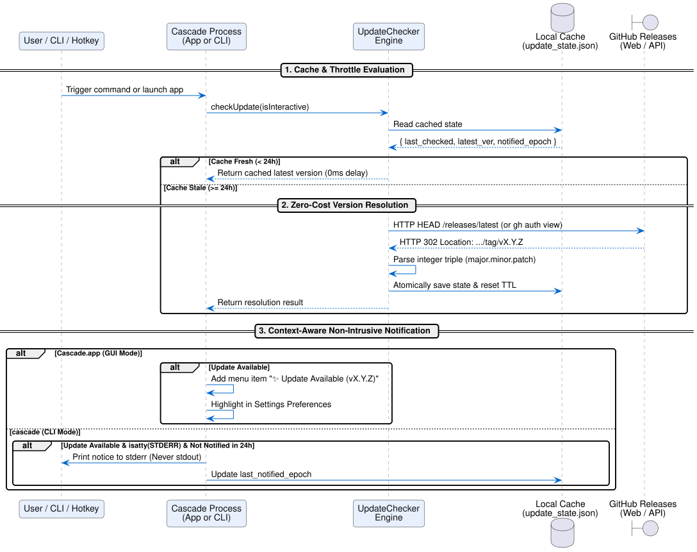
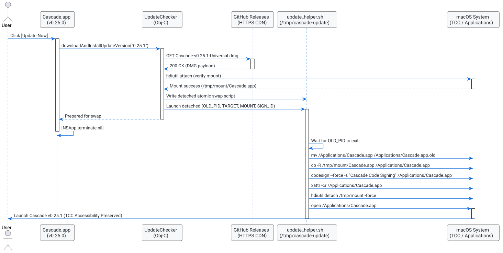

# Update Check and Notification Specification

## Problem and Goal

Cascade is a native macOS window manager designed for high performance, stability, and zero distraction. Users need to know when new releases with bug fixes, layout enhancements, and performance optimizations become available without suffering from common updater failure modes:

1. **Accessibility (TCC) Permission Breakage:** Indiscriminate in-place binary swapping destroys macOS Accessibility authorization when signatures change.
2. **Terminal Pipeline Pollution:** Piped CLI commands (`cascade --list | grep ...`) break if update banners are written to `stdout`.
3. **Execution Latency:** Synchronous network checks during window cascade operations introduce perceptible delays and freeze on offline networks.
4. **API Rate Limiting:** Unauthenticated calls to GitHub's REST API hit strict 60 req/hr IP quotas on shared networks.
5. **Private Repository Inaccessibility:** Unauthenticated requests to private repositories fail with HTTP 404.
6. **Privacy Invasiveness:** Low-level window managers making unannounced network requests trigger firewall alerts (Little Snitch, LuLu) and alarm security-conscious users.

The goal of this specification is to:
1. Provide a lightweight, zero-dependency Objective-C update engine (`UpdateChecker`) shared between `Cascade.app` and `cascade` CLI.
2. Implement a zero-cost release detection strategy utilizing HTTP `HEAD` redirect inspection (`Location` header) that bypasses GitHub REST API rate limits.
3. Establish a 24-hour cache TTL and 24-hour notification throttle to eliminate redundant network traffic and terminal noise.
4. Ensure 100% passive, non-intrusive notifications: `stderr`-only on interactive TTYs for the CLI, and dedicated menu/settings UI for the status bar app.
5. Fix installer code-signing to preserve persistent certificates across updates, eliminating TCC permission invalidation.

## System Architecture

The following sequence diagram illustrates the lifecycle of an update check across CLI and GUI invocation modes:



*Figure 1: Update evaluation lifecycle showing cache inspection, zero-cost HEAD redirect resolution, and non-intrusive notification dispatch.*

### Diagram Description

- **Actors and Triggers:** The user invokes either `cascade` from the command line or `Cascade.app` via hotkey (`⌥⌘C`) or launch.
- **Cache-First Evaluation:** Before any network request is attempted, `UpdateChecker` queries `~/Library/Caches/com.brunobrise.cascade/update_state.json`. If the record is younger than 24 hours, the cached state is returned immediately (0ms delay).
- **Network Resolution:** If the cache is stale or an explicit check is requested (`--check-update` or "Check for Updates..."), `UpdateChecker` initiates an asynchronous network request:
  - If authenticated credentials exist (`GITHUB_TOKEN` or `gh auth`), query the authenticated endpoint.
  - Otherwise, send an HTTP `HEAD` request to `https://github.com/brunobrise/cascade/releases/latest` with redirect following disabled. The HTTP 302 `Location` header is parsed directly to extract the latest release tag (e.g., `v0.24.0`), avoiding REST API rate limits entirely.
- **Atomic Cache Update:** Resolved version metadata is written atomically to disk using a temporary file and rename.
- **Context-Aware Presentation:**
  - In `Cascade.app`: The status menu displays an optional dynamic badge item `✨ Update Available (vX.Y.Z)` and the Settings window indicates update readiness. No intrusive modal alerts appear unless the user explicitly clicked "Check for Updates...".
  - In `cascade`: Update notices are routed strictly to `stderr`, only when `isatty(STDERR_FILENO)` is true, only if not notified within the last 24 hours, and completely suppressed in CI or when `CASCADE_NO_UPDATE_CHECK` is set.

## Technical Specification

### 1. Unified Engine (`src/UpdateChecker.h` & `src/UpdateChecker.m`)

- **State Model:**
  ```objc
  @interface CascadeUpdateState : NSObject
  @property (nonatomic, copy) NSString *latestVersion;
  @property (nonatomic, copy) NSString *releaseURL;
  @property (nonatomic, assign) NSTimeInterval lastCheckedTimestamp;
  @property (nonatomic, assign) NSTimeInterval lastNotifiedTimestamp;
  @property (nonatomic, copy) NSString *skippedVersion;
  @end
  ```
- **Cache Path:** `~/Library/Caches/com.brunobrise.cascade/update_state.json`.
- **Version Comparison:** Strict integer triple extraction (`major.minor.patch`) via `sscanf`:
  $$\text{SemVer}(V) = (M, m, p)$$
  $$\text{IsNewer}(V_{\text{remote}}, V_{\text{local}}) = (M_r > M_l) \lor (M_r = M_l \land m_r > m_l) \lor (M_r = M_l \land m_r = m_l \land p_r > p_l)$$
  Immune to ASCII string comparison errors (e.g. `0.23.10` vs `0.23.4`).

### 2. Privacy & User Control

- **Preferences Key:** `automaticallyCheckForUpdates` (`BOOL`, default `YES` in GUI).
- **Environment Kill-Switches:**
  - `CASCADE_NO_UPDATE_CHECK=1` or `DO_NOT_TRACK=1` disables all background network checks across both CLI and GUI.
  - `CI=true` disables all passive CLI update banners.
- **Zero Telemetry:** No user identifier, hardware ID, IP logging, or tracking payload is transmitted. Requests strictly query the release tag.

### 3. Installer Code-Signing Fix (`install.sh`)

- **Problem:** [`install.sh#L101`](file:///Users/chainsona/Code/src/github.com/brunobrise/cascade/install.sh#L101) previously used `codesign --force --deep -s -`, creating an ad-hoc signature that revoked Accessibility permissions on every update.
- **Fix:** Update `install.sh` to search for existing persistent signing identities (`Cascade Code Signing` or `Apple Development`) matching `Makefile`:
  ```bash
  SIGNING_IDENTITY=$(security find-identity -v -p codesigning 2>/dev/null | grep -E "Cascade Code Signing|Apple Development" | head -1 | sed -E 's/.*"([^"]+)".*/\1/' || true)
  [ -z "$SIGNING_IDENTITY" ] && SIGNING_IDENTITY="-"
  ```
  This preserves the cryptographic Designated Requirement across updates.

### 4. User Interface Integration

- **Status Bar Menu:**
  - "Check for Updates..." menu item opens a standard, non-blocking AppKit sheet or alert.
  - Background discovery injects an unobtrusive item: `✨ Update Available (vX.Y.Z)...` opening the release notes or triggering the update command.
- **Settings Modal:**
  - Added checkbox: `Automatically check for updates`.
  - Added `Check Now` button with inline status readout ("Cascade is up to date" or "vX.Y.Z available").
- **CLI Options:**
  - `--check-update`: Runs an explicit update check and outputs human-readable status to `stdout`.
  - Passive notice on command exit:
    ```text
    cascade: A new version is available: 0.23.4 -> 0.24.0
    To update, run: curl -fsSL https://raw.githubusercontent.com/brunobrise/cascade/main/install.sh | bash
    ```

### 5. In-App 1-Click Update & Atomic Bundle Swap

Users expect seamless single-click update installation without being forced to download DMGs manually or run terminal commands.



*Figure 2: In-app 1-click update installation and atomic bundle replacement lifecycle.*

- **Action Trigger:** The update alert presents `[Update Now]`, `[View Release]`, and `[Later]`.
- **Pre-Flight Download & Verification:**
  - Asset URL: `https://github.com/brunobrise/cascade/releases/download/v<version>/Cascade-v<version>-Universal.dmg`.
  - Downloaded to temporary directory `/tmp/cascade-update-XXXXXX/Cascade.dmg`.
  - Tested with `hdiutil attach -nobrowse -readonly` to verify disk image validity and bundle presence before terminating the running app.
- **Detached Swap Helper (`update_helper.sh`):**
  - Waits for current app PID to exit (`kill -0 $OLD_PID`).
  - Creates backup (`Cascade.app.old`) to enable atomic rollback on copy failure.
  - Replaces application bundle (`cp -R`).
  - Re-signs bundle with local persistent certificate `Cascade Code Signing` (or ad-hoc `-` if missing) to preserve macOS TCC Accessibility trust across releases.
  - Clears quarantine flags (`xattr -cr`).
  - Unmounts disk image (`hdiutil detach -force`).
  - Launches updated application via `open /Applications/Cascade.app`.
  - If CLI binary `~/.local/bin/cascade` is present and CLI tarball is available, updates and re-signs CLI binary in sync.

## Acceptance Criteria

- [ ] SemVer integer triple parsing correctly evaluates standard, prefixed (`vX.Y.Z`), and multi-digit versions (`0.23.10` > `0.23.4`).
- [ ] Local state round-trips through JSON cache file atomically.
- [ ] 24-hour cache TTL prevents repeated network requests during normal commands.
- [ ] CLI update notices print strictly to `stderr` and only when `isatty(STDERR_FILENO)` is true.
- [ ] Setting `CASCADE_NO_UPDATE_CHECK=1` or unchecking the preferences toggle completely inhibits background network queries.
- [ ] Status bar menu and Settings window accurately reflect update status without UI thread lockup.
- [ ] Update alert provides a direct `[Update Now]` action alongside `[View Release]` and `[Later]`.
- [ ] In-app 1-click update downloads DMG, verifies mount, and performs atomic bundle swap with TCC code-signing preservation.
- [ ] `install.sh` signs installed binaries with `Cascade Code Signing` when present, preserving Accessibility permissions across updates.
