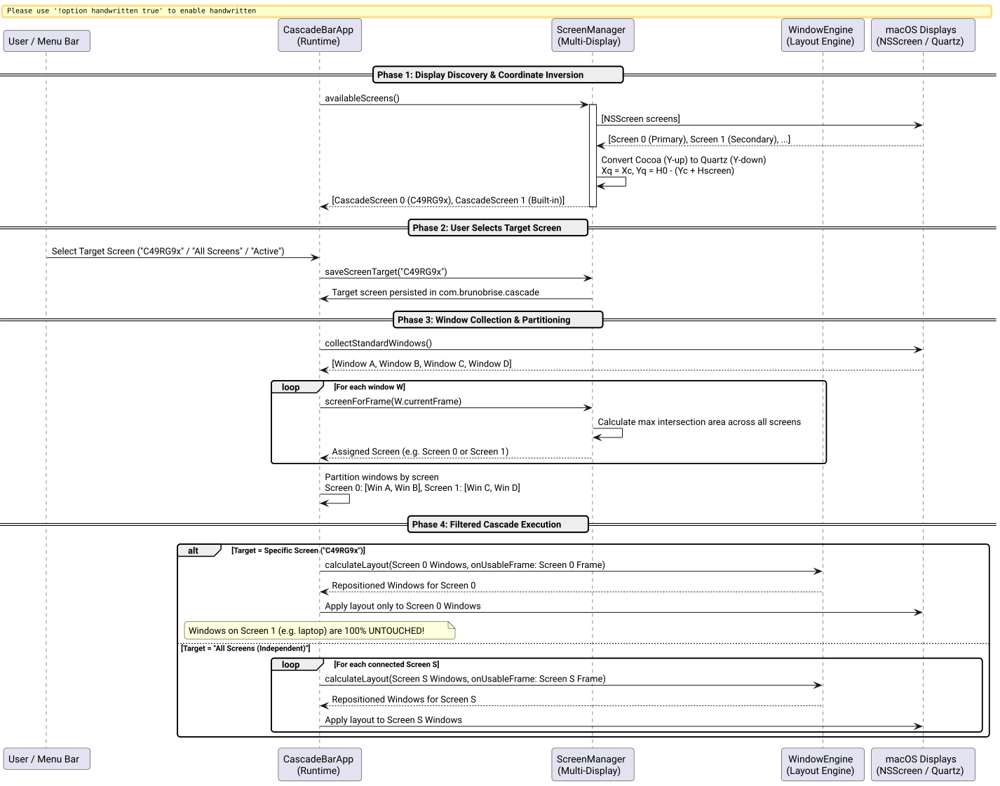

# Multi-Screen Support & Target Display Selection Spec

## Problem and Goal

On macOS, power users and software developers commonly operate multi-display environments (such as a 49-inch Super Ultrawide monitor paired with a MacBook's built-in Retina display). 

Previously, Cascade operated under a single-display assumption:
1. **Coordinate Inversion Discrepancy:** `usableScreenFrameWithTopInset:` referenced `[NSScreen mainScreen]` and performed insets assuming the screen origin was at $(0, 0)$. In macOS Cocoa, the origin $(0, 0)$ is at the bottom-left of the primary display ($Y$ increases upward). Secondary displays positioned below or above the primary monitor have negative $Y$ or inverted offsets in Cocoa, while Quartz/Accessibility coordinates place $(0, 0)$ at the top-left of the primary display with $Y$ increasing downward. As a result, calculating usable frames for secondary displays produced severe vertical offsets (hundreds of pixels misplaced).
2. **Indiscriminate Window Aggregation:** `collectStandardWindowsWithOnly:exclude:` collected all active windows across all connected displays and smashed them onto a single display's geometry. Reference notes, Slack, or terminal windows intentionally stationed on a secondary laptop screen were violently pulled onto the primary ultrawide monitor and resized to 5000+ pixels wide.
3. **No Screen Target Selection:** Users had no mechanism to restrict auto-cascade to a specific display or configure per-display cascading behaviors.

The goal of this specification is to:
1. Provide mathematical coordinate translation between Cocoa and Quartz display spaces for arbitrary multi-monitor topologies (screens to the left, right, above, or below).
2. Introduce a dedicated `ScreenManager` subsystem to partition windows by screen based on maximum intersection area.
3. Enable user selection of the target screen for auto-cascade and manual cascade:
   - **All Screens (Independent):** Each connected screen runs its own cascade independently.
   - **Active Screen (Follows Focus):** Cascade triggers only on the screen containing active user focus.
   - **Specific Named Screen:** e.g. `C49RG9x` or `Built-in Retina Display`. Windows on non-target screens remain 100% untouched.
4. Expose dynamic selection in both the menu bar status menu and the command-line interface.
5. Provide automatic resilience to monitor disconnection and reconnection (`NSApplicationDidChangeScreenParametersNotification`).

## System Architecture

The following diagram illustrates how displays are detected, coordinates are translated, windows are partitioned by screen intersection, and cascades are dispatched:



*Figure 1: Multi-screen detection, Quartz coordinate translation, window partitioning, and filtered cascade flow.*

## Technical Specification

### 1. Mathematical Coordinate Inversion

Given $N$ connected screens with primary display height $H_0 = \text{screens}[0].\text{frame}.\text{size}.\text{height}$:
For any screen $k$ with Cocoa frame $(X_{\text{cocoa}}, Y_{\text{cocoa}}, W, H)$ and Cocoa visible frame $(VX_{\text{cocoa}}, VY_{\text{cocoa}}, VW, VH)$:
- **Quartz Screen Frame:**
  $$X_{\text{quartz}} = X_{\text{cocoa}}$$
  $$Y_{\text{quartz}} = H_0 - (Y_{\text{cocoa}} + H)$$
- **Quartz Visible Usable Frame:**
  $$VX_{\text{quartz}} = VX_{\text{cocoa}}$$
  $$VY_{\text{quartz}} = H_0 - (VY_{\text{cocoa}} + VH)$$
  Width = $VW$, Height = $VH$.

### 2. Window-to-Screen Association by Maximum Intersection Area

For any window with Quartz frame $W$:
$$\text{Assigned Screen } S^* = \arg\max_{S \in \text{Screens}} \text{Area}(\text{CGRectIntersection}(W, S.\text{quartzFrame}))$$
If no intersection exists (e.g. window is completely offscreen), fall back to distance or primary display.

### 3. ScreenManager Subsystem (`src/ScreenManager.h` & `src/ScreenManager.m`)

- Data Model:
  ```objc
  @interface CascadeScreen : NSObject
  @property (nonatomic, assign) NSInteger index;
  @property (nonatomic, copy) NSString *name;
  @property (nonatomic, copy) NSString *displayID;
  @property (nonatomic, assign) BOOL isPrimary;
  @property (nonatomic, assign) CGRect cocoaFrame;
  @property (nonatomic, assign) CGRect cocoaVisibleFrame;
  @property (nonatomic, assign) CGRect quartzFrame;
  @property (nonatomic, assign) CGRect quartzVisibleFrame;
  @end
  ```
- Methods:
  ```objc
  + (NSArray<CascadeScreen *> *)availableScreens;
  + (CascadeScreen *)primaryScreen;
  + (CascadeScreen *)activeScreen;
  + (CascadeScreen *)screenForFrame:(CGRect)quartzFrame;
  + (CGRect)convertCocoaFrameToQuartz:(CGRect)cocoaFrame primaryScreenHeight:(CGFloat)h0;
  + (NSString *)savedScreenTarget;
  + (void)saveScreenTarget:(NSString *)target;
  + (NSArray<CascadeScreen *> *)screensMatchingTarget:(NSString *)target;
  ```

### 4. Menu Bar UI (`src/main_bar.m`)

Add a dynamic **"Target Screen"** submenu:
- `All Screens (Independent)`
- `Active Screen (Follows Focus)`
- Separator
- Dynamic items for each connected screen: e.g. `C49RG9x (5120x1440) [Primary]`, `Built-in Retina Display (1800x1169)`.
- Listen for `NSApplicationDidChangeScreenParametersNotification` to rebuild the menu when monitors are attached or detached.

### 5. CLI Interface (`src/main_cli.m`)

- `cascade --list-screens`: Print connected displays with dimensions and target indicator.
- `cascade --screen <target> --apply`: Cascade chosen screen.
- `cascade --set-screen <target>`: Save preferred screen target.

## Acceptance Criteria

- [ ] Mathematical coordinate inversion maps Cocoa frames to Quartz coordinates with zero pixel error across multi-monitor layouts.
- [ ] Windows are correctly attributed to their owning screen via maximum intersection area.
- [ ] Selecting a specific screen cascades only windows on that screen; windows on other screens remain untouched.
- [ ] Selecting "All Screens" cascades each screen independently within its own usable boundary.
- [ ] Status bar menu reflects connected monitors dynamically and updates on monitor hot-plugging.
- [ ] CLI supports `--list-screens` and `--screen` / `--set-screen`.
- [ ] All source files remain strictly $\le 420$ LOC.
- [ ] All unit tests pass.
