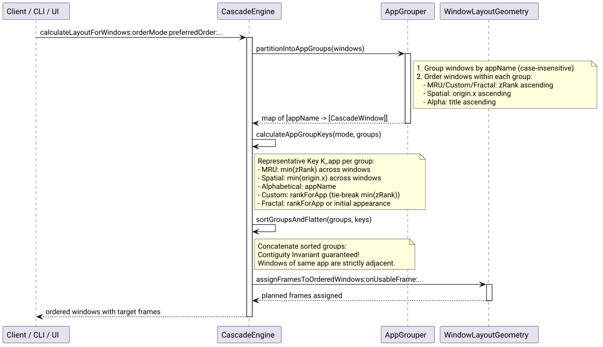

# Application Window Grouping Invariant Specification

## Problem and Goal

Prior to this specification, sorting algorithms in Cascade (`CascadeOrderModeMRU`, `CascadeOrderModeSpatial`, and unlisted applications in `CascadeOrderModeCustom`) sorted windows individually based purely on window-level properties (`zRank` or `currentFrame.origin.x`).

When an application had multiple open windows (e.g. 2 browser windows and 2 terminal windows), their positions frequently interleaved:
`[Safari 1, Terminal 1, Safari 2, Terminal 2]`

This created significant cognitive friction and visual disorganization:
1. Windows belonging to the same application were fragmented across disparate cascade slots.
2. Clicking unoccluded edge tabs caused awkward hopping across unrelated applications.
3. When new windows opened, they were appended at the end of the cascade, breaking proximity to their parent application.

The goal of this specification is to enforce a strict **Application Contiguity Invariant**:
**Windows belonging to the same application must always remain contiguous and grouped together, regardless of the active sorting mode or layout style.**

## Mathematical Definition & Invariant

Given a set of windows $W = \{w_1, w_2, \dots, w_n\}$ where each window has an associated application identifier $A(w) = w.appName$ (case-insensitive):

### 1. Contiguity Invariant
In the resulting ordered sequence of windows $O = [o_1, o_2, \dots, o_n]$:
$$\forall i < j, \quad A(o_i) = A(o_j) \implies \forall k \in [i, j], \quad A(o_k) = A(o_i)$$
No window belonging to another application $B \ne A$ may appear between any two windows of application $A$.

### 2. Group Partitioning & Ordering
The set of windows $W$ is partitioned into disjoint equivalence classes (App Groups) $G = \{G_{A_1}, G_{A_2}, \dots, G_{A_m}\}$ where $G_A = \{w \in W \mid A(w) = A\}$.

Each group $G_A$ is assigned a representative key $K(G_A)$ according to the active sorting mode:

1. **MRU Mode (`CascadeOrderModeMRU`):**
   $$K_{MRU}(G_A) = \min_{w \in G_A} (w.zRank)$$
   Groups are sorted by $K_{MRU}(G_A)$ ascending (the application with the most recently focused window is positioned first).
   *Intra-group ordering:* Windows within $G_A$ are sorted by $w.zRank$ ascending (frontmost window of that app at the group head).

2. **Spatial Mode (`CascadeOrderModeSpatial`):**
   $$K_{Spatial}(G_A) = \min_{w \in G_A} (w.currentFrame.origin.x)$$
   Groups are sorted by $K_{Spatial}(G_A)$ ascending (the application furthest to the screen's left is positioned first).
   *Intra-group ordering:* Windows within $G_A$ are sorted by $w.currentFrame.origin.x$ ascending (left-to-right).

3. **Alphabetical Mode (`CascadeOrderModeAlphabetical`):**
   $$K_{Alpha}(G_A) = A$$
   Groups are sorted alphabetically by application name.
   *Intra-group ordering:* Windows within $G_A$ are sorted by $w.title$ ascending (or $w.zRank$).

4. **Custom / Preferred App Order (`CascadeOrderModeCustom`):**
   $$K_{Pref}(G_A) = rankForApp(A, preferredOrder)$$
   Ties (unlisted applications where rank is $999999$): sorted by $\min_{w \in G_A} (w.zRank)$ ascending.
   *Intra-group ordering:* Windows within $G_A$ are sorted by $w.zRank$ ascending.

5. **Fractal Layout (`CascadeLayoutStyleFractal`):**
   - If `preferredOrder` is non-empty: ranked by $rankForApp(A, preferredOrder)$, tie-broken by initial input sequence.
   - If `preferredOrder` is empty: ordered by the initial input appearance of application $A$.
   - Windows from the same application are clustered together before the max depth clamping ($K \le 4$).

6. **Order Preservation Invariant (`preservingOrderFrom:`):**
   When an active cascade order is preserved across window lifecycle events:
   - A new window $w_{new}$ belonging to an already present application $A$ is inserted immediately following the last window of $A$ in the cascade.
   - A new window belonging to an unrepresented application is appended at the end.

## Architecture and Flow

### Diagram: Application Window Grouping Invariant

This diagram shows how `CascadeEngine` intercepts window lists, partitions them into application groups, sorts them according to the mode's representative key, and flattens them into contiguous blocks before assigning cascade frames.

- **Main entities:** `CascadeEngine` computes layout; partitioning logic clusters by `appName`; `WindowLayoutGeometry` calculates physical frame bounds.
- **Flow:** 1. Input windows arrive. 2. Windows are clustered into groups by `appName`. 3. Intra-group sorting is applied. 4. Representative group keys are computed. 5. Groups are ordered and flattened. 6. Geometry frames are assigned.
- **References:** [`WindowEngine.m`](../../src/WindowEngine.m), [`WindowLayoutGeometry.m`](../../src/WindowLayoutGeometry.m), [`test_engine.m`](../../tests/test_engine.m).

## Acceptance Criteria

- [ ] In `CascadeOrderModeMRU`, all windows belonging to the same application are contiguous; the app with the frontmost window comes first, and windows within the app are ordered by `zRank`.
- [ ] In `CascadeOrderModeSpatial`, all windows belonging to the same application are contiguous; the app with the leftmost window comes first, and windows within the app are ordered left-to-right.
- [ ] In `CascadeOrderModeAlphabetical`, all windows belonging to the same application are contiguous.
- [ ] In `CascadeOrderModeCustom`, all windows belonging to the same application are contiguous; unlisted apps are grouped and sorted by most recently used.
- [ ] In `CascadeLayoutStyleFractal`, windows from the same application are contiguous.
- [ ] In `preservingOrderFrom:`, new windows from an existing application are inserted adjacent to their sibling windows rather than appended at the end of the list.
- [ ] All existing test suites continue to pass without regression.
