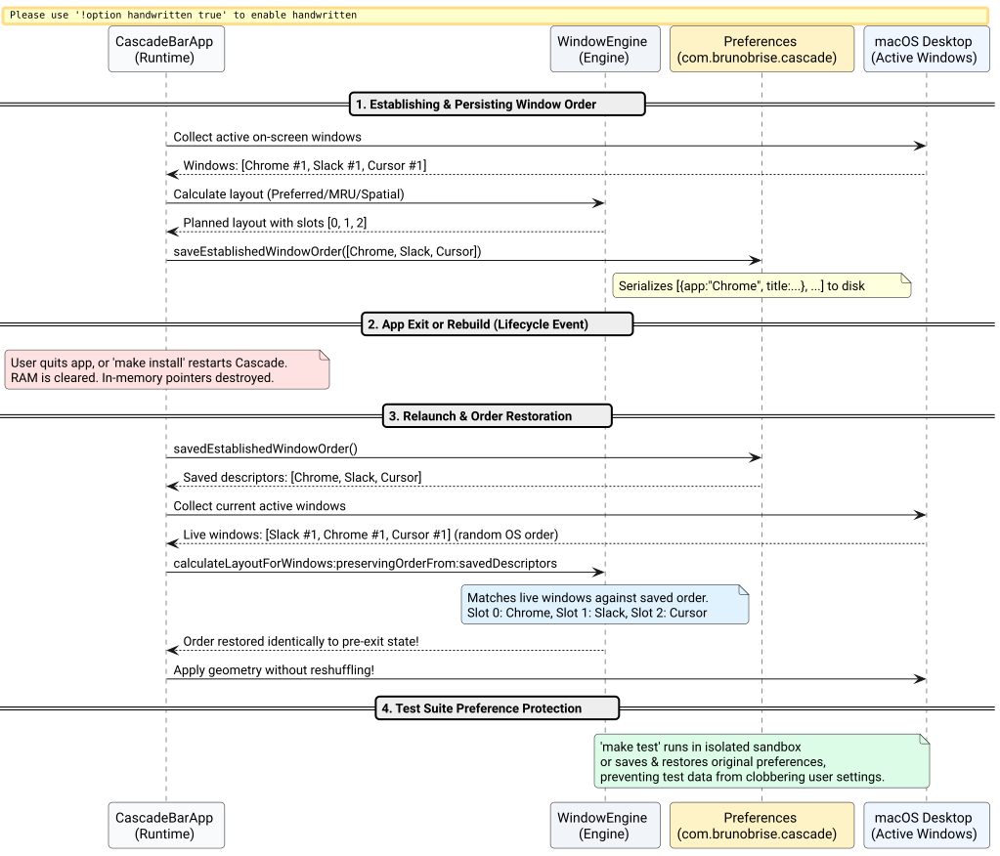

# Window Order Persistence Across App Exit & Install Spec

## Problem and Goal

During window management, users organize active application windows into a spatial mental model (e.g., Slot 0 = Editor, Slot 1 = Browser, Slot 2 = Terminal). However, users identified that the window order was not properly persisted across application exits and new installations.

Deep investigation uncovered two independent root causes:
1. **Test Suite Clobbering User Preferences on Install:** When `make test` runs during build/install cycles, `testPreferencesPersistence()` in `tests/test_engine.m` directly executes test setters (`saveOrderMode:CascadeOrderModeSpatial`, `setPreferredAppOrder:@[@"Cursor", @"Terminal", @"Chrome"]`) against the live `com.brunobrise.cascade` suite without backing up or restoring existing user settings. Every install or test run silently clobbers the user's custom "Windows Order".
2. **Ephemeral In-Memory Window Sequence:** In `src/main_bar.m`, `self.establishedOrder` was stored solely in an in-memory `NSArray<CascadeWindow *> *` instance property. When Cascade exits, updates, or restarts, `establishedOrder` is deallocated. On relaunch, `self.establishedOrder` is `nil`, forcing the first window lifecycle event (or auto-rearrange) to re-sort all windows from scratch, scrambling the user's desktop layout.
3. **Multi-Window Tie-Breaker Collapse:** In `collectStandardWindowsWithOnly:exclude:`, `zRank` was tracked per-PID rather than per-window. When multiple windows of the same application exist, their sort comparator returns equality (`NSOrderedSame`), causing them to flip positions unpredictably across runs.

The goal of this specification is to:
1. **Protect User Preferences:** Ensure unit tests (`make test`) isolate their defaults or backup and restore live preferences, guaranteeing that builds and installs never overwrite user settings.
2. **Persist Established Window Sequences:** Serialize established window order descriptors (`appName`, `title`) to user defaults so that Cascade restores the exact sequence across app exits, rebuilds, and system restarts.
3. **Preserve Order in Manual Cascades:** Ensure manual cascade actions (`Option + Command + C`) preserve established slot allocations rather than reshuffling based on momentary focus.
4. **Deterministic Same-App Tie-Breaking:** Guarantee unambiguous, deterministic order for multiple windows belonging to the same application.

## System Architecture

The following diagram illustrates how window order is serialized, restored across process termination, and protected from test runner clobbering:



*Figure 1: Window order persistence lifecycle across application exits, restarts, and test isolation.*

## Technical Specification

### 1. Test Suite Preference Protection (`tests/test_engine.m`)
- In `testPreferencesPersistence()`, capture original values for `savedOrderMode`, `savedDelta`, `savedRestackZOrder`, `savedAutoRearrange`, and `preferredAppOrder`.
- At the end of the test, restore all original values back into storage.

### 2. Window Order Descriptors & Serialization (`src/WindowEngine.h` & `src/WindowEngine.m`)
- Add serialization and restoration methods:
  ```objc
  + (NSArray<NSDictionary<NSString *, NSString *> *> *)serializeWindows:(NSArray<CascadeWindow *> *)windows;
  + (NSArray<CascadeWindow *> *)matchWindows:(NSArray<CascadeWindow *> *)currentWindows
                         withSavedDescriptors:(NSArray<NSDictionary<NSString *, NSString *> *> *)saved;
  + (NSArray<NSDictionary<NSString *, NSString *> *> *)savedEstablishedWindowOrder;
  + (void)saveEstablishedWindowOrder:(NSArray<CascadeWindow *> *)windows;
  ```
- Storage key: `establishedWindowOrder` in `com.brunobrise.cascade`.

### 3. Startup Restoration & Watcher Integration (`src/main_bar.m`)
- In `applicationDidFinishLaunching:`, load `[CascadeEngine savedEstablishedWindowOrder]`. If saved descriptors exist and windows are present, match and populate `self.establishedOrder`.
- In `performCascade:`, if `self.establishedOrder.count > 0`, preserve established slots and apply geometry. When updated, call `[CascadeEngine saveEstablishedWindowOrder:planned]`.
- In `rearrangePreservingOrder:`, persist the updated layout with `[CascadeEngine saveEstablishedWindowOrder:planned]`.
- In `setOrderModeValue:`, clear `self.establishedOrder` and remove saved order so explicit mode changes recalculate fresh layout.

### 4. Per-Window Distinct `zRank` & Deterministic Sorting
- In `collectStandardWindowsWithOnly:exclude:`, track `zRank` with window-level granularity (using window title, window index, or order in `cgWindows`).
- In comparator for `CascadeOrderModeCustom`, break ties with window title (`[a.title compare:b.title]`) and `currentFrame.origin.x` to guarantee non-zero deterministic ordering.

## Acceptance Criteria

- [ ] `make test` runs completely without mutating existing user preferences in `com.brunobrise.cascade`.
- [ ] Cascading windows saves `establishedWindowOrder` descriptors into `com.brunobrise.cascade`.
- [ ] Quitting Cascade (`pkill -x Cascade`) and re-launching restores the exact same window slots without reshuffling.
- [ ] Multiple windows of the same application retain deterministic ordering across restarts.
- [ ] Manual cascade (`Option + Command + C`) preserves established sequence instead of jumping focused window to slot 0.
- [ ] All source files remain strictly under 420 LOC.
- [ ] All unit tests pass.
