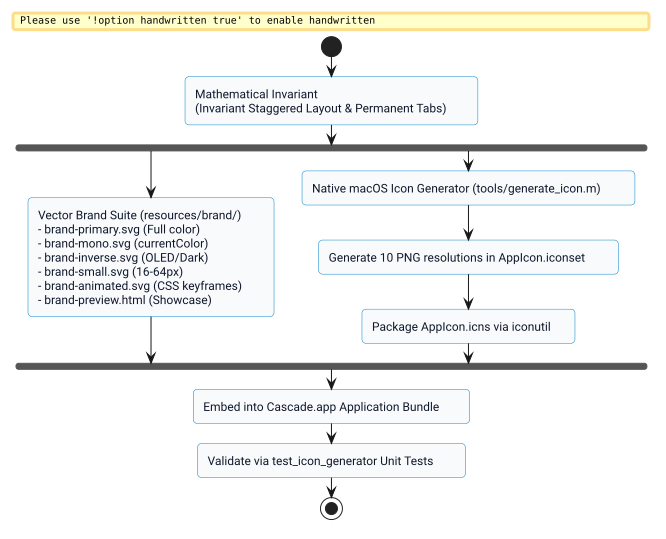

# Minimalist Brand Identity & Native Icon Success Story

## Context

Prior to this work, Cascade relied on an ad-hoc, skeuomorphic icon generated via Objective-C that simulated heavy drop shadows, colored traffic light buttons, and artificial text content lines. The icon collapsed into visual noise when rendered at standard dock or menu bar scales (16px to 32px), lacked standard vector identity assets, and did not reflect the mathematical elegance of the window cascade layout.

## The Bet

By anchoring the brand identity directly in Cascade's core mathematical invariant—staggered planar geometry with permanently unoccluded click tabs—we could create a minimalist, high-taste identity system that:
1. Translates the algorithm into an iconic, ownable silhouette.
2. Scales without degradation from a 16px favicon up to a 1024px retina display.
3. Automatically builds into native macOS application bundles (`AppIcon.icns`) via `make icon`.
4. Delivers a complete, standards-compliant SVG vector package (`brand-primary`, `brand-mono`, `brand-inverse`, `brand-small`, and `brand-animated`).

## What Worked and Why

The pipeline was separated into two complementary delivery mechanisms:
1. **Universal SVG Vector System (`resources/brand/`):**
   - Built with strict geometric proportions ($1.45 : 1$ aspect ratio, uniform offset cadence $\delta$).
   - Monochrome variant uses negative-space knockout gutters, enabling 100% vector reproduction on any background without opacity dependencies.
   - Small variant boosts stroke weight and simplifies to two high-contrast frames for razor-sharp 16px to 32px reproduction.
   - Animated SVG uses zero-dependency CSS keyframes with `@media (prefers-reduced-motion)` support.
2. **Native macOS Squircle Asset Generator (`tools/generate_icon.m`):**
   - Renders the exact same minimalist geometry on the macOS Big Sur $824 \times 824$ active canvas within $1024 \times 1024$.
   - Automatically exports all 10 required PNG resolutions into `AppIcon.iconset` and builds `AppIcon.icns` via `iconutil`.

*Figure 1: Production asset pipeline from mathematical invariant to SVG deliverables and native macOS bundle.*

## Evidence & Verification

1. **Unit Test Suite:**
   - `test_icon_generator` compiles and passes all checks in `make test`.
   - Verified that `AppIcon.icns` is valid, non-empty (>150KB), and contains all 10 expected resolution representations (from 16x16 up to 512x512@2x).
   - Verified that all SVG files conform to XML specifications, include valid `viewBox`, `<title>`, and proper `currentColor` or keyframe definitions.
2. **Visual & Scale Verification:**
   - Validated via `resources/brand/brand-preview.html` across 16px, 24px, 32px, 48px, 64px, 128px, and 200px.
   - Verified high contrast in light, dark, and OLED contexts.

## Reusable Pattern

When developing native macOS utilities that also need cross-platform web or documentation presence:
1. Ground the visual metaphor in the product's functional invariant rather than generic software clichés.
2. Maintain parallel vector SVG and native Cocoa icon pipelines sharing identical geometric parameters.
3. Implement automated test suites asserting file existence, pixel dimensions, and SVG XML attributes as part of the standard `make test` target.

## Limits

The small variant (`brand-small.svg`) drops the third back window to preserve legibility below 32px. For full 3-window fidelity, surfaces must be at least 48px wide.

## Related Artifacts

- [Identity Specification](../specs/01a0fc49a5197278-minimalist-identity-and-icon-system.md)
- [SVG Vector Deliverables](../../resources/brand/)
- [Interactive Preview Showcase](../../resources/brand/brand-preview.html)
- [Design Rationale](../../resources/brand/brand-rationale.md)
- [Native Icon Generator](../../tools/generate_icon.m)
- [Test Suite](../../tests/test_icon_generator.m)
