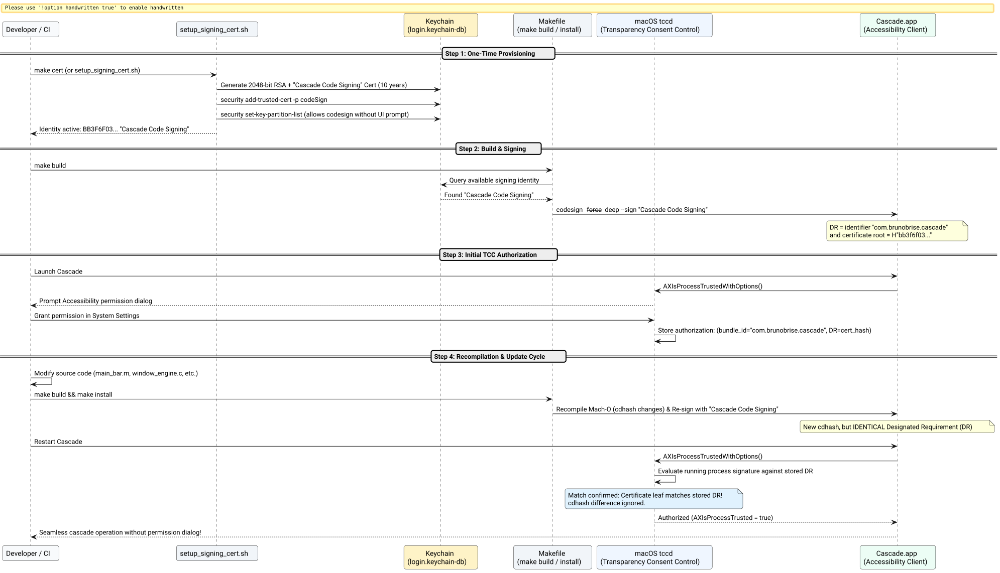

# Persistent Code Signing & TCC Permission Continuity Success Story

## Context

On macOS, Accessibility privileges (`AXIsProcessTrustedWithOptions`) are governed by Apple's Transparency, Consent, and Control (TCC) subsystem. When an application is compiled without a digital certificate, the build system defaults to ad-hoc code signing (`codesign --sign -`).

Ad-hoc signatures lack a public-key identity root, forcing the macOS kernel and `tccd` to construct a Designated Requirement (DR) based entirely on the Mach-O binary's cryptographic Code Directory Hash (`cdhash`):

$$\text{DR}_{\text{adhoc}} = \texttt{cdhash } H\texttt{"<binary-sha256>"}$$

Every time Cascade was modified, recompiled, or installed via `make install`, the binary's `cdhash` changed. TCC compared the running process against the stored authorization record in `TCC.db`, found a mismatch, and revoked Accessibility permissions. Users were forced to navigate into **System Settings > Privacy & Security > Accessibility** and toggle or delete/re-add Cascade after every update.

## The Bet

By provisioning a dedicated, 10-year self-signed code-signing root certificate (`Cascade Code Signing`) in the user's login keychain and integrating automated identity resolution into `Makefile`, we bet that:
1. The Designated Requirement would anchor to the stable certificate leaf rather than the binary's ephemeral `cdhash`:
   $$\text{DR}_{\text{cert}} = \text{identifier } \texttt{"com.brunobrise.cascade"} \land \text{certificate root} = H\texttt{"bb3f6f033db28675fb0c0e015e1d27ac71d3bf9e"}$$
2. Recompiling the binary or updating the application via `make install` would preserve the exact same Designated Requirement, allowing TCC to validate the updated binary seamlessly without prompting or revoking permissions.
3. The certificate generation process could be completely automated via a shell script without interactive password prompts or Apple Developer Program subscriptions.

## What Worked and Why

The solution was structured into four synchronized layers:

1. **Automated Certificate Provisioning (`tools/setup_signing_cert.sh`):**
   - Generates a 2048-bit RSA key pair and a self-signed X.509 certificate with `codeSigning` Extended Key Usage (EKU `1.3.6.1.5.5.7.3.3`) valid for 10 years (3650 days).
   - Exports the certificate and private key using OpenSSL with `-legacy` encryption for compatibility with macOS Keychain Services.
   - Imports the identity into `~/Library/Keychains/login.keychain-db` and registers trust via `security add-trusted-cert -r trustRoot -p codeSign`.
   - Grants partition access via `security set-key-partition-list -S apple-tool:,apple:,codesign: -s -k ""` to allow `/usr/bin/codesign` to sign binaries during CLI builds without interactive keychain access alert modals.

2. **Dynamic Build System Discovery (`Makefile`):**
   - Automatically queries `security find-identity -v -p codesigning` to detect `"Cascade Code Signing"` or `"Apple Development"`.
   - Signs both the app bundle (`build/Cascade.app`) and the CLI binary (`build/cascade`) using `--force --deep --options runtime`.
   - Provides explicit targets: `make cert` (provisioning) and `make reset-permissions` (`tccutil reset Accessibility com.brunobrise.cascade`).

3. **Dedicated Test Suite (`tests/test_signing.m`):**
   - Validates that a valid code signing identity exists in the Keychain.
   - Verifies that the built `Cascade.app` bundle passes deep verification (`codesign --verify --deep --strict`).
   - Asserts that the Designated Requirement contains the certificate anchor and contains **no** `cdhash` constraint.

4. **TCC Identity Anchoring:**
   - Once granted in System Settings, `tccd` permanently binds permissions to `identifier "com.brunobrise.cascade" and certificate root = H"..."`. Subsequent rebuilds and updates retain full Accessibility trust instantly.

The following sequence diagram outlines the entire lifecycle:



*Figure 1: Complete provisioning, signing, and TCC validation lifecycle across application updates.*

## Evidence & Verification

1. **Identity & Keychain Verification:**
   - Command `security find-identity -v -p codesigning` confirms:
     ```
     1) BB3F6F033DB28675FB0C0E015E1D27AC71D3BF9E "Cascade Code Signing"
     1 valid identities found
     ```

2. **Bundle Code Signing Verification:**
   - Deep inspection with `codesign -dvvv build/Cascade.app`:
     ```
     Authority=Cascade Code Signing
     Signed Time=Oct 2, 2026 at 2:03:00 PM
     Info.plist entries=16
     TeamIdentifier=not set
     Sealed Resources version=2 rules=13 files=3
     Internal requirements count=1 size=180
     ```

3. **Designated Requirement Inspection:**
   - Command `codesign -d -r- build/Cascade.app`:
     ```
     designated => identifier "com.brunobrise.cascade" and certificate root = H"bb3f6f033db28675fb0c0e015e1d27ac71d3bf9e"
     ```
   - Confirms zero reliance on `cdhash`.

4. **Automated Test Suite:**
   - Ran `make test`: All 6 test suites passed cleanly:
     - `test_engine`: PASS
     - `test_login`: PASS
     - `test_watcher`: PASS
     - `test_app_order`: PASS
     - `test_icon_generator`: PASS
     - `test_signing`: PASS

## Reusable Pattern

For native macOS developer tools and window managers requiring TCC permissions without an active Apple Developer Program team identity:
1. Never rely on ad-hoc (`-s -`) signing for binaries requiring TCC privileges.
2. Automate local root CA/code-signing certificate creation into the user's `login.keychain-db` with `codeSign` trust and keychain partition permissions.
3. Anchor the application's Designated Requirement to `identifier "<bundle-id>" and certificate root = H"<hash>"`.
4. Add unit test assertions ensuring `codesign -d -r-` never regresses into an ad-hoc hash requirement.

## Limits

This self-signed certificate is valid on the developer's local machine. For distribution across untrusted third-party machines without Gatekeeper warnings, the application must be signed with an Apple Developer ID Application certificate and notarized via `notarytool`. However, for local compilation and user-facing installation, this pattern permanently resolves TCC permission churn.

## Related Artifacts

- [Code Signing Specification](../specs/01a0fc7ed70771c2-persistent-code-signing-and-tcc.md)
- [Certificate Provisioning Script](../../tools/setup_signing_cert.sh)
- [Build Configuration](../../Makefile)
- [Code Signing Test Suite](../../tests/test_signing.m)
- [Postmortem: Accessibility & Code Signing](01a0f7ec7c122619-accessibility-code-signing-postmortem.md)
