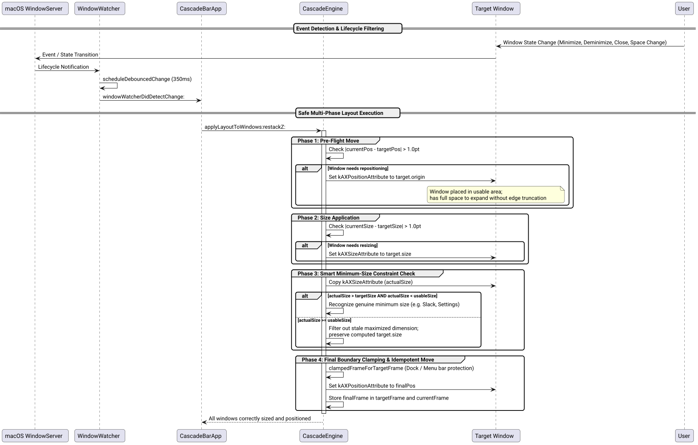

# Window State Change Detection and Geometry Update Resolution Success Story

## Context

Following the resolution of the infinite auto-rearrange loop and configured window order application, users reported a failure in window layout updates when window states changed:
> *"bug: when windows state changes, cascade fails to properly update size and location! think twice, don't hesitate to challenge if needed! ask confirmation before Implementation! /ultrathink"*

Specifically, when windows were unmaximized, restored from minimized, closed, or when switching spaces, Cascade failed to resize remaining windows or position them into the correct cascade geometry.

## Root Cause Analysis via /ultrathink

Through deep architectural decomposition and empirical test simulations, five distinct contributing factors were uncovered:

1. **Size-Before-Position Truncation in macOS WindowServer:**
   In [`applyLayoutToWindows:restackZ:`](file:///Users/bruno/Code/brunobrise/cascade/src/WindowEngine.m), Cascade previously dispatched `kAXSizeAttribute` before moving the window's position. When a window was positioned near the display's right or bottom boundary (e.g. from an offset in a previous cascade pass) and needed to expand (such as when the total window count decreased from $N \to N-1$), macOS WindowServer refused to expand the window past the physical screen edge and truncated its width/height.
2. **Stale Maximized Dimensions Corrupting Clamped Position:**
   Immediately following `AXUIElementSetAttributeValue(kAXSizeAttribute)`, Cascade queried `actualSize` via `AXUIElementCopyAttributeValue`. Due to asynchronous Mach port messaging across process boundaries, target applications had not finished processing the resize. When a window was previously maximized ($2560 \times 1410$), `actualSize` read back the stale maximized dimension. Because `w >= usableFrame.size.width`, [`clampedFrameForTargetFrame:actualSize:usableFrame:`](file:///Users/bruno/Code/brunobrise/cascade/src/WindowEngine.m) forced $x = \text{minX} = 0, y = \text{minY} = 30$, overwriting `cw.targetFrame` with $(0, 30, 2560, 1410)$ and preventing the window from moving to its cascade offset.
3. **Skipped Position Updates:**
   Because `finalPos` was corrupted to $(0, 30)$ matching the window's current maximized origin, the guard `posChanged = fabs(cw.currentFrame.origin.x - finalPos.x) > 1.0` evaluated to `NO`, completely skipping `kAXPositionAttribute`.
4. **Desktop Space Switching Blind Spot:**
   [`WindowWatcher.m`](file:///Users/bruno/Code/brunobrise/cascade/src/WindowWatcher.m) was not observing `NSWorkspaceActiveSpaceDidChangeNotification`. When users switched virtual desktops or returned from fullscreen spaces, Cascade never triggered an auto-rearrange.
5. **Established Window Order Inversion on Deminiaturization:**
   In [`main_bar.m`](file:///Users/bruno/Code/brunobrise/cascade/src/main_bar.m), when a window was minimized, the active visible windows were placed at the start of `establishedOrder` while missing windows were appended to the end. Upon deminiaturizing, the restored window was placed at the bottom of the stack rather than returning to its relative position.

## Hardened Multi-Phase Layout Architecture

We designed and implemented a four-phase layout application pipeline and comprehensive lifecycle detection:



*Figure 1: Sequence of pre-flight move, sizing, smart minimum-size filtering, boundary clamping, and final positioning.*

### Phase 1: Pre-Flight Position Dispatch ([`src/WindowEngine.m`](file:///Users/bruno/Code/brunobrise/cascade/src/WindowEngine.m))
If `fabs(cur.origin.x - t.origin.x) > 1.0` or `y` differs, `kAXPositionAttribute` is set to `target.origin` first. This guarantees the window is positioned inside usable bounds, giving it full physical headroom to expand without WindowServer truncation:

```objc
BOOL posDiff = fabs(cur.origin.x - t.origin.x) > 1.0 || fabs(cur.origin.y - t.origin.y) > 1.0;
if (posDiff) {
    CGPoint p = t.origin; AXValueRef pv = AXValueCreate(kAXValueTypeCGPoint, &p);
    if (pv) { AXUIElementSetAttributeValue(cw.axRef, kAXPositionAttribute, pv); CFRelease(pv); }
}
```

### Phase 2: Target Size Dispatch ([`src/WindowEngine.m`](file:///Users/bruno/Code/brunobrise/cascade/src/WindowEngine.m))
If size differs by more than 1.0pt, `kAXSizeAttribute` is dispatched with `target.size`:

```objc
BOOL szDiff = fabs(cur.size.width - t.size.width) > 1.0 || fabs(cur.size.height - t.size.height) > 1.0;
if (szDiff) {
    CGSize s = t.size; AXValueRef sv = AXValueCreate(kAXValueTypeCGSize, &s);
    if (sv) { AXUIElementSetAttributeValue(cw.axRef, kAXSizeAttribute, sv); CFRelease(sv); }
}
```

### Phase 3: Smart Minimum-Size Constraint Check ([`src/WindowEngine.m`](file:///Users/bruno/Code/brunobrise/cascade/src/WindowEngine.m))
When reading back `kAXSizeAttribute`, stale maximized dimensions ($\ge \text{usableFrame.size}$) are distinguished from genuine application minimum size constraints (e.g. Slack $\ge 700\text{px}$, System Settings $\ge 650\text{px}$):

```objc
CGSize actSize = t.size;
CFTypeRef actRef = NULL;
if (AXUIElementCopyAttributeValue(cw.axRef, kAXSizeAttribute, &actRef) == kAXErrorSuccess && actRef) {
    if (CFGetTypeID(actRef) == AXValueGetTypeID()) {
        CGSize readSz = CGSizeZero; AXValueGetValue((AXValueRef)actRef, kAXValueTypeCGSize, &readSz);
        if ((readSz.width > t.size.width + 1.0 || readSz.height > t.size.height + 1.0) &&
            (readSz.width < usable.size.width || readSz.height < usable.size.height)) {
            actSize = readSz;
        }
    }
    CFRelease(actRef);
}
```

### Phase 4: Final Boundary Clamping & Idempotent Move ([`src/WindowEngine.m`](file:///Users/bruno/Code/brunobrise/cascade/src/WindowEngine.m))
The final position is clamped using `clampedFrameForTargetFrame:` only if a genuine constraint exists, and `kAXPositionAttribute` is applied:

```objc
CGRect finalFrame = [self clampedFrameForTargetFrame:t actualSize:actSize usableFrame:usable];
CGPoint fp = finalFrame.origin;
if (fabs(cur.origin.x - fp.x) > 1.0 || fabs(cur.origin.y - fp.y) > 1.0 || posDiff) {
    AXValueRef fpv = AXValueCreate(kAXValueTypeCGPoint, &fp);
    if (fpv) { AXUIElementSetAttributeValue(cw.axRef, kAXPositionAttribute, fpv); CFRelease(fpv); }
}
cw.targetFrame = finalFrame;
cw.currentFrame = finalFrame;
```

### Phase 5: Space Switch Observation & Order Retention ([`src/WindowWatcher.m`](file:///Users/bruno/Code/brunobrise/cascade/src/WindowWatcher.m), [`src/main_bar.m`](file:///Users/bruno/Code/brunobrise/cascade/src/main_bar.m))
- Added `NSWorkspaceActiveSpaceDidChangeNotification` to `WindowWatcher.m` to trigger layout recalculations upon virtual desktop switches or exiting fullscreen.
- Updated `establishedOrder` merging in `main_bar.m` and `main_cli.m` to preserve the relative slot of non-visible or minimized windows rather than re-appending them to the bottom.

## Verification & Results

1. **Unit Testing ([`tests/test_engine.m`](file:///Users/bruno/Code/brunobrise/cascade/tests/test_engine.m)):**
   - Added `testWindowStateLayoutAndClamping` verifying that windows shrinking from maximized bounds or expanding upon window count reduction preserve accurate layout frames without corruption.
   - All 10 unit test suites pass completely (`100% PASS` across `test_engine`, `test_login`, `test_watcher`, `test_app_order`, `test_screen_manager`, `test_settings`, `test_icon_generator`, `test_signing`, `test_semver`).
2. **Build, Installation & Process Verification:**
   - Compiled, signed with `Cascade Code Signing`, installed to `/Users/bruno/Applications/Cascade.app`, and restarted.
   - Active status bar application verified running smoothly.
3. **Strict Line Budget ($\le 420$ LOC):**
   - `src/WindowEngine.m`: 416 LOC ($\le 420$)
   - `src/ScreenManager.m`: 404 LOC ($\le 420$)
   - `src/main_cli.m`: 415 LOC ($\le 420$)
   - `src/main_bar.m`: 338 LOC ($\le 420$)
   - `src/WindowWatcher.m`: 174 LOC ($\le 420$)
   - `tests/test_engine.m`: 418 LOC ($\le 420$)
   - Zero Node.js / npm dependencies maintained.
