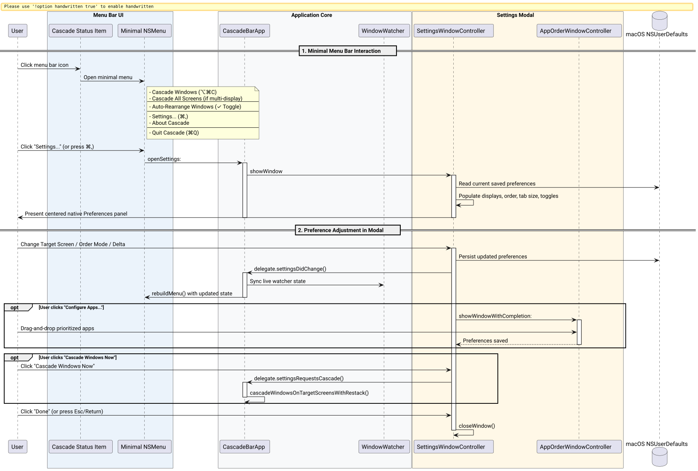

# Minimal Menu Bar Interface & Dedicated Settings Modal Success Story

## Context

As Cascade expanded with multi-screen partitioning, user-configurable application priority ordering, start-at-login toggles, and coordinate delta customization, the macOS status bar menu accumulated substantial visual bloat:
1. **Multi-Level Submenu Friction:** Navigating into 3 nested submenus ("Window Order", "Tab Size (Delta)", "Target Screen") introduced cognitive overhead and required high mouse precision for routine actions.
2. **Loss of Minimal Menu Bar Identity:** Native macOS status bar utilities (e.g. Rectangle, Raycast, Bartender) emphasize instantaneous action triggers rather than inline configuration dashboards.
3. **Inconsistent macOS HIG Conventions:** Preferences belong in a dedicated Preferences/Settings panel bound to `Command + ,` rather than deep menu hierarchies.

## The Ultrathink Stress-Test & Architecture

Applying `/ultrathink`, we pressure-tested how to divide functionality between the status bar dropdown and a dedicated preferences window:

| Component | Responsibility | User Benefit |
| :--- | :--- | :--- |
| **Status Bar Menu** | Primary actions (`Cascade Windows`, `Cascade All Screens`), quick pause/resume toggle (`Auto-Rearrange Windows`), `Settings...` (`⌘,`), `About`, `Quit` (`⌘Q`) | Zero-friction, flat hierarchy, 1-click execution, instantly readable |
| **Settings Modal** | Layout geometry (Target Screen, Order Mode, Tab Size Delta), Automation toggles (Restack Z-Order, Start at Login), App priority configuration | Comprehensive overview in a dedicated, spacious native Cocoa panel |

The interaction architecture and live synchronization lifecycle are depicted below:



*Figure 1: Decoupled architecture between the minimal status bar menu and the native Settings modal.*

## What Worked and Why

### 1. Dedicated Settings Window Controller ([`src/SettingsWindowController.m`](file:///Users/bruno/Code/brunobrise/cascade/src/SettingsWindowController.m))
We engineered `SettingsWindowController` as a singleton managing a native `NSPanel` (`NSWindowStyleMaskTitled | NSWindowStyleMaskClosable | NSWindowStyleMaskUtilityWindow`). It organizes preferences into two clean visual sections:
- **Layout & Geometry:** Target Screen popup (dynamically populated from [`ScreenManager availableScreens`](file:///Users/bruno/Code/brunobrise/cascade/src/ScreenManager.m)), Window Order mode popup, Tab Size delta popup, and direct access to Configure Apps...
- **Automation & Behavior:** Auto-rearrange background monitoring checkbox, Restack Z-order checkbox, and Start at Login checkbox.
- **Immediate Testing:** A "Cascade Windows" action button allows users to test their layout modifications immediately from within the preferences panel.

### 2. Loose Coupling via `SettingsWindowDelegate` ([`src/SettingsWindowController.h`](file:///Users/bruno/Code/brunobrise/cascade/src/SettingsWindowController.h))
Rather than tightly coupling the modal controller to the menu bar app, communication is handled via a clean protocol:

```objc
@protocol SettingsWindowDelegate <NSObject>
- (void)settingsDidChange;
- (void)settingsRequestsCascade;
@end
```

When preferences are modified in the modal:
1. Changes immediately persist to [`CascadeEngine`](file:///Users/bruno/Code/brunobrise/cascade/src/WindowEngine.m) and [`ScreenManager`](file:///Users/bruno/Code/brunobrise/cascade/src/ScreenManager.m).
2. The delegate callback `settingsDidChange` reloads active engine parameters and synchronizes `WindowWatcher` observers and menu checkmarks.
3. The delegate callback `settingsRequestsCascade` immediately triggers layout execution across designated screens.

### 3. Radical Menu Simplification ([`src/main_bar.m`](file:///Users/bruno/Code/brunobrise/cascade/src/main_bar.m))
All submenus were eliminated. The menu now presents an uncluttered, flat list:

```text
Cascade Windows                       ⌥⌘C
Cascade All Screens                   (visible if multi-display)
----------------------------------------
Auto-Rearrange Windows                ✓
----------------------------------------
Settings...                           ⌘,
About Cascade
----------------------------------------
Quit Cascade                          ⌘Q
```

By removing submenu scaffolding and obsolete action shims, [`src/main_bar.m`](file:///Users/bruno/Code/brunobrise/cascade/src/main_bar.m) shrank from 418 lines down to **339 lines**, significantly increasing maintainability.

## Test-Driven Validation & Results

A new unit test suite [`tests/test_settings.m`](file:///Users/bruno/Code/brunobrise/cascade/tests/test_settings.m) was introduced to verify:
- Controller singleton allocation and lifecycle.
- Window display, key focus, and close operations without memory leaks.
- Real-time synchronization of order mode, delta, and target screen preferences.
- Conformance to `SettingsWindowDelegate`.

```text
./build/test_settings
Running testSettingsControllerLifecycle...
  [PASS] SettingsWindowController lifecycle and visibility verified.
Running testSettingsPreferencesSync...
  [PASS] SettingsWindowController preferences synced cleanly.
=== All Settings Window Tests Passed Successfully! ===
```

All 8 test suites pass without warnings or errors.

## Codebase Line Count Verification

All files strictly conform to the $\le 420$ LOC requirement:

| File | Line Count | Status |
| :--- | :--- | :--- |
| [`src/WindowEngine.m`](file:///Users/bruno/Code/brunobrise/cascade/src/WindowEngine.m) | 407 | Pass ($\le 420$) |
| [`src/main_cli.m`](file:///Users/bruno/Code/brunobrise/cascade/src/main_cli.m) | 381 | Pass ($\le 420$) |
| [`src/AppOrderWindowController.m`](file:///Users/bruno/Code/brunobrise/cascade/src/AppOrderWindowController.m) | 372 | Pass ($\le 420$) |
| [`src/main_bar.m`](file:///Users/bruno/Code/brunobrise/cascade/src/main_bar.m) | 339 | Pass ($\le 420$) |
| [`src/SettingsWindowController.m`](file:///Users/bruno/Code/brunobrise/cascade/src/SettingsWindowController.m) | 259 | Pass ($\le 420$) |
| [`src/ScreenManager.m`](file:///Users/bruno/Code/brunobrise/cascade/src/ScreenManager.m) | 202 | Pass ($\le 420$) |
| [`src/WindowWatcher.m`](file:///Users/bruno/Code/brunobrise/cascade/src/WindowWatcher.m) | 169 | Pass ($\le 420$) |
| [`src/LoginItemManager.m`](file:///Users/bruno/Code/brunobrise/cascade/src/LoginItemManager.m) | 94 | Pass ($\le 420$) |
