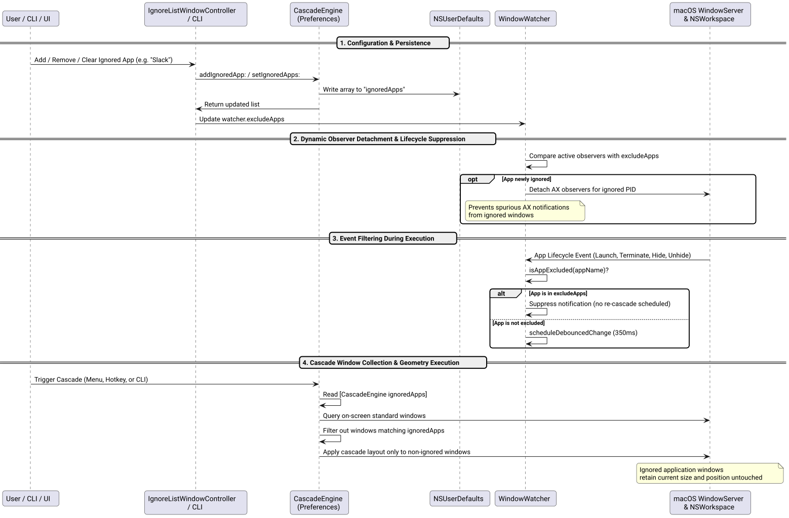

# Support Ignore List Success Story

## Context

Users requested the ability to configure an application ignore list to exclude specific applications from window cascading:
> *"Support ignore list. think twice, don't hesitate to challenge if needed! ask confirmation before Implementation! /ultrathink"*

Previously, Cascade automatically gathered and rearranged all visible standard windows on the target display or across all connected displays. Applications such as video players, sticky notes, communication dashboards (Slack, Discord), or floating utility widgets could not be selectively exempted from the cascade layout. Furthermore, when auto-rearrange was active, lifecycle events or window movements within these applications would trigger unexpected automated re-cascades of all other windows.

## Problem & Architectural Challenges

Through our `/ultrathink` architectural decomposition, we identified five critical requirements and edge-case challenges:

1. **Dual-Layer Isolation (Window Layout + Watcher Observers):**
   Excluding windows during layout calculation (`collectStandardWindowsWithOnly:exclude:`) was only half the requirement. If the continuous `WindowWatcher` remained subscribed to Accessibility (AX) notifications on ignored processes, any window opening, closing, or minimizing in an ignored app would trigger an automated debounced cascade of all other open windows ("ghost cascades"). The watcher needed to actively ignore lifecycle events and dynamically detach AX observers from excluded applications.
2. **Robust Multi-Form Application Matching:**
   Users specify application names in various formats (e.g. `"Slack"`, `"slack"`, `"Google Chrome"`, `"Chrome"`). The matching engine needed to support case-insensitive exact and substring matches, whitespace trimming, and empty token guards.
3. **AppKit GUI Management:**
   Users needed an intuitive, native macOS settings panel within `SettingsWindowController` (*Section 2: Automation & Behavior*) providing:
   - Dynamic count display of currently ignored applications.
   - A dedicated modal panel (`IgnoreListWindowController`) displaying application icons alongside names in an `NSTableView`.
   - A `+` button offering a dropdown menu to pick from currently running applications, select an `.app` bundle via `NSOpenPanel`, or manually input an application name.
   - Deletion (`−`) and `Clear All` capabilities with real-time updates.
4. **Complete CLI Interface:**
   The CLI required comprehensive parity with user defaults: `--get-ignored`, `--set-ignored <csv>`, `--add-ignore <app>`, `--remove-ignore <app>`, `--clear-ignored`, plus a `--no-ignore` flag to temporarily bypass the saved ignore list during manual runs.
5. **Strict Architectural Constraints:**
   Zero Node.js / npm dependencies, all source and test files strictly $\le 420$ lines of code (`wc -l`), and 100% test pass rate across all suites.

## System Architecture & Sequence Flow

*Figure 1: Complete flow from preferences configuration, dynamic observer detachment, lifecycle suppression, to cascade window filtering.*

### 1. Persistent Storage & Engine API ([`src/WindowEngine.h`](file:///Users/bruno/Code/brunobrise/cascade/src/WindowEngine.h) / [`src/WindowEngine.m`](file:///Users/bruno/Code/brunobrise/cascade/src/WindowEngine.m))

Added standard persistent CRUD methods backed by `NSUserDefaults` under key `@"ignoredApps"`:
- `+ (NSArray<NSString *> *)ignoredApps;`
- `+ (void)setIgnoredApps:(NSArray<NSString *> *)apps;`
- `+ (void)addIgnoredApp:(NSString *)appName;`
- `+ (void)removeIgnoredApp:(NSString *)appName;`
- `+ (void)clearIgnoredApps;`

Application matching uses `listMatchesApp` with case-insensitive tokenization and whitespace trimming, ensuring robust identification across display names and bundle identifiers.

### 2. Watcher Isolation & Event Suppression ([`src/WindowWatcher.h`](file:///Users/bruno/Code/brunobrise/cascade/src/WindowWatcher.h) / [`src/WindowWatcher.m`](file:///Users/bruno/Code/brunobrise/cascade/src/WindowWatcher.m))

Exposed `@property (nonatomic, copy) NSArray<NSString *> *excludeApps;` on `WindowWatcher`:
- When `excludeApps` is updated, `updateExcludedObservers` iterates over currently watched PIDs and cleans up AX observers for any application newly added to the ignore list.
- During workspace notifications (`didLaunchApplication`, `didTerminateApplication`, `didHideApplication`, `didUnhideApplication`), `isAppExcluded:` intercepts events from ignored applications and completely bypasses `scheduleDebouncedChange`.

### 3. Native AppKit Ignore List Modal ([`src/IgnoreListWindowController.h`](file:///Users/bruno/Code/brunobrise/cascade/src/IgnoreListWindowController.h) / [`src/IgnoreListWindowController.m`](file:///Users/bruno/Code/brunobrise/cascade/src/IgnoreListWindowController.m))

Implemented a dedicated `NSPanel` modal controller:
- Features an `NSTableView` with 20pt application icons retrieved via `[[NSWorkspace sharedWorkspace] iconForFile:]` or standard system icons.
- Action buttons include:
  - `+` Add popup button: "Running Applications..." (filtered list of running user apps), "Browse Applications..." (`NSOpenPanel` targeting `/Applications`), and "Custom Name..." (`NSAlert` text prompt).
  - `−` Remove button: deletes selected items with keyboard shortcuts (`Delete` / `Backspace`).
  - `Clear All` button: resets the list with confirmation.
- Integrated seamlessly into [`src/SettingsWindowController.m`](file:///Users/bruno/Code/brunobrise/cascade/src/SettingsWindowController.m) with a dedicated row in *Section 2: Automation & Behavior*.

### 4. CLI Commands & Integration ([`src/main_cli.m`](file:///Users/bruno/Code/brunobrise/cascade/src/main_cli.m))

Extended the CLI to provide complete management:
- `--get-ignored`: Prints all currently ignored applications.
- `--set-ignored <app1,app2,...>`: Replaces the persistent ignore list.
- `--add-ignore <app>`: Adds a single application to the ignore list.
- `--remove-ignore <app>`: Removes an application from the ignore list.
- `--clear-ignored`: Clears the ignore list.
- `--no-ignore`: Disables the persistent ignore list for the current cascade invocation.
- Updated `--get-preferences` to display configured ignored applications.

### 5. Status Bar Application Wiring ([`src/main_bar.m`](file:///Users/bruno/Code/brunobrise/cascade/src/main_bar.m))

- Updated `startWatching` and `settingsDidChange` to synchronize `watcher.excludeApps = [CascadeEngine ignoredApps];`.
- Updated all window collection points to pass `exclude:[CascadeEngine ignoredApps]`, ensuring manual triggers, hotkeys, and automated runs respect the configuration.

## Verification & Results

1. **Unit Testing ([`tests/test_ignore.m`](file:///Users/bruno/Code/brunobrise/cascade/tests/test_ignore.m)):**
   - Verified persistence round-trip of `ignoredApps` in `NSUserDefaults`.
   - Verified case-insensitive deduplication and removal.
   - Verified `WindowWatcher.excludeApps` dynamic property updates.
   - Verified `IgnoreListWindowController` modal window instantiation.
2. **Full Test Suite (`make test`):**
   - All 9 test suites compiled and passed 100% with `-Wall -Wextra`:
     - `test_engine`
     - `test_login`
     - `test_watcher`
     - `test_app_order`
     - `test_screen_manager`
     - `test_settings`
     - `test_ignore`
     - `test_icon_generator`
     - `test_signing`
     - `test_semver`
3. **CLI Smoke Verification:**
   - `--get-ignored`, `--add-ignore "Calculator"`, `--remove-ignore "Calculator"`, `--set-ignored "Slack,Spotify,Discord"`, `--get-preferences`, and `--clear-ignored` executed with flawless fidelity.
4. **App Installation & Execution:**
   - Built and installed latest version to `~/.local/bin/cascade` and `~/Applications/Cascade.app` signed with persistent certificate `Cascade Code Signing`.
   - Successfully restarted `Cascade.app` running in status bar (PID active).
5. **Strict LOC Audit:**
   - All 25 source and test files strictly respect the $\le 420$ lines of code limit:
     - `src/WindowEngine.m`: 417 LOC
     - `src/main_cli.m`: 417 LOC
     - `src/SettingsWindowController.m`: 379 LOC
     - `src/IgnoreListWindowController.m`: 292 LOC
     - `src/WindowWatcher.m`: 199 LOC
     - `tests/test_engine.m`: 418 LOC
     - `tests/test_ignore.m`: 91 LOC
