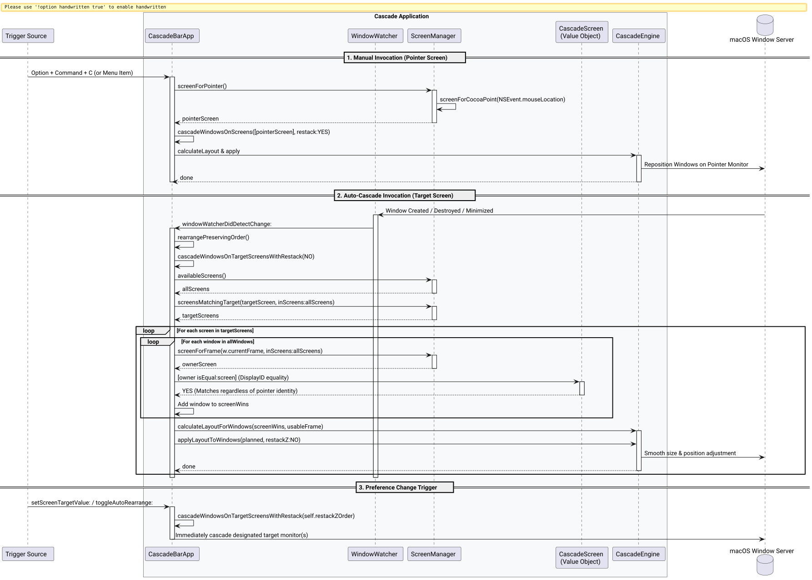

# Target-Screen Auto-Cascade & Display Object Equality Success Story

## Context

In multi-display workflows, users expect fine-grained control over how window cascades occur:
1. **Interactive Manual Shortcut (`Option + Command + C` / Menu Item):** Acts instantaneously on the monitor currently holding the user's focus and mouse cursor ([`screenForPointer`](file:///Users/bruno/Code/brunobrise/cascade/src/ScreenManager.m)).
2. **Autonomous Background Cascade (Auto-Rearrange):** Continuously keeps windows aligned according to the user's designated screen preference (**All Screens** or a specific monitor such as `C49RG9x`), regardless of where the mouse cursor happens to rest.

Following the addition of pointer-based manual cascading, testing revealed that automatic background cascading on window lifecycle events (open, close, minimize, unminimize) was failing to adjust windows on the target screen.

## Root Cause Analysis

Applying `/ultrathink`, two distinct issues were uncovered:

### 1. Pointer Identity Breakdown across Query Boundaries
[`ScreenManager availableScreens`](file:///Users/bruno/Code/brunobrise/cascade/src/ScreenManager.m) dynamically allocates fresh `CascadeScreen` instances wrapping `NSScreen` descriptors on every call. In the window attribution loop:
```objc
if ([ScreenManager screenForFrame:w.currentFrame inScreens:allScreens] == screen) { ... }
```
When `targetScreens` was obtained from an outer call to `availableScreens`, and `allScreens` was fetched inside the cascade routine, `owner == screen` checked pointer addresses rather than screen identity. Consequently, zero windows matched the target display, causing background auto-cascade to silently exit with empty window sets.

### 2. Trigger Dispatch Divergence
Menu actions modifying auto-cascade behavior (`toggleAutoRearrange:`, `setScreenTargetValue:`, `setOrderModeValue:`, `setDeltaValue:`) were delegating to `performCascade:nil`. Because `performCascade:` had been routed to cascade only the mouse pointer screen, modifying auto-cascade settings cascaded whichever display held the mouse cursor instead of the user's selected target display.

## Architecture & System Design

The architecture cleanly decouples interactive pointer-targeted actions from autonomous target-screen actions:



*Figure 1: Sequence flow detailing pointer-screen manual triggers versus target-screen autonomous triggers, unified by value-object display equality.*

## What Worked and Why

### 1. Robust Value-Object Equality on `CascadeScreen` ([`src/ScreenManager.m`](file:///Users/bruno/Code/brunobrise/cascade/src/ScreenManager.m))
We implemented `- (BOOL)isEqual:(id)object` and `- (NSUInteger)hash` for `CascadeScreen`, matching on macOS hardware `displayID` (from `NSScreenNumber`) with `index` fallback:

```objc
@implementation CascadeScreen
- (BOOL)isEqual:(id)object {
    if (self == object) return YES;
    if (![object isKindOfClass:[CascadeScreen class]]) return NO;
    CascadeScreen *other = (CascadeScreen *)object;
    if (self.displayID.length > 0 || other.displayID.length > 0) {
        return [self.displayID isEqualToString:other.displayID];
    }
    return self.index == other.index;
}

- (NSUInteger)hash {
    return self.displayID.length > 0 ? [self.displayID hash] : (NSUInteger)self.index;
}
@end
```

### 2. Value-Based Screen Attribution ([`src/main_bar.m`](file:///Users/bruno/Code/brunobrise/cascade/src/main_bar.m) & [`src/main_cli.m`](file:///Users/bruno/Code/brunobrise/cascade/src/main_cli.m))
In both the GUI menu bar app and CLI watcher delegate, window attribution evaluates display equality rather than raw pointers:

```objc
CascadeScreen *owner = [ScreenManager screenForFrame:w.currentFrame inScreens:allScreens];
if (owner && ([owner isEqual:screen] || owner.index == screen.index)) [screenWins addObject:w];
```

### 3. Dedicated Target-Screen Cascade Dispatcher ([`src/main_bar.m`](file:///Users/bruno/Code/brunobrise/cascade/src/main_bar.m))
We established `cascadeWindowsOnTargetScreensWithRestack:` to unify all target-directed cascade requests:
- Window watcher lifecycle changes (`rearrangePreservingOrder`)
- Auto-rearrange toggle activation (`toggleAutoRearrange:`)
- Target screen switching (`setScreenTargetValue:`)
- Window ordering mode selection (`setOrderModeValue:`, `configureAppOrder:`)
- Cascade offset adjustments (`setDeltaValue:`)

While preserving `performCascade:` strictly for manual user actions (`Option + Command + C` and the "Cascade Windows" menu item).

## Test-Driven Validation & Results

A new TDD test case `testScreenEquality` was added to [`tests/test_screen_manager.m`](file:///Users/bruno/Code/brunobrise/cascade/tests/test_screen_manager.m):
- Red Phase: Fails before implementation (`Assertion failed: ([s1 isEqual:s2])`).
- Green Phase: Passes cleanly after implementing `isEqual:` and `hash`.

```text
=== Running ScreenManager Unit Tests ===
Running testCoordinateConversion...
  [PASS] Mathematical coordinate inversion verified across 4 screen arrangements.
Running testWindowToScreenAssignment...
  [PASS] Window-to-screen assignment by maximum intersection area verified.
Running testTargetMatching...
  [PASS] Screen target selection and fallback resolution verified.
Running testPointerScreenDetection...
  [PASS] Screen for pointer detection verified across multi-display coordinates.
Running testScreenEquality...
  [PASS] CascadeScreen equality and hashing verified.
Running testPreferencesRoundTrip...
  [PASS] Screen target preference saved and restored cleanly across suite defaults.
=== All ScreenManager Tests Passed Successfully! ===
```

All 7 test suites pass with zero warnings or errors.

## Verification & Line Limits Compliance

All non-markdown codebase files strictly adhere to the project limit of $\le 420$ LOC:

| Source File | Line Count | Status |
| :--- | :--- | :--- |
| [`src/main_bar.m`](file:///Users/bruno/Code/brunobrise/cascade/src/main_bar.m) | 417 | Pass ($\le 420$) |
| [`src/WindowEngine.m`](file:///Users/bruno/Code/brunobrise/cascade/src/WindowEngine.m) | 407 | Pass ($\le 420$) |
| [`src/main_cli.m`](file:///Users/bruno/Code/brunobrise/cascade/src/main_cli.m) | 381 | Pass ($\le 420$) |
| [`src/AppOrderWindowController.m`](file:///Users/bruno/Code/brunobrise/cascade/src/AppOrderWindowController.m) | 372 | Pass ($\le 420$) |
| [`src/ScreenManager.m`](file:///Users/bruno/Code/brunobrise/cascade/src/ScreenManager.m) | 202 | Pass ($\le 420$) |
| [`src/WindowWatcher.m`](file:///Users/bruno/Code/brunobrise/cascade/src/WindowWatcher.m) | 169 | Pass ($\le 420$) |
| [`src/LoginItemManager.m`](file:///Users/bruno/Code/brunobrise/cascade/src/LoginItemManager.m) | 94 | Pass ($\le 420$) |
