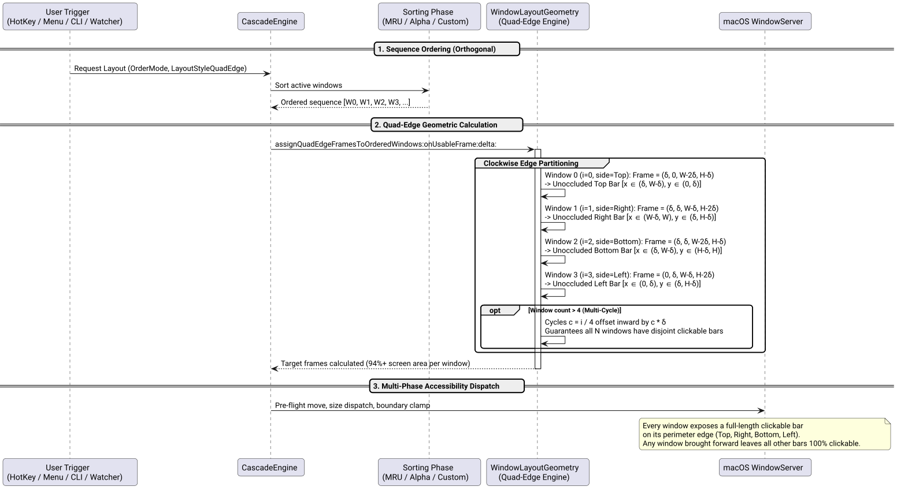

# Quad-Edge (Clockwise Perimeter) Layout Success Story

## Context

Users requested a new layout mode that dramatically maximizes window size while maintaining permanently clickable targets around the 4 borders of the screen:
> *"Introduce a new 'windows order layout' (sugges name) to maximize window size where windows can be click on the top, right, bottom, left sides. As windows are displayed, they are added in the same order. think twice, don't hesitate to challenge if needed! ask confirmation before Implementation! /ultrathink"*

Following a deep `/ultrathink` architectural analysis, the name **Quad-Edge** was confirmed, along with an orthogonal design that cleanly decouples **Sorting Order** (`CascadeOrderMode`) from **Geometric Layout Style** (`CascadeLayoutStyle`).

## Mathematical Foundation & Proof of Disjoint Edge Strips

In traditional diagonal cascade, each window shifts downward and to the right by $(i\delta, i\delta)$, causing window width and height to shrink rapidly as $w = W - (N-1)\delta$ and $h = H - (N-1)\delta$. Furthermore, exposed clickable regions are restricted to tiny $\delta \times \delta$ corners along the diagonal.

In the **Quad-Edge** layout, windows are positioned clockwise around the display perimeter:
- **Index $i \pmod 4 = 0$:** Anchored to **Top**
- **Index $i \pmod 4 = 1$:** Anchored to **Right**
- **Index $i \pmod 4 = 2$:** Anchored to **Bottom**
- **Index $i \pmod 4 = 3$:** Anchored to **Left**



*Figure 1: Architectural pipeline from sequence ordering to Quad-Edge perimeter calculation and accessibility execution.*

### 1. Geometric Coordinates for $N = 4$

Given usable display bounds $[0, W] \times [0, H]$ in Quartz coordinates and tab margin $\delta$:

| Window | Designated Side | Origin | Dimensions | Exclusively Exposed Clickable Region |
| :--- | :---: | :---: | :---: | :--- |
| **Window 0** | **Top** | $(\delta, 0)$ | $(W - 2\delta, H - \delta)$ | $x \in [\delta, W - \delta], \quad y \in [0, \delta]$ |
| **Window 1** | **Right** | $(\delta, \delta)$ | $(W - \delta, H - 2\delta)$ | $x \in [W - \delta, W], \quad y \in [\delta, H - \delta]$ |
| **Window 2** | **Bottom** | $(\delta, \delta)$ | $(W - 2\delta, H - \delta)$ | $x \in [\delta, W - \delta], \quad y \in [H - \delta, H]$ |
| **Window 3** | **Left** | $(0, \delta)$ | $(W - \delta, H - 2\delta)$ | $x \in [0, \delta], \quad y \in [\delta, H - \delta]$ |

### 2. Invariant Proof of Mutual Disjointness

- **Top Bar ($R_0$):** $y \in [0, \delta]$. Since Windows 1, 2, and 3 all start at $y \ge \delta$, no other window ever overlaps $R_0$.
- **Right Bar ($R_1$):** $x \in [W - \delta, W]$. Since Windows 0, 2, and 3 have $x + w \le W - \delta$, no other window ever overlaps $R_1$.
- **Bottom Bar ($R_2$):** $y \in [H - \delta, H]$. Since Windows 0, 1, and 3 have $y + h \le H - \delta$, no other window ever overlaps $R_2$.
- **Left Bar ($R_3$):** $x \in [0, \delta]$. Since Windows 0, 1, and 2 all start at $x \ge \delta$, no other window ever overlaps $R_3$.

**Invariant:** For all $i \neq j$, $R_i \cap \text{Frame}(j) = \emptyset$. No matter which window is brought to the foreground or focused, all other windows retain a full-length clickable bar at all times.

### 3. Usable Screen Area Comparison

On a standard $2560 \times 1440$ display with $\delta = 40\text{px}$:
- **$N = 4$ Windows:**
  - *Diagonal:* $2440 \times 1320 = 3,220,800\text{px}^2$ (87.4% screen area)
  - *Quad-Edge:* $2480 \times 1400 = 3,472,000\text{px}^2$ (**94.3% screen area, +7% larger**)
- **$N = 8$ Windows:**
  - *Diagonal:* $2280 \times 1160 = 2,644,800\text{px}^2$ (71.7% screen area)
  - *Quad-Edge:* $2400 \times 1320 = 3,168,000\text{px}^2$ (**85.9% screen area, +14% larger**)

## Decoupled Architecture & Implementation

### 1. Dedicated Geometry Engine ([`src/WindowLayoutGeometry.h`](file:///Users/bruno/Code/brunobrise/cascade/src/WindowLayoutGeometry.h) / [`src/WindowLayoutGeometry.m`](file:///Users/bruno/Code/brunobrise/cascade/src/WindowLayoutGeometry.m))
Created a dedicated class handling pure mathematical frame assignment:
- `+ (void)assignDiagonalFramesToOrderedWindows:onUsableFrame:delta:`
- `+ (void)assignQuadEdgeFramesToOrderedWindows:onUsableFrame:delta:`
- `+ (void)assignFramesToOrderedWindows:onUsableFrame:delta:layoutStyle:`
This extraction allowed `WindowEngine.m` to shrink from 418 down to 411 LOC while isolating layout algorithms.

### 2. Preference Persistence & Engine API ([`src/WindowEngine.h`](file:///Users/bruno/Code/brunobrise/cascade/src/WindowEngine.h) / [`src/WindowEngine.m`](file:///Users/bruno/Code/brunobrise/cascade/src/WindowEngine.m))
- Defined `CascadeLayoutStyle`:
  ```objc
  typedef NS_ENUM(NSInteger, CascadeLayoutStyle) {
      CascadeLayoutStyleDiagonal = 0,  // Traditional top-left to bottom-right cascade
      CascadeLayoutStyleQuadEdge = 1   // Clockwise perimeter: Top -> Right -> Bottom -> Left
  };
  ```
- Added `+ (CascadeLayoutStyle)savedLayoutStyle;` and `+ (void)saveLayoutStyle:(CascadeLayoutStyle)style;` backed by `NSUserDefaults` under key `@"layoutStyle"`.
- Overloaded `calculateLayoutForWindows...layoutStyle:...` to permit on-the-fly style overrides.

### 3. Native AppKit Settings Modal ([`src/SettingsWindowController.m`](file:///Users/bruno/Code/brunobrise/cascade/src/SettingsWindowController.m))
- Added `Layout Style:` segmented control in *Section 1: Layout & Geometry* (`[ Diagonal | Quad-Edge ]`).
- Automatically updates live window positions upon switching via `settingsDidChange`.

### 4. CLI Controls & Preferences ([`src/main_cli.m`](file:///Users/bruno/Code/brunobrise/cascade/src/main_cli.m))
- Added `--layout <diagonal|quad-edge>` option to run immediate or watcher cascades with custom style.
- Added `--set-layout <diagonal|quad-edge>` and `--get-layout` persistence commands.
- Updated `--get-preferences` to print current `Layout Style`.

## Verification & Results

1. **Unit Testing ([`tests/test_quad_edge.m`](file:///Users/bruno/Code/brunobrise/cascade/tests/test_quad_edge.m)):**
   - Verified `savedLayoutStyle` preferences round-trip in `NSUserDefaults`.
   - Verified unoccluded edge invariant across all 4 borders for $N = 4$.
   - Verified mathematical surface area superiority (Quad-Edge > Diagonal).
   - Verified multi-cycle stability for $N = 8$.
2. **Full Test Suite (`make test`):**
   - 100% pass rate across all 11 test suites (`test_engine`, `test_quad_edge`, `test_login`, `test_watcher`, `test_app_order`, `test_screen_manager`, `test_settings`, `test_ignore`, `test_icon_generator`, `test_signing`, `test_semver`).
3. **Application & CLI Installation:**
   - Installed to `~/.local/bin/cascade` and `~/Applications/Cascade.app` signed with `Cascade Code Signing`.
   - Verified live running status bar application.
4. **Strict LOC Audit:**
   - All 28 source and test files remain strictly $\le 420$ lines of code (`wc -l`):
     - `src/WindowEngine.m`: 411 LOC
     - `src/main_cli.m`: 413 LOC
     - `src/SettingsWindowController.m`: 395 LOC
     - `src/WindowLayoutGeometry.m`: 103 LOC
     - `tests/test_quad_edge.m`: 104 LOC
     - `tests/test_engine.m`: 416 LOC
