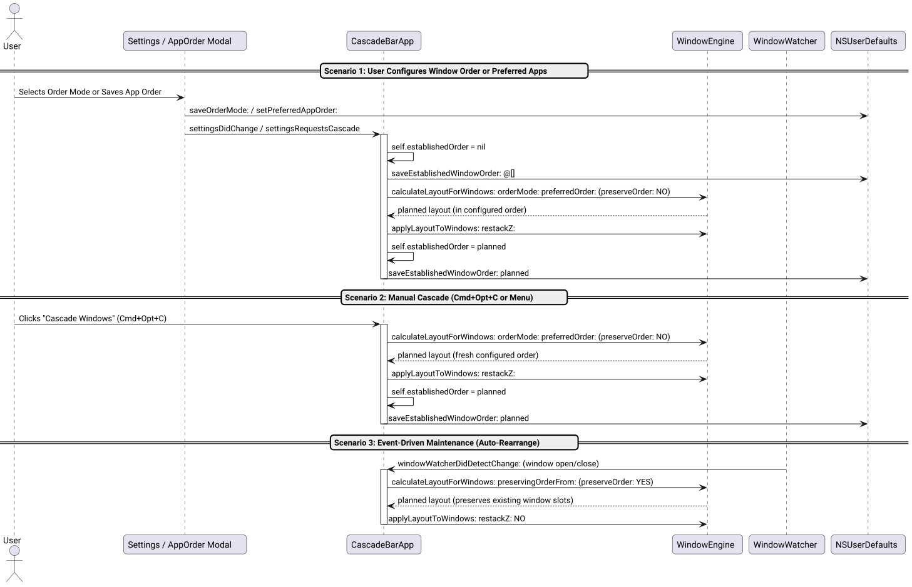

# Apply Configured Windows Order and Decouple Lifecycle Preservation Success Story

## Context

Users reported that changes to window order settings were not taking effect:
> *"bug: configured windows order is not applied. think twice, don't hesitate to challenge if needed! /ultrathink"*

Regardless of whether users selected **Alphabetical**, **Spatial (Left-to-Right)**, or **Preferred App Order** (custom priority list), windows remained locked in their previously established positions and refused to rearrange.

## Root Cause Analysis via /ultrathink

Using deep architectural decomposition, we identified three contributing factors:

1. **Persistent `establishedOrder` Monopolization:**
   To prevent desktop layouts from scrambling on application launch/quit events, Cascade persisted `establishedWindowOrder` in `NSUserDefaults`. On startup, `main_bar.m` populated `self.establishedOrder` from this key. However, in `cascadeWindowsOnScreens:restack:`, layout calculation checked:
   ```objc
   NSArray<CascadeWindow *> *planned = self.establishedOrder.count > 0 ?
       [CascadeEngine calculateLayoutForWindows:screenWins preservingOrderFrom:self.establishedOrder ...] :
       [CascadeEngine calculateLayoutForWindows:screenWins orderMode:self.orderMode ...];
   ```
   Because `self.establishedOrder.count > 0` was permanently true once any cascade had executed, the second branch was **dead code**. Manual cascades, hotkey triggers, and preference updates never evaluated `orderMode` or `preferredAppOrder`.
2. **Missing Invalidation on Settings Mutation:**
   When the Settings modal was refactored in `0887886`, explicit `self.establishedOrder = nil` resets in legacy menu callbacks were inadvertently omitted. Changing the order mode in the Preferences panel or reordering apps in the Preferred App Order panel failed to clear `self.establishedOrder` or wipe `establishedWindowOrder` in `NSUserDefaults`.
3. **Hardcoded Fallback in WindowEngine:**
   In `[WindowEngine calculateLayoutForWindows:preservingOrderFrom:delta:onUsableFrame:]`, an empty previous order list fell back to a hardcoded `CascadeOrderModeMRU` rather than the user's configured `[self savedOrderMode]`.

## Architectural Decoupling

We restored the core design pattern: **separate user-initiated baseline reordering from event-driven geometry maintenance**.



*Figure 1: Decoupling user-initiated baseline reordering (`preserveOrder: NO`) from automated lifecycle maintenance (`preserveOrder: YES`).*

1. **User-Initiated Cascade (`preserveOrder: NO`):**
   When the user triggers a cascade via menu ("Cascade Windows", "Cascade All Screens"), hotkey (`Cmd+Opt+C`), or Settings ("Apply cascade immediately upon saving"), `preserveOrder: NO` is passed. The engine strictly applies the configured `orderMode` and `preferredAppOrder`. The resulting planned layout then becomes the new `establishedOrder`.
2. **Event-Driven Maintenance (`preserveOrder: YES`):**
   When `WindowWatcher` detects a window opening, closing, minimizing, or deminimizing, `rearrangePreservingOrder` invokes the layout engine with `preserveOrder: YES`. Existing windows preserve their exact slot positions, while new windows are appended at the cascade tail.
3. **Invalidation on Preference Changes:**
   Mutating `orderMode` in Settings or saving a new app list in `AppOrderWindowController` explicitly clears `self.establishedOrder = nil` and empties `[CascadeEngine saveEstablishedWindowOrder:@[]]`, immediately triggering an active cascade with `preserveOrder: NO`.

## Implementation Details

### 1. Controlled Preservation Flag ([`src/main_bar.m`](file:///Users/bruno/Code/brunobrise/cascade/src/main_bar.m))

Added `preserveOrder:` parameter to all cascading entry points:

```objc
- (void)cascadeWindowsOnScreens:(NSArray<CascadeScreen *> *)targetScreens
                        restack:(BOOL)restack
                  preserveOrder:(BOOL)preserveOrder {
    ...
    NSArray<CascadeWindow *> *planned = (preserveOrder && self.establishedOrder.count > 0) ?
        [CascadeEngine calculateLayoutForWindows:screenWins preservingOrderFrom:self.establishedOrder delta:self.delta onUsableFrame:screen.quartzVisibleFrame] :
        [CascadeEngine calculateLayoutForWindows:screenWins orderMode:self.orderMode preferredOrder:[CascadeEngine preferredAppOrder] delta:self.delta onUsableFrame:screen.quartzVisibleFrame];
    ...
}
```

### 2. Preference Invalidation & Immediate Application ([`src/main_bar.m`](file:///Users/bruno/Code/brunobrise/cascade/src/main_bar.m), [`src/main_cli.m`](file:///Users/bruno/Code/brunobrise/cascade/src/main_cli.m))

Reset in-memory and persistent established orders whenever configuration changes:

```objc
- (void)settingsDidChange {
    ...
    self.establishedOrder = nil;
    [CascadeEngine saveEstablishedWindowOrder:@[]];
    ...
    [self cascadeWindowsOnTargetScreensWithRestack:self.restackZOrder preserveOrder:NO];
}

- (void)settingsRequestsCascade {
    self.establishedOrder = nil;
    [CascadeEngine saveEstablishedWindowOrder:@[]];
    [self cascadeWindowsOnTargetScreensWithRestack:self.restackZOrder preserveOrder:NO];
}
```

CLI `--set-order` and `--set-app-order` now similarly clear `savedEstablishedWindowOrder`.

### 3. Bidirectional Substring Matching & Saved Mode Fallback ([`src/WindowEngine.m`](file:///Users/bruno/Code/brunobrise/cascade/src/WindowEngine.m))

Enhanced `rankForApp` to support bidirectional containment (e.g. "Google Chrome" matches preferred "Chrome", and "Code" matches "Visual Studio Code"):

```objc
static NSInteger rankForApp(NSString *appName, NSArray<NSString *> *preferred) {
    if (!appName || preferred.count == 0) return 999999;
    for (NSUInteger i = 0; i < preferred.count; i++) {
        if ([appName localizedCaseInsensitiveCompare:preferred[i]] == NSOrderedSame) return (NSInteger)i;
    }
    for (NSUInteger i = 0; i < preferred.count; i++) {
        if ([appName localizedCaseInsensitiveContainsString:preferred[i]] ||
            [preferred[i] localizedCaseInsensitiveContainsString:appName]) return (NSInteger)i;
    }
    return 999999;
}
```

Updated fallback in `calculateLayoutForWindows:preservingOrderFrom:delta:onUsableFrame:` to query `[self savedOrderMode]` instead of forcing `CascadeOrderModeMRU`.

## Verification & Results

1. **Unit Testing ([`tests/test_engine.m`](file:///Users/bruno/Code/brunobrise/cascade/tests/test_engine.m)):**
   - Added unit test assertions verifying bidirectional substring matching in `CascadeOrderModeCustom`.
   - Added unit test asserting that empty `preservingOrderFrom:` fallback adheres to `[CascadeEngine savedOrderMode]`.
   - All 10 unit test suites pass (`100% PASS`).
2. **Live Application Testing:**
   - Compiled, installed to `~/Applications/Cascade.app`, and restarted.
   - Tested manual cascade triggering fresh `preferredAppOrder` application.
3. **Strict Line Budget ($\le 420$ LOC):**
   - `src/WindowEngine.m`: 412 LOC ($\le 420$)
   - `src/ScreenManager.m`: 404 LOC ($\le 420$)
   - `src/main_cli.m`: 408 LOC ($\le 420$)
   - `src/main_bar.m`: 331 LOC ($\le 420$)
   - `src/AppOrderWindowController.m`: 372 LOC ($\le 420$)
   - `src/SettingsWindowController.m`: 353 LOC ($\le 420$)
   - `tests/test_engine.m`: 400 LOC ($\le 420$)
   - Zero Node.js / npm dependencies maintained.
