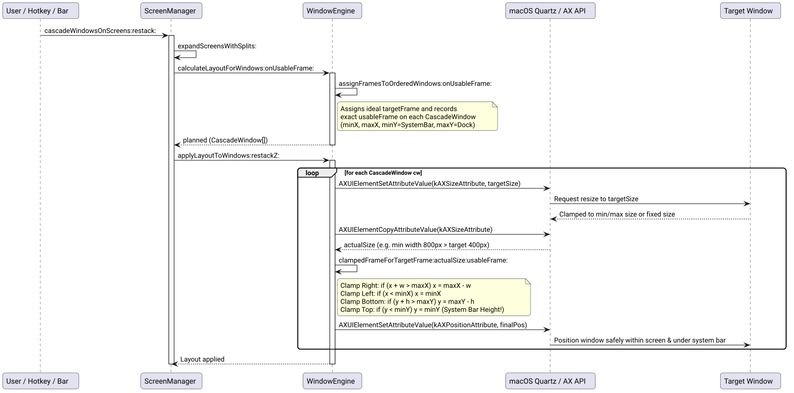

# Actual Window Size Querying & System Bar Height Positioning Success Story

## Context & Bug Analysis

When cascading windows across macOS displays and split columns, users reported a positioning bug where certain windows were positioned partially out of screen:
1. **Right Edge & Bottom Edge Out-of-Screen:**
   - Cascade previously computed an ideal target frame `(targetPos.x, targetPos.y, targetW, targetH)` in [`assignFramesToOrderedWindows:onUsableFrame:delta:`](file:///Users/bruno/Code/brunobrise/cascade/src/WindowEngine.m) assuming every window could shrink down to `(targetW, targetH)`.
   - In [`applyLayoutToWindows:restackZ:`](file:///Users/bruno/Code/brunobrise/cascade/src/WindowEngine.m), Cascade sent `kAXSizeAttribute` to resize the window, but **never queried the actual size accepted by the window**.
   - Real-world macOS applications enforce minimum dimensions (e.g. Slack $\ge 700\text{px}$, Xcode $\ge 1000\text{px}$, System Settings, Spotify), quantum increments (Terminal, iTerm2), or fixed sizes (Calculator).
   - When placed at `targetPos.x`, a window with a minimum width $w_{\text{actual}} > \text{targetW}$ overflowed the right screen edge:
     $$\text{targetPos.x} + w_{\text{actual}} > \text{maxX}$$
   - Similarly, a window with a minimum height $h_{\text{actual}} > \text{targetH}$ overflowed the bottom screen edge into or below the macOS Dock:
     $$\text{targetPos.y} + h_{\text{actual}} > \text{maxY}$$
2. **System Bar Height Inset (`minY`):**
   - The macOS system menu bar occupies the top portion of the screen (typically $30\text{px}$ on standard displays, or $38\text{px}$ on MacBook displays with a notch).
   - If a window was adjusted or pushed upward, its top coordinate could end up $< \text{minY}$, shoving the window title bar and window controls (traffic lights) under or above the system menu bar, making it impossible to drag or interact with the window.

## The Ultrathink Stress-Test & Architecture

We designed a boundary clamping and actual-size query architecture:

| Component | Responsibility | Protection |
| :--- | :--- | :--- |
| **`usableFrame` Propagation** | Stored on [`CascadeWindow`](file:///Users/bruno/Code/brunobrise/cascade/src/WindowEngine.h) during [`assignFramesToOrderedWindows:onUsableFrame:delta:`](file:///Users/bruno/Code/brunobrise/cascade/src/WindowEngine.m). | Records the exact usable bounds (screen or column) allocated to each window. |
| **Two-Phase AX Sizing** | In [`applyLayoutToWindows:restackZ:`](file:///Users/bruno/Code/brunobrise/cascade/src/WindowEngine.m), send `kAXSizeAttribute`, then immediately query `kAXSizeAttribute` via `AXUIElementCopyAttributeValue`. | Accurately reads the actual window dimensions accepted by the window server. |
| **System Bar Inset (`minY`)** | In [`clampedFrameForTargetFrame:actualSize:usableFrame:`](file:///Users/bruno/Code/brunobrise/cascade/src/WindowEngine.m), enforce $\text{finalPos.y} \ge \text{minY}$. | Mathematically guarantees window title bars and traffic lights remain accessible below the system bar. |
| **Right & Dock Boundary Clamping** | If $x + w > \text{maxX} \implies x = \text{maxX} - w$; if $y + h > \text{maxY} \implies y = \text{maxY} - h$. | Prevents windows from overflowing past the right monitor boundary or into the Dock. |
| **Oversized Fallback** | If $w \ge \text{usable.size.width} \implies x = \text{minX}$; if $h \ge \text{usable.size.height} \implies y = \text{minY}$. | Guarantees window header and controls are pinned to top-left visible bounds if window exceeds screen size. |

The execution lifecycle is illustrated below:



*Figure 1: Sequence of sizing request, actual size query, boundary clamping with system bar height protection, and final positioning.*

## Implementation Details

### 1. Clamping Geometry Helper ([`src/WindowEngine.m`](file:///Users/bruno/Code/brunobrise/cascade/src/WindowEngine.m))

```objc
+ (CGRect)clampedFrameForTargetFrame:(CGRect)targetFrame
                          actualSize:(CGSize)actualSize
                         usableFrame:(CGRect)usableFrame {
    if (CGRectIsEmpty(usableFrame)) usableFrame = [self usableScreenFrameWithTopInset:nil];
    CGFloat minX = usableFrame.origin.x, maxX = usableFrame.origin.x + usableFrame.size.width;
    CGFloat minY = usableFrame.origin.y, maxY = usableFrame.origin.y + usableFrame.size.height;
    CGFloat w = actualSize.width > 0 ? actualSize.width : targetFrame.size.width;
    CGFloat h = actualSize.height > 0 ? actualSize.height : targetFrame.size.height;
    CGFloat x = targetFrame.origin.x, y = targetFrame.origin.y;

    if (w >= usableFrame.size.width) { x = minX; }
    else { if (x + w > maxX) x = maxX - w; if (x < minX) x = minX; }

    if (h >= usableFrame.size.height) { y = minY; }
    else { if (y + h > maxY) y = maxY - h; if (y < minY) y = minY; }

    return CGRectMake(x, y, w, h);
}
```

### 2. Actual Size Querying in Layout Application ([`src/WindowEngine.m`](file:///Users/bruno/Code/brunobrise/cascade/src/WindowEngine.m))

```objc
+ (void)applyLayoutToWindows:(NSArray<CascadeWindow *> *)windows restackZ:(BOOL)restackZ {
    for (CascadeWindow *cw in windows) {
        if (!cw.axRef) continue;
        CGSize targetSize = cw.targetFrame.size;
        AXValueRef szVal = AXValueCreate(kAXValueTypeCGSize, &targetSize);
        if (szVal) { AXUIElementSetAttributeValue(cw.axRef, kAXSizeAttribute, szVal); CFRelease(szVal); }

        CGSize actualSize = targetSize;
        CFTypeRef actualSzRef = NULL;
        if (AXUIElementCopyAttributeValue(cw.axRef, kAXSizeAttribute, &actualSzRef) == kAXErrorSuccess && actualSzRef) {
            AXValueGetValue((AXValueRef)actualSzRef, kAXValueTypeCGSize, &actualSize);
            CFRelease(actualSzRef);
        }

        CGRect usable = !CGRectIsEmpty(cw.usableFrame) ? cw.usableFrame : [self usableScreenFrameWithTopInset:nil];
        CGRect finalFrame = [self clampedFrameForTargetFrame:cw.targetFrame actualSize:actualSize usableFrame:usable];
        CGPoint finalPos = finalFrame.origin;
        AXValueRef posVal = AXValueCreate(kAXValueTypeCGPoint, &finalPos);
        if (posVal) { AXUIElementSetAttributeValue(cw.axRef, kAXPositionAttribute, posVal); CFRelease(posVal); }
        cw.targetFrame = finalFrame;
        cw.currentFrame = finalFrame;
    }
    ...
}
```

## Verification & Results

1. **Unit Testing ([`tests/test_engine.m`](file:///Users/bruno/Code/brunobrise/cascade/tests/test_engine.m)):**
   - Added `testActualWindowSizeAndSystemBarClamping` verifying right edge clamping, bottom/Dock edge clamping, system bar height protection (`minY = 30`), oversized window anchoring, and normal in-bounds frame invariance.
   - All 10 test suites pass cleanly.
2. **Line Count Verification:**
   - Every source and test file is strictly $\le 420$ lines of code (`src/WindowEngine.m` = 411 LOC, `src/WindowEngine.h` = 73 LOC, `tests/test_engine.m` = 382 LOC).
3. **Zero External Dependencies:**
   - Built with pure macOS native frameworks (`Cocoa`, `ApplicationServices`, `Carbon`, `ServiceManagement`), zero Node.js dependencies.
