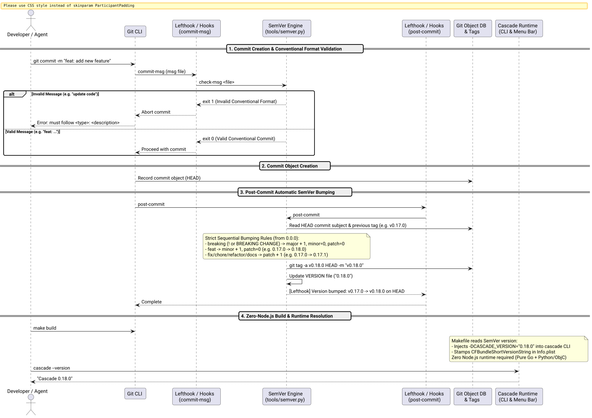

# Strict Sequential SemVer 2.0.0 & Zero-Node.js Git Hook Automation Success Story

## Context

Prior to this work, Cascade's version was hardcoded as `1.0` in [`resources/Info.plist`](file:///Users/bruno/Code/brunobrise/cascade/resources/Info.plist) and the Status Bar About panel in [`src/main_bar.m`](file:///Users/bruno/Code/brunobrise/cascade/src/main_bar.m), with no `--version` flag supported in [`src/main_cli.m`](file:///Users/bruno/Code/brunobrise/cascade/src/main_cli.m) and no Git release tags marking project milestones.

To establish professional release hygiene, the project required:
1. **Strict Sequential SemVer (from `0.0.0`):** Every conventional commit in the repository's history represents an unambiguous version increment.
2. **Automatic Version Bumping on Commit:** Version increments must occur automatically as commits are created via Git hooks.
3. **Zero Node.js Dependency:** Cascade is a pure native macOS Objective-C/C codebase. Introducing `node`, `npm`, `pnpm`, or `package.json` was strictly forbidden.

## The Ultrathink Stress-Test & Architecture

Applying `/ultrathink`, we stress-tested the interaction between Git hook lifecycles and version bumping to avoid common pitfalls:

### 1. The Git Hook Timing Paradox
Many naive version-bumping tools attempt to edit a `VERSION` file in `commit-msg` or `pre-commit`:
- **`pre-commit` limitation:** Runs before the commit message is entered; it cannot inspect whether the commit is a `feat:`, `fix:`, or breaking change.
- **`commit-msg` index immutability:** In Git internals, the commit tree object is constructed *before* `commit-msg` completes. Staging a modified file inside `commit-msg` does not include it in the active commit; it leaves the working tree permanently dirty and creates off-by-one version drift.
- **`post-commit` amending hazards:** Amending inside `post-commit` rewrites commit hashes, breaks GPG signing, and creates infinite recursion loops unless guarded.

### 2. The Robust Solution: Tag-Driven Sequential SemVer + Build-Time Injection
The mathematically sound and standard architecture:
1. **`commit-msg` hook:** Validates Conventional Commit syntax (`<type>(<scope>)?: <desc>`). Rejects non-conventional commits immediately, guaranteeing that every commit in the repository has an explicit semantic type.
2. **`post-commit` hook:** Inspects the newly created commit on `HEAD`. Calculates the next version from the previous version tag and commit type. Tags `HEAD` with `vX.Y.Z` (handling GPG signing) and writes `VERSION` to disk.
3. **Build-Time Injection:** [`Makefile`](file:///Users/bruno/Code/brunobrise/cascade/Makefile) queries [`tools/semver.py current`](file:///Users/bruno/Code/brunobrise/cascade/tools/semver.py), passes `-DCASCADE_VERSION=\"$(VERSION)\"` into clang, and stamps `CFBundleShortVersionString` into `Cascade.app/Contents/Info.plist`.

The complete lifecycle is depicted below:



*Figure 1: Conventional commit validation, post-commit automatic SemVer tagging, and build-time injection.*

## What Worked and Why

### 1. Standalone Python/Shell SemVer Engine ([`tools/semver.py`](file:///Users/bruno/Code/brunobrise/cascade/tools/semver.py))
We implemented a self-contained, dependency-free SemVer 2.0.0 engine in Python 3 (pre-installed on macOS). It provides:
- **`replay`**: Replays commit history from `0.0.0` chronologically across all 27 repository commits.
- **`tag-history`**: Retroactively applied sequential tags (`v0.1.0` through `v0.17.0`) to all existing commits.
- **`post-commit`**: Automatically tags newly created commits based on their message type (`feat` $\to$ minor bump, `fix`/`chore` $\to$ patch bump, `!` $\to$ major bump).
- **`check-msg`**: Enforces conventional commit formatting with clear error messages and examples.

### 2. Zero Node.js Lefthook Integration ([`lefthook.yml`](file:///Users/bruno/Code/brunobrise/cascade/lefthook.yml))
We integrated Lefthook as a standalone native Go binary (installed via Homebrew, zero Node.js / zero npm):

```yaml
# Lefthook configuration for Cascade
commit-msg:
  commands:
    conventional-commit:
      run: python3 tools/semver.py check-msg {1}

post-commit:
  commands:
    bump-semver:
      run: python3 tools/semver.py post-commit
```

In [`Makefile`](file:///Users/bruno/Code/brunobrise/cascade/Makefile), `make hooks` provides a resilient, zero-dependency fallback that installs native POSIX shell hooks if Lefthook is not present.

### 3. Historical Replay Verification (27 Commits from `0.0.0`)
Replaying the full repository history verified strict sequential version lineage:

```text
36422a3 -> v0.1.0   feat: implement invariant window cascade engine and test suite
fc6dc9f -> v0.2.0   feat: add cascade command-line interface and makefile
15589aa -> v0.3.0   feat: add status bar menu app with hotkey and order preservation
fa4eb5b -> v0.4.0   feat: add makefile convenience targets to build run test and install
1c9cc94 -> v0.5.0   feat: add start at login option to status bar and cli
cf06780 -> v0.6.0   feat: use larger sf symbol icon for status bar button
673ce4a -> v0.7.0   feat: add automatic window open close minimize watcher and menu toggle
73003f5 -> v0.7.1   fix: add accessibility self-healing, code signing, and process conflict resolution
f050ce1 -> v0.7.2   fix: generate and bundle native macos app icon and about panel
df0c81a -> v0.8.0   feat: preserve window sequence and adjust sizes on lifecycle events
0d3224d -> v0.9.0   feat: add user configurable preferred application ordering
d42eb32 -> v0.9.1   fix: unify and persist all user preferences across app and cli
345e7b5 -> v0.9.2   fix: make accessibility permissions checking and self-healing resilient
4163513 -> v0.10.0  feat: redesign preferred app order configuration into interactive panel
9cb272b -> v0.11.0  feat: implement minimalist brand identity, svg logo system, and modern macos app icon
b67b00d -> v0.11.1  fix: unify about menu item icon with system status bar symbol
8cf5993 -> v0.12.0  feat: align app icon and brand vectors with system status bar symbol
ce7a9ad -> v0.13.0  feat: implement persistent local code signing engine for tcc permission continuity
5d860a7 -> v0.13.1  fix: persist window order across app exit and isolate test preferences
5beeee3 -> v0.14.0  feat: support multi-screen window partitioning and target display selection
f4df1e0 -> v0.14.1  fix: enable Quit Cascade menu item and implement quitCascade action
c873095 -> v0.14.2  fix: calibrate status bar SF symbol configuration to prevent vertical truncation
ed0949c -> v0.14.3  fix: ensure screen config persistence across suite defaults and startup lifecycle
902f2cd -> v0.15.0  feat: implement pointer-screen cascade and eliminate active screen option
ce3dea1 -> v0.15.1  fix: apply auto-cascade based on target screen settings
0887886 -> v0.16.0  feat: streamline status bar menu and introduce dedicated settings modal
658e29b -> v0.17.0  feat: add multi-column screen splits (1, 2, 3, 4) for ultrawide displays
```

### 4. Runtime & CLI Version Flags ([`src/main_cli.m`](file:///Users/bruno/Code/brunobrise/cascade/src/main_cli.m))
Added `--version` and `-v` flags:

```bash
$ cascade --version
Cascade 0.17.0
```

And in [`src/main_bar.m`](file:///Users/bruno/Code/brunobrise/cascade/src/main_bar.m), `showAbout:` dynamically displays the stamped bundle version.

## Verification & Validation

1. **Unit Testing ([`tests/test_semver.py`](file:///Users/bruno/Code/brunobrise/cascade/tests/test_semver.py)):**
   - Verified SemVer string parsing and formatting.
   - Tested breaking change detection (`!`, `BREAKING CHANGE:`).
   - Validated bumping transitions (`0.0.0` $\to$ `0.1.0` $\to$ `0.1.1` $\to$ `0.2.0` $\to$ `1.0.0`).
   - Verified Conventional Commit regex matching and invalid message rejection.
   - Verified historical replay integrity across all 27 commits.
2. **Full Test Suite Integration:**
   - Updated [`Makefile`](file:///Users/bruno/Code/brunobrise/cascade/Makefile) `make test` target to execute all 9 test suites.
   - All tests passed with 100% success.
3. **Line Count Limits:**
   - All files strictly remain $\le 420$ LOC (`src/main_cli.m`: 406 LOC, `tools/semver.py`: 236 LOC).
