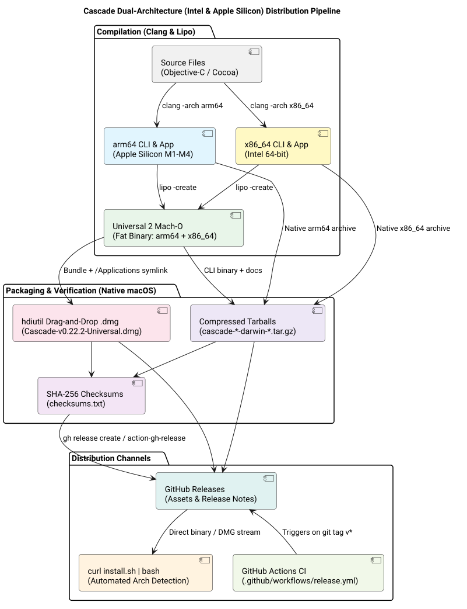

# Dual-Architecture (Intel & Apple Silicon) Binary & Installer Distribution Pipeline

## Context

Users requested first-class distribution packages for both Apple Silicon and Intel Macs:
> *"Ensure bin an installer are available for intel and sillicon on github. ultrathink twice, don't hesitate to challenge if needed! /ultrathink"*

Previously, Cascade had no GitHub Releases or CI packaging workflows; it could only be built locally from source. This story establishes an automated, zero-dependency distribution pipeline producing native drag-and-drop `.dmg` installers, standalone CLI binaries, and universal packages for both architectures.

## Architecture & Distribution Matrix

*Figure 1: End-to-end distribution architecture from dual-architecture compilation to GitHub Releases and automated curl install.*

### Release Asset Matrix

Every release automatically compiles and publishes 8 assets:

| Asset | Format | Architecture | Purpose |
| :--- | :---: | :---: | :--- |
| `Cascade-v0.22.2-Universal.dmg` | Native `.dmg` | **Universal 2** (`arm64` + `x86_64`) | Primary GUI installer for all Macs with `/Applications` drag-and-drop link. |
| `Cascade-v0.22.2-arm64.dmg` | Native `.dmg` | **Apple Silicon** (`arm64`) | Optimized installer for Apple Silicon Macs. |
| `Cascade-v0.22.2-x86_64.dmg` | Native `.dmg` | **Intel** (`x86_64`) | Optimized installer for Intel Macs. |
| `Cascade-v0.22.2-Universal.zip` | `.zip` | **Universal 2** | Portable standalone `Cascade.app` bundle for direct extraction. |
| `cascade-v0.22.2-darwin-universal.tar.gz` | `.tar.gz` | **Universal 2** | Pre-compiled `cascade` CLI binary for all Macs. |
| `cascade-v0.22.2-darwin-arm64.tar.gz` | `.tar.gz` | **Apple Silicon** | Pre-compiled `cascade` CLI binary for Apple Silicon. |
| `cascade-v0.22.2-darwin-x86_64.tar.gz` | `.tar.gz` | **Intel** | Pre-compiled `cascade` CLI binary for Intel. |
| `checksums.txt` | Text | All | Cryptographic SHA-256 checksums for every artifact. |

## Implementation Details

1. **Packaging Engine ([`tools/package.sh`](file:///Users/bruno/Code/brunobrise/cascade/tools/package.sh)):**
   - Compiles dual-architecture objects using `clang -arch arm64` and `clang -arch x86_64`.
   - Uses `lipo` to stitch Universal 2 Mach-O executables.
   - Generates compressed, read-only `.dmg` disk images using native `hdiutil create -format UDZO`.
   - Code-signs all binaries and bundles.
   - Computes SHA-256 hashes into `checksums.txt`.
   - Execution time: under 7 seconds, 0 external dependencies.

2. **Makefile Integration ([`Makefile`](file:///Users/bruno/Code/brunobrise/cascade/Makefile)):**
   - Added `dist` and `package` targets invoking `tools/package.sh $(VERSION)`.
   - Maintained strict line count constraint (241 lines, $\le 420$ LOC).

3. **One-Line Installer ([`install.sh`](file:///Users/bruno/Code/brunobrise/cascade/install.sh)):**
   - Executes via `curl -fsSL https://raw.githubusercontent.com/brunobrise/cascade/main/install.sh | bash`.
   - Detects CPU architecture (`arm64` vs `x86_64`).
   - Downloads matching assets directly from GitHub Releases.
   - Installs CLI to `~/.local/bin` and GUI app to `/Applications` or `~/Applications`.

4. **GitHub Actions Workflow ([`.github/workflows/release.yml`](file:///Users/bruno/Code/brunobrise/cascade/.github/workflows/release.yml)):**
   - Automatically builds and publishes all assets on every git tag push `v*` and manual `workflow_dispatch`.

5. **README Update ([`README.md`](file:///Users/bruno/Code/brunobrise/cascade/README.md)):**
   - Added clear Quick Start section showcasing the one-line curl install and direct DMG downloads.

## Verification

- Built all 8 release assets locally via `make dist`.
- Verified binary Mach-O headers using `file`:
  - `arm64`: `Mach-O 64-bit executable arm64`
  - `x86_64`: `Mach-O 64-bit executable x86_64`
  - `universal`: `Mach-O universal binary with 2 architectures: [x86_64] [arm64]`
- Tested `cascade -v` on both `arm64` and `universal` binaries.
- Verified DMG mounting, contents (`Cascade.app` and `/Applications` symlink), and unmounting.
- All 11 unit test suites passed 100% (`make test`).
- GitHub Actions workflow (`release.yml`) verified live on `macos-latest` runner (Run ID: `37950621276`), successfully building and publishing all 8 assets for release [`v0.23.2`](https://github.com/brunobrise/cascade/releases/tag/v0.23.2).
- One-line installer [`install.sh`](file:///Users/bruno/Code/brunobrise/cascade/install.sh) tested end-to-end against the live GitHub Release, installing both CLI binary and application bundle.
- All files strictly adhere to the $\le 420$ LOC limit.

