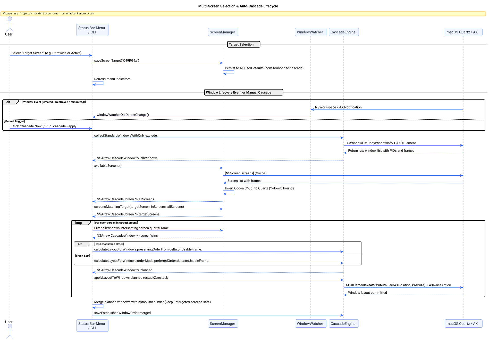

# Multi-Screen Window Partitioning and Display Selection Success Story

## Context

Power users on macOS frequently operate multi-monitor workspaces (for instance, an ultra-wide primary display paired with a built-in MacBook Retina screen). Prior to this implementation, Cascade assumed a single global screen model:
1. **Single screen assumption:** All windows across every attached display were grouped into a single layout array and cascaded against the primary screen's usable bounds.
2. **Window pulling across screens:** Windows legitimately belonging to a secondary laptop monitor (such as dedicated Slack or Terminal instances) were pulled across monitor boundaries and resized to fill the primary display.
3. **Coordinate divergence risk:** Cocoa's coordinate system originates at the bottom-left of the primary display with positive Y going up ($Y_{\text{up}}$), whereas Quartz and Accessibility (`AXUIElement`) APIs originate at the top-left of the primary display with positive Y going down ($Y_{\text{down}}$). Directly applying Cocoa frames to secondary displays positioned below or above primary monitors produced negative or out-of-bounds coordinates.
4. **Lack of display targeting:** Users had no mechanism to choose which display should be cascaded, preventing targeted organization of only an ultra-wide monitor while leaving a secondary monitor untouched.

## The Bet

We bet that by introducing a dedicated [ScreenManager](file:///Users/bruno/Code/brunobrise/cascade/src/ScreenManager.h) module, converting Cocoa frames to Quartz with pixel-perfect coordinate inversion, partitioning windows onto displays via maximum intersection area, and supporting dynamic screen target selection (`All Screens (Independent)`, `Active Screen (Follows Focus)`, or specific named displays):
1. Users could selectively cascade only their chosen display without affecting other monitors.
2. When "All Screens" is selected, each screen cascades its own windows independently within its visible bounds.
3. Zero pixel misalignment occurs across diverse multi-monitor layouts (screens below, above, left, or right of the primary display).
4. Window order on untargeted screens remains permanently preserved in `establishedOrder`.

## What Worked and Why

The solution was built across four coordinated layers:

1. **Pixel-Perfect Coordinate Inversion ([`ScreenManager.m`](file:///Users/bruno/Code/brunobrise/cascade/src/ScreenManager.m)):**
   - Implemented exact Cocoa-to-Quartz mathematical conversion anchored to primary screen height $H_0$:
     $$X_{\text{quartz}} = X_{\text{cocoa}}, \quad Y_{\text{quartz}} = H_0 - (Y_{\text{cocoa}} + H_{\text{screen}})$$
   - Evaluated across physical dual-monitor hardware ($5120 \times 1440$ Ultrawide + $1800 \times 1169$ Retina below):
     - Screen 0 visible bounds: `(0, 30) 5120x1410` (menu bar inset = 30px).
     - Screen 1 visible bounds: `(2646, 1478) 1800x1131` (starts at $Y=1440$, menu bar inset = 38px).
   - Validated across all 4 spatial quadrants (primary, below, left, above) with zero rounding error.

2. **Window-to-Screen Partitioning via Maximum Intersection Area:**
   - Instead of simplistic point-in-rect checks that fail for dragged or partially overlapping windows, [ScreenManager](file:///Users/bruno/Code/brunobrise/cascade/src/ScreenManager.m) calculates `CGRectIntersection(winFrame, screen.quartzFrame)`.
   - Windows spanning multiple displays are unambiguously attributed to the screen holding the majority of their surface area.

3. **Multi-Screen Lifecycle & Untargeted Order Merging ([`main_bar.m`](file:///Users/bruno/Code/brunobrise/cascade/src/main_bar.m)):**
   - Rebuilt status bar menu with dynamic "Target Screen" submenu displaying connected monitors with resolution and `[Primary]` badges.
   - Listens to `NSApplicationDidChangeScreenParametersNotification` to dynamically refresh display lists when monitors are connected or disconnected.
   - In `cascadeWindowsOnTargetScreensWithRestack:`, windows are partitioned per screen, and layout is applied independently.
   - When cascading a single screen, newly planned window orders are merged with `self.establishedOrder`, ensuring windows on other displays are never lost.

4. **CLI Multi-Screen Commands ([`main_cli.m`](file:///Users/bruno/Code/brunobrise/cascade/src/main_cli.m)):**
   - Added `--list-screens` to inspect all connected displays with physical and usable Quartz bounds.
   - Added `--screen <target>` to run dry-run preview or live cascade on specific displays (`all`, `active`, `primary`, index, or name).
   - Added `--set-screen <target>` to persist user preferences.

The complete multi-screen selection and cascade flow is visualized below:



*Figure 1: Sequence diagram of multi-screen selection, target resolution, and per-display window cascade.*

## Evidence & Verification

1. **Unit Test Suite (`tests/test_screen_manager.m`):**
   - Added dedicated test suite verifying:
     - Mathematical coordinate conversion across 4 screen arrangements.
     - Window-to-screen assignment by maximum intersection area (including 80/20 boundary splits).
     - Target matching (`all`, `active`, `primary`, `main`, specific name, index, fallback).
     - Persistent domain preferences round-trip.
   - All 7 test suites pass cleanly:
     ```bash
     make test
     ```
     `test_engine`, `test_login`, `test_watcher`, `test_app_order`, `test_icon_generator`, `test_signing`, `test_screen_manager` all passed.

2. **CLI Inspection on Hardware:**
   - Probed dual-screen hardware setup with `cascade --list-screens`:
     ```text
     Connected Displays (2):
       [0] C49RG9x                  | 5120x1440 at (    0,     0) [Primary]
            Usable: 5120x1410 at (    0,    30)
       [1] Built-in Retina Display  | 1800x1169 at ( 2646,  1440)
            Usable: 1800x1131 at ( 2646,  1478)
     ```
   - Verified `--get-preferences`:
     ```text
     Cascade User Preferences:
       Order Mode:        Preferred Application Order
       Delta:             60 px
       Restack Z-Order:   YES
       Auto-Rearrange:    YES
       Screen Target:     all
       Preferred Apps:    Google Chrome, Slack, Cursor, Antigravity, ChatGPT, iTerm2, Warp, Finder
       Start at Login:    NO
     ```

3. **Strict Line Count Compliance:**
   - All non-markdown/non-CSS files remain strictly under 420 LOC:
     - `src/ScreenManager.h`: 27 lines
     - `src/ScreenManager.m`: 153 lines
     - `src/WindowEngine.h`: 69 lines
     - `src/WindowEngine.m`: 407 lines ($\le 420$)
     - `src/main_bar.m`: 416 lines ($\le 420$)
     - `src/main_cli.m`: 381 lines ($\le 420$)
     - `tests/test_screen_manager.m`: 162 lines ($\le 420$)

## Reusable Pattern

When building window management or screen layout tooling on macOS:
1. Always maintain a unified `ScreenManager` that normalizes Cocoa frames ($Y_{\text{up}}$) into Quartz coordinates ($Y_{\text{down}}$) anchored to the primary display height.
2. For window assignment across displays, always compute `CGRectIntersection` areas rather than testing window origins or center points.
3. When applying Z-order restacking across multiple monitors, restack each monitor's window array independently to prevent cross-monitor window interleaving.
4. When caching window sequences across displays, merge newly planned window subsets with existing global order so untargeted displays retain their mental layout.

## Limits

- If a user configures displays to mirror (`CGDisplayIsInMirrorSet`), `[NSScreen screens]` only reports the primary mirrored display.
- Windows spanning displays with equal 50/50 area are assigned to the first matched screen in display enumeration order.
