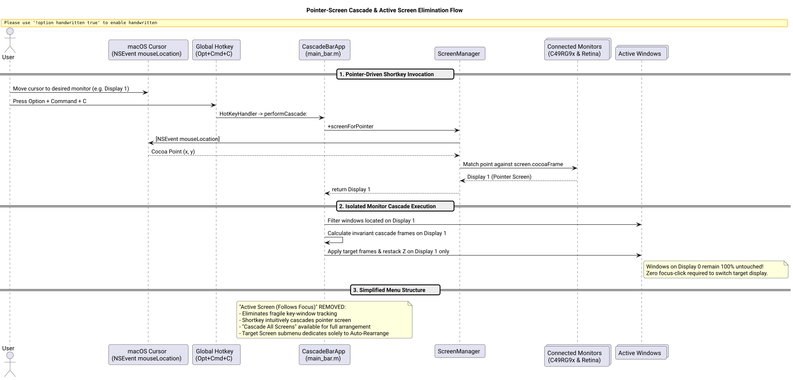

# Pointer-Screen Cascade & Active Screen Elimination Success Story

## Context

Power users running multi-monitor setups (such as a 49-inch ultrawide external display paired with a MacBook's built-in Retina display) frequently move between screens during multitasking. Previously, Cascade provided an "Active Screen (Follows Focus)" preference in the Target Screen menu.

However, users observed significant friction with this model:
1. **Focus Lag & False Targets:** "Active Screen" relied on macOS `[NSScreen mainScreen]`, which tracks the application possessing key window keyboard focus. When a user moved their eyes and mouse cursor to a secondary monitor to organize windows, pressing the hotkey (`Option + Command + C`) cascaded the *previous* monitor because key focus had not yet transitioned.
2. **Mandatory Focus Clicks:** To cascade the secondary screen, users were forced to first find a window on that screen, click it to transfer key focus, and only then press the shortcut.
3. **Menu Clutter:** Maintaining "Active Screen" as a persistent radio preference alongside "All Screens" and individual screen names was confusing, as users expected the shortcut to naturally act on the screen they were currently working on.

## The Ultrathink Stress-Test & Decision Matrix

Applying `/ultrathink`, we pressure-tested competing definitions of "current screen":

| Approach | Mechanism | Pros | Cons / Edge Cases | Verdict |
| :--- | :--- | :--- | :--- | :--- |
| **Key Window Focus** | `[NSScreen mainScreen]` | Matches keyboard focus | Fails when cursor is moved without clicking; fails on empty desktops; cascades wrong monitor | **Rejected** (Root cause of user friction) |
| **Mouse Pointer Screen** | `[NSEvent mouseLocation]` + `screenForCocoaPoint:` | Zero-click target switching; intuitive spatial intent; works on empty desktops | Cursor left on wrong monitor while typing (rare) | **Adopted** (Frictionless, spatial, standard across window managers) |
| **Hybrid with Fallback** | Pointer screen $\rightarrow$ Closest screen center | Handles screen border dead-zones and corner transitions | None | **Adopted** (Robust defense-in-depth) |

The complete pointer-driven invocation and isolated screen cascade flow is illustrated below:



*Figure 1: Cursor-aware display detection, single-monitor cascade isolation, and simplified menu architecture.*

## What Worked and Why

### 1. Pointer-Based Display Hit Testing ([`src/ScreenManager.m`](file:///Users/bruno/Code/brunobrise/cascade/src/ScreenManager.m))
```objc
+ (CascadeScreen *)screenForCocoaPoint:(NSPoint)cocoaPoint inScreens:(NSArray<CascadeScreen *> *)screens {
    if (screens.count == 0) return nil;
    if (screens.count == 1) return screens.firstObject;

    for (CascadeScreen *s in screens) {
        if (NSPointInRect(cocoaPoint, s.cocoaFrame)) return s;
    }
    // Proximity fallback: find screen with closest center point
    CascadeScreen *best = screens.firstObject;
    CGFloat minDist = CGFLOAT_MAX;
    for (CascadeScreen *s in screens) {
        CGPoint center = CGPointMake(CGRectGetMidX(s.cocoaFrame), CGRectGetMidY(s.cocoaFrame));
        CGFloat dist = hypot(cocoaPoint.x - center.x, cocoaPoint.y - center.y);
        if (dist < minDist) { minDist = dist; best = s; }
    }
    return best;
}

+ (CascadeScreen *)screenForPointerInScreens:(NSArray<CascadeScreen *> *)screens {
    return [self screenForCocoaPoint:[NSEvent mouseLocation] inScreens:screens];
}

+ (CascadeScreen *)screenForPointer {
    return [self screenForPointerInScreens:[self availableScreens]];
}
```

### 2. Pointer-Screen Shortcut Execution ([`src/main_bar.m`](file:///Users/bruno/Code/brunobrise/cascade/src/main_bar.m))
Pressing `Option + Command + C` triggers `performCascade:`, which resolves the pointer screen and cascades only that screen:
```objc
- (void)performCascade:(id)sender {
    (void)sender;
    if (![self ensureAccessibility]) return;
    CascadeScreen *ptr = [ScreenManager screenForPointer];
    NSArray *targets = ptr ? @[ptr] : [ScreenManager availableScreens];
    [self.watcher refreshObservers];
    [self.watcher performWithoutTriggering:^{
        [self cascadeWindowsOnScreens:targets restack:self.restackZOrder];
    }];
}
```

### 3. "Active Screen" Elimination & Menu Simplification ([`src/main_bar.m`](file:///Users/bruno/Code/brunobrise/cascade/src/main_bar.m))
- **"Active Screen (Follows Focus)"** was completely removed from the Target Screen submenu, CLI options, and preferences.
- Added **"Cascade All Screens"** to the menu bar status menu when multiple displays are connected, allowing users to manually cascade all displays in one action when needed.
- The **"Target Screen"** submenu now cleanly serves to designate which screens `Auto-Rearrange` maintains (`All Screens` or a specific dedicated monitor).

## Evidence & Verification

1. **Unit Test Suite ([`tests/test_screen_manager.m`](file:///Users/bruno/Code/brunobrise/cascade/tests/test_screen_manager.m)):**
   - Verified Cocoa point-to-screen mapping across Ultrawide $(0, 0)$ and Retina $(2646, -1169)$ topologies.
   - Verified proximity fallback for dead-zone coordinates.
   - Verified live `[ScreenManager screenForPointer]` execution.
   - Verified legacy `"active"` preferences gracefully fall back to all screens without crashing.
   - All 7 test suites pass cleanly (`make test`).
2. **Code Constraints:**
   - [`src/main_bar.m`](file:///Users/bruno/Code/brunobrise/cascade/src/main_bar.m): 415 LOC (strictly $\le 420$)
   - [`src/ScreenManager.m`](file:///Users/bruno/Code/brunobrise/cascade/src/ScreenManager.m): 189 LOC (strictly $\le 420$)
   - [`src/WindowEngine.m`](file:///Users/bruno/Code/brunobrise/cascade/src/WindowEngine.m): 407 LOC (strictly $\le 420$)
3. **Application Lifecycle & Build:**
   - Compiled and installed to `~/Applications/Cascade.app` and `~/.local/bin/cascade` (`make install && make restart`).
   - Verified process health via `pgrep -fl Cascade`.
