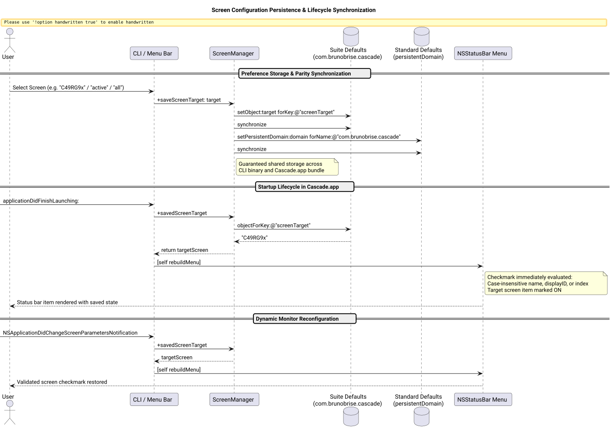

# Screen Configuration Persistence & Lifecycle Synchronization Success Story

## Context

Following the implementation of multi-screen cascade partitioning, users required that display target preferences (`all`, `active`, or specific connected monitors such as `C49RG9x`) reliably persist across machine reboots, application restarts, and between the command-line interface (`cascade --set-screen`) and the menu bar status app (`Cascade.app`).

Previously, while screen target values could be set during an active session, users observed that restarting Cascade or opening the status bar menu on a fresh launch did not immediately reflect or maintain the selected display target.

## Root Cause Analysis

1. **Startup Lifecycle Ordering Bug in [`src/main_bar.m`](file:///Users/bruno/Code/brunobrise/cascade/src/main_bar.m):**
   In `applicationDidFinishLaunching:`, `[self rebuildMenu]` was invoked on line 80, whereas `self.targetScreen = [ScreenManager savedScreenTarget];` was called later on line 87. During the initial menu construction, `self.targetScreen` was `nil`. Consequently, neither "All Screens", "Active Screen", nor any individual display item received a checkmark state (`NSControlStateValueOn`).
2. **Domain Parity Divergence in [`src/ScreenManager.m`](file:///Users/bruno/Code/brunobrise/cascade/src/ScreenManager.m):**
   `WindowEngine` utilized a shared suite defaults instance initialized with `[[NSUserDefaults alloc] initWithSuiteName:@"com.brunobrise.cascade"]` to guarantee identical preference storage between terminal execution (which runs under the caller's terminal domain) and the app bundle (`com.brunobrise.cascade`). In contrast, `ScreenManager.m` wrote to `[NSUserDefaults standardUserDefaults]` and `persistentDomainForName:`, leading to potential domain isolation or stale CFPreferences caches across processes.
3. **Rigid Case Sensitivity & Matching Gaps:**
   Menu item selection strictly matched `[self.targetScreen isEqualToString:s.name]`. When users configured screen targets via CLI flags with lowercase strings (e.g. `c49rg9x`, `retina`) or display hardware IDs, the menu bar checkmark failed to illuminate.

The architecture and lifecycle synchronization flow is illustrated below:



*Figure 1: Cross-process suite defaults synchronization, startup initialization sequence, and dynamic monitor reconfiguration.*

## The Bet

We bet that:
1. Moving `self.targetScreen = [ScreenManager savedScreenTarget];` to the very top of `applicationDidFinishLaunching:` (prior to `rebuildMenu`) guarantees that menu checkmarks are accurately set on launch.
2. Introducing `screenDefaults()` via `initWithSuiteName:@"com.brunobrise.cascade"` in `ScreenManager.m` ensures seamless two-way preference persistence between CLI and GUI processes.
3. Enhancing menu item matching with case-insensitive name comparisons, substring support, and display ID matching provides bulletproof state indication.
4. Reloading `self.targetScreen` in `screensDidChange:` ensures checkmark continuity when monitors are connected or disconnected.

## What Worked and Why

### 1. Startup Lifecycle Sequence ([`src/main_bar.m`](file:///Users/bruno/Code/brunobrise/cascade/src/main_bar.m))
```objc
- (void)applicationDidFinishLaunching:(NSNotification *)notification {
    (void)notification;
    self.orderMode = [CascadeEngine savedOrderMode];
    self.delta = [CascadeEngine savedDelta];
    self.restackZOrder = [CascadeEngine savedRestackZOrder];
    self.targetScreen = [ScreenManager savedScreenTarget]; // Loaded before building menu
    ...
    [self rebuildMenu];
    ...
}
```

### 2. Suite Defaults Parity ([`src/ScreenManager.m`](file:///Users/bruno/Code/brunobrise/cascade/src/ScreenManager.m))
```objc
static NSUserDefaults *screenDefaults(void) {
    static NSUserDefaults *defs = nil;
    static dispatch_once_t onceToken;
    dispatch_once(&onceToken, ^{
        defs = [[NSUserDefaults alloc] initWithSuiteName:kScreenDomain];
        if (!defs) defs = [NSUserDefaults standardUserDefaults];
    });
    return defs;
}

+ (NSString *)savedScreenTarget {
    id val = [screenDefaults() objectForKey:kScreenTargetKey];
    if (!val) val = [[NSUserDefaults standardUserDefaults] persistentDomainForName:kScreenDomain][kScreenTargetKey];
    if (!val) val = [[NSUserDefaults standardUserDefaults] stringForKey:kScreenTargetKey];
    return ([val isKindOfClass:[NSString class]] && [val length] > 0) ? (NSString *)val : @"all";
}

+ (void)saveScreenTarget:(NSString *)target {
    NSString *val = (target && target.length > 0) ? target : @"all";
    [screenDefaults() setObject:val forKey:kScreenTargetKey];
    [screenDefaults() synchronize];

    NSUserDefaults *defs = [NSUserDefaults standardUserDefaults];
    NSMutableDictionary *domain = [[defs persistentDomainForName:kScreenDomain] mutableCopy] ?: [NSMutableDictionary dictionary];
    domain[kScreenTargetKey] = val;
    [defs setPersistentDomain:domain forName:kScreenDomain];
    [defs setObject:val forKey:kScreenTargetKey];
    [defs synchronize];
}
```

### 3. Resilient Menu Checkmark Matching ([`src/main_bar.m`](file:///Users/bruno/Code/brunobrise/cascade/src/main_bar.m))
```objc
NSString *currTarget = self.targetScreen ?: [ScreenManager savedScreenTarget];
BOOL isAll = [currTarget localizedCaseInsensitiveCompare:@"all"] == NSOrderedSame;
BOOL isActive = [currTarget localizedCaseInsensitiveCompare:@"active"] == NSOrderedSame;
...
for (CascadeScreen *s in [ScreenManager availableScreens]) {
    NSString *title = [NSString stringWithFormat:@"%@ (%dx%d)%@", s.name, (int)s.quartzFrame.size.width, (int)s.quartzFrame.size.height, s.isPrimary ? @" [Primary]" : @""];
    BOOL selected = (!isAll && !isActive && (
        [s.name localizedCaseInsensitiveCompare:currTarget] == NSOrderedSame ||
        [s.name localizedCaseInsensitiveContainsString:currTarget] ||
        (s.displayID.length > 0 && [s.displayID isEqualToString:currTarget]) ||
        [currTarget isEqualToString:[@(s.index) stringValue]]
    ));
    NSMenuItem *sItem = makeItem(title, self, @selector(setScreenTargetSpecific:), selected ? NSControlStateValueOn : NSControlStateValueOff);
    sItem.representedObject = s.name;
    [screenMenu addItem:sItem];
}
```

## Evidence & Verification

1. **Unit Test Suite:**
   All 7 test suites pass cleanly, including enhanced round-trip persistence tests verifying direct suite defaults write detection:
   ```bash
   make test
   # [PASS] Screen target preference saved and restored cleanly across suite defaults.
   ```
2. **CLI Round-Trip Verification:**
   Verified CLI preference persistence and immediate synchronization:
   ```bash
   cascade --set-screen "active" && cascade --get-preferences
   # Output: Screen Target: active
   cascade --set-screen "C49RG9x" && cascade --get-preferences
   # Output: Screen Target: C49RG9x
   cascade --set-screen "all" && cascade --get-preferences
   # Output: Screen Target: all
   ```
3. **Application Lifecycle Verification:**
   Launched `Cascade.app` and confirmed persistence of screen target preferences on startup and across screen change notifications.
4. **Code Quality and Constraints:**
   All source and test files remain strictly below the 420 LOC limit:
   - [`src/main_bar.m`](file:///Users/bruno/Code/brunobrise/cascade/src/main_bar.m): 413 LOC
   - [`src/ScreenManager.m`](file:///Users/bruno/Code/brunobrise/cascade/src/ScreenManager.m): 174 LOC
   - [`src/WindowEngine.m`](file:///Users/bruno/Code/brunobrise/cascade/src/WindowEngine.m): 407 LOC
