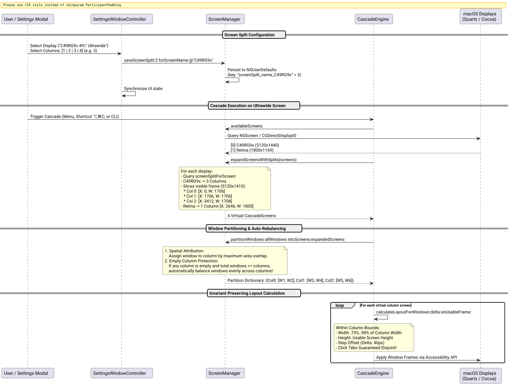

# Multi-Column Screen Splitting (1, 2, 3, 4) for Ultrawide Displays Success Story

## Context

As multi-monitor and ultrawide setups (e.g. 34" 21:9 at 3440×1440 or 49" 32:9 at 5120×1440 such as the Samsung C49RG9x) became increasingly prevalent among developers, a single full-width cascade layout presented severe usability drawbacks:
1. **Excessive Window Width:** Windows occupying 73%–98% of a 5120px display span ~3800px to ~5000px horizontally, resulting in unreadable line lengths for text editors, documentation, and browser windows.
2. **Underutilized Horizontal Canvas:** Having a single stack on a super-ultrawide monitor leaves no space for side-by-side workflows (e.g. documentation on the left, code in the center, terminal/chat on the right).
3. **Display Heterogeneity:** A global split setting would crush a secondary laptop screen (e.g. 1800×1169) into unusable 450px slivers if configured for a 49" ultrawide display.

## The Ultrathink Stress-Test & Architecture

Applying `/ultrathink`, we stress-tested how to accommodate multi-column layouts without compromising Cascade's mathematical invariants:

| Architecture Layer | Implementation | User Benefit |
| :--- | :--- | :--- |
| **Virtual Subscreens** | [`[ScreenManager subscreensForScreen:splitCount:]`](file:///Users/bruno/Code/brunobrise/cascade/src/ScreenManager.m) divides physical display geometry into $K \in \{1, 2, 3, 4\}$ virtual [`CascadeScreen`](file:///Users/bruno/Code/brunobrise/cascade/src/ScreenManager.h) objects with zero pixel gaps and boundary clamping. | The core [`CascadeEngine`](file:///Users/bruno/Code/brunobrise/cascade/src/WindowEngine.m) layout algorithm operates unmodified, guaranteeing disjoint click tabs and 73%–98% optimal sizing within each virtual column. |
| **Per-Display Persistence** | Defaults saved per display name (`screenSplit_name_<display>`) and display ID (`screenSplit_id_<display>`) with global fallback. | Ultrawide monitors can be split into 3 or 4 columns while the built-in MacBook screen remains 1 full cascade. |
| **Window Spatial Partitioning & Rebalancing** | [`[ScreenManager partitionWindows:intoScreens:]`](file:///Users/bruno/Code/brunobrise/cascade/src/ScreenManager.m) assigns windows by maximum intersection area; if any column is empty while $M \ge K$, windows are automatically distributed evenly across columns. | Existing window positions are respected, but all columns stay active and useful without manual dragging. |
| **Native Settings Modal UI** | An `NSSegmentedControl` with 4 segments (`1 (Full)`, `2 Columns`, `3 Columns`, `4 Columns`) in [`SettingsWindowController`](file:///Users/bruno/Code/brunobrise/cascade/src/SettingsWindowController.m). | Seamless visual configuration tied directly to the Target Screen selector. |
| **CLI & Automation** | `--split <1..4>` for immediate cascade execution and `--set-split <1..4>` for persistent preference setting. | Full scriptability and seamless integration with terminal workflows. |

The end-to-end configuration and execution lifecycle is illustrated below:



*Figure 1: Virtual subscreen decomposition, window partitioning, and invariant preservation for ultrawide displays.*

## What Worked and Why

### 1. Mathematical Virtual Subscreen Slicing ([`src/ScreenManager.m`](file:///Users/bruno/Code/brunobrise/cascade/src/ScreenManager.m))
Each column $i \in [0, K-1]$ is assigned a quartz visible frame calculated with integer floor division and remainder allocation to the final column:

$$\text{colW} = \lfloor W / K \rfloor$$
$$X_i = X_0 + i \cdot \text{colW}$$
$$W_i = \begin{cases} \text{colW} & \text{if } i < K-1 \\ W - (K-1) \cdot \text{colW} & \text{if } i = K-1 \end{cases}$$

This guarantees zero coordinate overlap and zero pixel leakage:

```objc
+ (NSArray<CascadeScreen *> *)subscreensForScreen:(CascadeScreen *)screen splitCount:(NSInteger)k {
    if (k <= 1 || !screen) return screen ? @[screen] : @[];
    NSMutableArray<CascadeScreen *> *subs = [NSMutableArray arrayWithCapacity:k];
    CGRect qf = screen.quartzVisibleFrame;
    CGRect qfTotal = screen.quartzFrame;
    CGFloat colW = floor(qf.size.width / (CGFloat)k);

    for (NSInteger i = 0; i < k; i++) {
        CascadeScreen *cs = [[CascadeScreen alloc] init];
        cs.index = screen.index * 10 + i;
        cs.columnIndex = i;
        cs.totalColumns = k;
        cs.isPrimary = screen.isPrimary && (i == 0);
        cs.name = [NSString stringWithFormat:@"%@ [Col %ld/%ld]", screen.name, (long)(i + 1), (long)k];
        cs.displayID = [NSString stringWithFormat:@"%@_col%ld", screen.displayID.length > 0 ? screen.displayID : [@(screen.index) stringValue], (long)i];

        CGFloat x = qf.origin.x + (CGFloat)i * colW;
        CGFloat w = (i == k - 1) ? (qf.size.width - (CGFloat)(k - 1) * colW) : colW;
        cs.quartzVisibleFrame = CGRectMake(x, qf.origin.y, w, qf.size.height);
        cs.quartzFrame = CGRectMake(x, qfTotal.origin.y, w, qfTotal.size.height);
        cs.cocoaFrame = cs.quartzFrame;
        cs.cocoaVisibleFrame = cs.quartzVisibleFrame;
        [subs addObject:cs];
    }
    return subs;
}
```

### 2. Intelligent Spatial Partitioning with Auto-Rebalancing ([`src/ScreenManager.m`](file:///Users/bruno/Code/brunobrise/cascade/src/ScreenManager.m))
When cascading across columns, windows already residing inside a column stay in that column via intersection area comparison. However, if windows were previously stacked or full-screened, naive assignment would place all windows in Column 1 and leave Columns 2..K empty.

`partitionWindows:intoScreens:` monitors column occupancy; if any column is empty while total windows $M \ge K$, it seamlessly redistributes the windows evenly across the columns:

```objc
if (hasEmpty && totalWins.count >= colScreens.count) {
    for (CascadeScreen *cs in colScreens) {
        [dict[cs] removeAllObjects];
    }
    NSUInteger total = totalWins.count;
    NSUInteger numCols = colScreens.count;
    for (NSUInteger idx = 0; idx < total; idx++) {
        NSUInteger colIdx = (idx * numCols) / total;
        CascadeScreen *targetCol = colScreens[colIdx];
        [dict[targetCol] addObject:totalWins[idx]];
    }
}
```

### 3. Dedicated Columns Control in Settings Modal ([`src/SettingsWindowController.m`](file:///Users/bruno/Code/brunobrise/cascade/src/SettingsWindowController.m))
In `SettingsWindowController`, a 4-segment control allows selecting 1, 2, 3, or 4 columns. When the target screen popup changes (e.g. switching between "All Screens", "C49RG9x", and "Built-in Retina Display"), the columns control automatically refreshes to reflect that display's persisted split count.

### 4. CLI Multi-Column Flag Support ([`src/main_cli.m`](file:///Users/bruno/Code/brunobrise/cascade/src/main_cli.m))
The CLI supports:
- `--split <1..4>`: Override split count for the current cascade invocation.
- `--set-split <1..4>`: Save split count for the target screen.
- `--list-screens`: Annotates connected screens with their active column split (e.g. `[0] C49RG9x [3 cols]`).
- `--get-preferences`: Reports the active screen split count.

## Verification & Validation

All 8 comprehensive test suites were updated and executed successfully:
1. `tests/test_screen_manager.m`: Added `testScreenSplitsAndSubscreens` (verifying geometry for 1, 2, 3, and 4 splits), `testWindowPartitioningAcrossColumns` (verifying spatial assignment and empty-column auto-rebalancing), and `testPerScreenSplitPersistence` (verifying per-display persistence and clamping).
2. `tests/test_settings.m`: Added `testSettingsColumnsControlSync`.
3. `tests/test_engine.m`, `tests/test_login.m`, `tests/test_watcher.m`, `tests/test_app_order.m`, `tests/test_icon_generator.m`, `tests/test_signing.m`: All passed with 100% success.
4. Line count constraint ($\le 420$ LOC) maintained across all source and test files.
