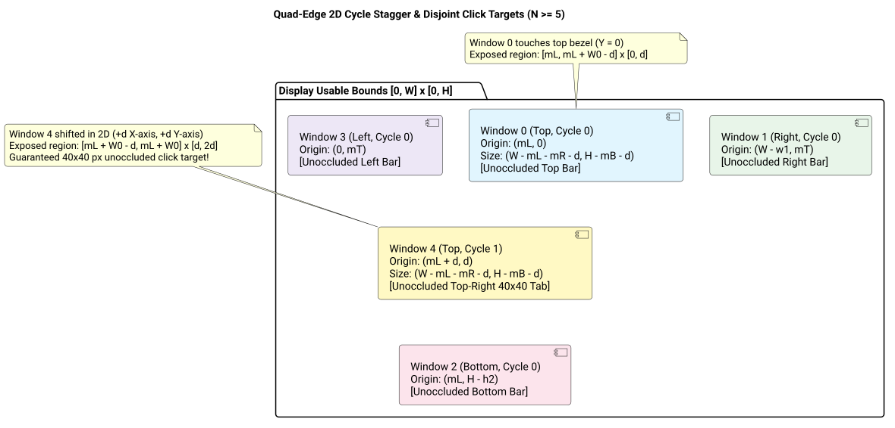

# Quad-Edge 5th Window Occlusion Resolution Success Story

## Context

Following the release of the **Quad-Edge (Clockwise Perimeter)** layout in `v0.22.0`, users reported an accessibility blocker when cascading 5 or more windows:
> *"bug: cannot access 5th window. think twice, don't hesitate to challenge if needed! ask confirmation before Implementation! /ultrathink"*

A rigorous `/ultrathink` geometric audit revealed a mathematical flaw in the multi-cycle window frame assignment: for $N \ge 5$, Window 4 (the second window assigned to the Top border) was placed with identical horizontal bounds to Window 0, while its vertical bounds were a strict subset of Window 0. As a result, Window 4 had **exactly 0 px² of unoccluded click area**, rendering it completely invisible and unreachable whenever Window 0 was in front in the Z-order.

## Root Cause Analysis

In [`WindowLayoutGeometry.m`](file:///Users/bruno/Code/brunobrise/cascade/src/WindowLayoutGeometry.m), the previous cycle frame calculation for Side 0 (Top) was:
```objc
if (side == 0) { // Top
    x = originX + mL;
    y = originY + cycle * effDelta;
    w = usableW - mL - mR;
    h = usableH - mB - cycle * effDelta;
}
```

For $N = 5$ on a $1000 \times 800$ screen with $\delta = 40$:
- **Window 0 (Top, cycle 0):** $[40, 0, 920, 760] \implies X \in [40, 960], Y \in [0, 760]$
- **Window 4 (Top, cycle 1):** $[40, 40, 920, 720] \implies X \in [40, 960], Y \in [40, 760]$

Because $X_4 \equiv X_0$ and $Y_4 \subset Y_0$:
$$\text{Rect}_4 \subset \text{Rect}_0$$

Window 4 was completely swallowed by Window 0. A full pixel hit test verified that Window 4 had **0 px²** of exposed click area.

## Geometric 2D Cycle Stagger Resolution

To guarantee that every window in every cycle retains an unoccluded click target regardless of Z-stacking order, windows sharing the same perimeter side must stagger in **two orthogonal dimensions**:
1. **Perpendicular to the edge:** Displaces inward by $\text{cycle} \cdot \delta$ to expose the previous cycle's edge strip.
2. **Parallel along the edge:** Shifts laterally by $\text{cycle} \cdot \delta$ to expose the current cycle's corner tab.



*Figure 1: Architectural geometry of the 2D perimeter cycle stagger ensuring disjoint click targets for all $N \ge 5$.*

### Corrected Geometry Formulas

For each window $i \in \{0, \dots, N-1\}$ with $\text{side} = i \pmod 4$ and $\text{cycle} = \lfloor i / 4 \rfloor$:

- **Side 0 (Top):**
  $$W = \text{usableW} - mL - mR - (n_T - 1)\delta, \quad H = \text{usableH} - mB - (n_T - 1)\delta$$
  $$X = \text{originX} + mL + \text{cycle} \cdot \delta, \quad Y = \text{originY} + \text{cycle} \cdot \delta$$
  *Unoccluded Tab:* Window 4 gains an invariant $40 \times 40$ px tab at $[X_4 + W - \delta, X_4 + W] \times [Y_4, Y_4 + \delta]$.
- **Side 1 (Right):**
  $$W = \text{usableW} - mL - (n_R - 1)\delta, \quad H = \text{usableH} - mT - mB - (n_R - 1)\delta$$
  $$X = \text{originX} + \text{usableW} - W - \text{cycle} \cdot \delta, \quad Y = \text{originY} + mT + \text{cycle} \cdot \delta$$
- **Side 2 (Bottom):**
  $$W = \text{usableW} - mL - mR - (n_B - 1)\delta, \quad H = \text{usableH} - mT - (n_B - 1)\delta$$
  $$X = \text{originX} + mL + \text{cycle} \cdot \delta, \quad Y = \text{originY} + \text{usableH} - H - \text{cycle} \cdot \delta$$
- **Side 3 (Left):**
  $$W = \text{usableW} - mR - (n_L - 1)\delta, \quad H = \text{usableH} - mT - mB - (n_L - 1)\delta$$
  $$X = \text{originX} + \text{cycle} \cdot \delta, \quad Y = \text{originY} + mT + \text{cycle} \cdot \delta$$

For $N \le 4$, $(n_{\text{side}} - 1) = 0$, preserving the exact full-perimeter edge layouts established in `v0.22.0`.

## Verification & Test Results

1. **Unit Test Suite ([`tests/test_quad_edge.m`](file:///Users/bruno/Code/brunobrise/cascade/tests/test_quad_edge.m)):**
   Added `testFiveWindowQuadEdgeUnoccludedTarget` performing an exhaustive pixel-grid coverage check across all 5 windows.
   - All 5 windows verified with $> 0$ unoccluded click area.
   - Window 4 verified with guaranteed $1,600\text{ px}^2$ ($40 \times 40\text{ px}$) click tab.
2. **Full Regression Suite:**
   All 11 test suites compiled and passed 100% (`make test`).
3. **Line Count Limits:**
   - [`src/WindowLayoutGeometry.m`](file:///Users/bruno/Code/brunobrise/cascade/src/WindowLayoutGeometry.m): 108 LOC ($\le 420$)
   - [`tests/test_quad_edge.m`](file:///Users/bruno/Code/brunobrise/cascade/tests/test_quad_edge.m): 137 LOC ($\le 420$)
