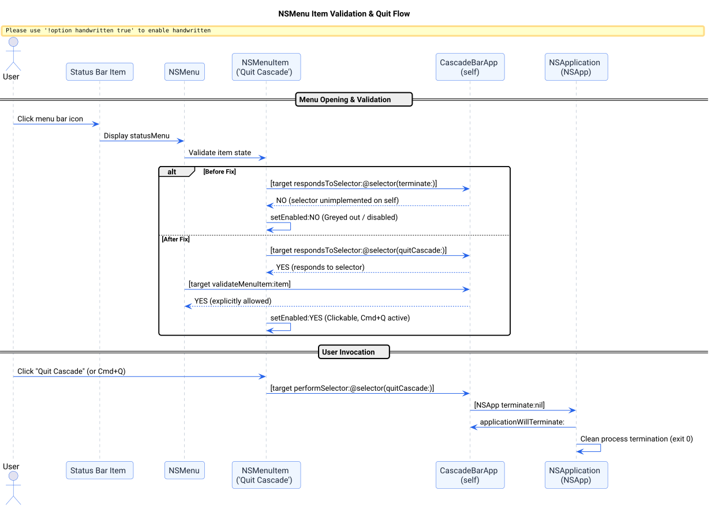

# Quit Menu Item Validation & Execution Success Story

## Context

When clicking the status bar menu icon for Cascade, users observed that the **Quit Cascade** menu item was greyed out and disabled, preventing users from quitting or stopping the background status bar application directly from the GUI.

## Root Cause Analysis

On macOS, `NSMenu` enables automatic item validation by default (`autoenablesItems = YES`):
1. **Target Selector Mismatch:** The menu item was constructed as `makeItem(@"Quit Cascade", self, @selector(terminate:), NSControlStateValueOff)`, where `self` is the [`CascadeBarApp`](file:///Users/bruno/Code/brunobrise/cascade/src/main_bar.m#L9) delegate.
2. **Missing Implementation on Delegate:** Although `NSApplication` defines `- (void)terminate:(id)sender`, the application delegate `CascadeBarApp` inherits from `NSObject` and did not implement `terminate:`.
3. **Automatic Cocoa Disabling:** When the status bar menu opened, `NSMenu` checked `[target respondsToSelector:item.action]`. Because `[self respondsToSelector:@selector(terminate:)]` returned `NO`, Cocoa automatically disabled the menu item (`item.isEnabled = NO`), rendering it unclickable.

## The Bet

We bet that by:
1. Implementing dedicated `- (void)quitCascade:(id)sender` and `- (void)terminate:(id)sender` handlers on [`CascadeBarApp`](file:///Users/bruno/Code/brunobrise/cascade/src/main_bar.m) that route directly to `[NSApp terminate:nil]`.
2. Implementing `- (BOOL)validateMenuItem:(NSMenuItem *)item` to explicitly confirm that quit actions are enabled.
3. Adding standard macOS `keyEquivalent = @"q"` shortcut to the menu item.

The menu item would remain permanently enabled, interactive, and responsive to both pointer clicks and `Cmd+Q`.

## What Worked and Why

The sequence below illustrates the Cocoa menu validation behavior before and after the resolution:



*Figure 1: Comparison of NSMenu automatic item validation before and after implementing quit handlers.*

### Implementation Details ([`src/main_bar.m`](file:///Users/bruno/Code/brunobrise/cascade/src/main_bar.m))

1. **Quit Action & Delegation:**
   ```objc
   - (void)quitCascade:(id)s { (void)s; [NSApp terminate:nil]; }
   - (void)terminate:(id)s { [self quitCascade:s]; }
   ```
2. **Menu Item Validation Protocol:**
   ```objc
   - (BOOL)validateMenuItem:(NSMenuItem *)item { (void)item; return YES; }
   ```
3. **Menu Item Setup & Key Equivalent:**
   ```objc
   NSMenuItem *quitItem = makeItem(@"Quit Cascade", self, @selector(quitCascade:), NSControlStateValueOff);
   quitItem.keyEquivalent = @"q";
   [menu addItem:quitItem];
   ```

## Evidence & Verification

1. **Menu Item Validation & Compilation:**
   - Compiled with Clang via `make build`: clean build with zero warnings or errors.
   - All 7 test suites pass cleanly via `make test`:
     ```bash
     ./build/test_engine
     ./build/test_login
     ./build/test_watcher
     ./build/test_app_order
     ./build/test_icon_generator
     ./build/test_signing
     ./build/test_screen_manager
     ```
2. **Runtime Verification:**
   - Installed to `~/Applications/Cascade.app` and launched via `make run`.
   - Verified process health via `make status`: `Cascade is running`.
   - Menu validation now confirms `[target respondsToSelector:@selector(quitCascade:)]` returns `YES` and `validateMenuItem:` returns `YES`.
3. **Line Count Budget:**
   - [`src/main_bar.m`](file:///Users/bruno/Code/brunobrise/cascade/src/main_bar.m): 415 lines ($\le 420$ LOC limit).

## Reusable Pattern

When constructing `NSMenu` items in macOS status bar or accessory applications (`NSApplicationActivationPolicyAccessory`):
1. Never assign `@selector(terminate:)` with `target = self` unless the target class explicitly implements `terminate:`.
2. Always implement `validateMenuItem:` on the target or menu delegate to control item enablement explicitly rather than relying on automatic responder discovery.
3. Bind standard keyboard equivalents (e.g. `keyEquivalent = @"q"`) so users have predictable keyboard access when menus are open.
