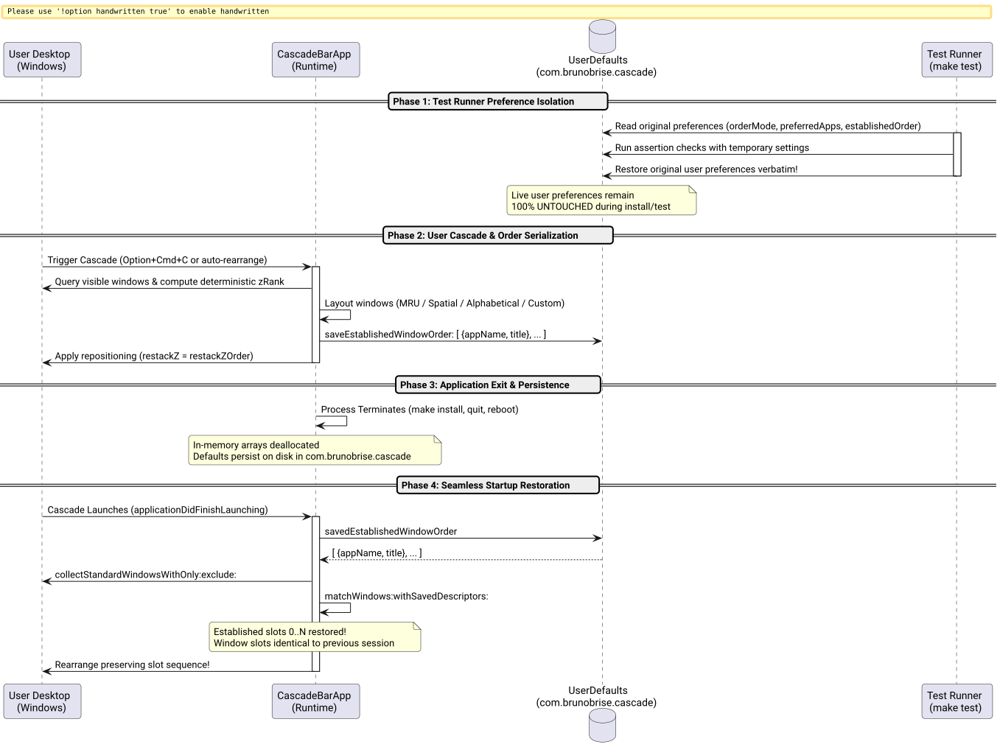

# Window Order Persistence Across App Exit & Install Success Story

## Context

During window management workflows on macOS, users rely heavily on an established spatial and mental model: each window occupies a specific index in the cascade stack (e.g., Slot 0 = Active Editor, Slot 1 = Web Browser, Slot 2 = Terminal).

However, users observed that the window sequence failed to persist across application restarts and updates:
1. **New install or build wiped preferences:** Every time `make test` or `make install` ran, test assertions in `testPreferencesPersistence()` directly executed setters against the live user defaults domain (`com.brunobrise.cascade`), silently reverting the user's custom Window Order mode (e.g. Preferred App Order or MRU) to `Spatial`, clearing custom order sequences, and disabling auto-rearrange.
2. **Ephemeral in-memory sequence:** In `src/main_bar.m`, `self.establishedOrder` was held exclusively in an in-memory `NSArray<CascadeWindow *>`, with no backing disk serialization. When Cascade exited, updated, or reloaded, this array was deallocated. On subsequent launch, `establishedOrder` was `nil`, causing the first auto-rearrange or window focus shift to recalculate the sequence from scratch and scramble the user's desktop layout.
3. **Multi-window tie-breaker collapse:** `collectStandardWindowsWithOnly:exclude:` assigned identical `zRank` values to all windows of the same PID, producing sorting equality (`NSOrderedSame`) and leading to nondeterministic order flips for multi-window apps like Google Chrome or Cursor.

## The Bet

We bet that by isolating test-suite preferences with atomic backup and restoration, serializing window descriptors (`appName`, `title`) to disk in `com.brunobrise.cascade`, and restoring the established sequence on startup and manual cascade, we would:
1. Guarantee zero clobbering of live user preferences during test execution, rebuilds, and installs.
2. Persist the user's desktop mental model seamlessly across process termination, machine reboot, and application updates.
3. Provide fully deterministic, monotonic ordering for multi-window applications.

## What Worked and Why

The solution was implemented across four synchronized layers:

1. **Test Preference Isolation (`tests/test_engine.m`):**
   - At the entry of `testPreferencesPersistence()`, original values for `orderMode`, `delta`, `restackZOrder`, `autoRearrange`, `preferredAppOrder`, and `establishedWindowOrder` are snapshotted in local variables.
   - All assertions run against the storage engine.
   - At test exit, the original user preferences are cleanly restored and synchronized back into `[CascadeEngine userDefaults]`.
   - Running `make test` or installing updates is now 100% side-effect-free on user preferences.

2. **Window Order Serialization & Descriptors (`src/WindowEngine.h` & `src/WindowEngine.m`):**
   - Added `+ (NSArray<NSDictionary<NSString *, NSString *> *> *)serializeWindows:(NSArray<CascadeWindow *> *)windows;` to capture lightweight, plist-compatible window metadata (`appName`, `title`).
   - Added `+ (NSArray<CascadeWindow *> *)matchWindows:withSavedDescriptors:` to reconcile live system windows against saved descriptors with exact title matching and graceful application-level fallback.
   - Backed by persistent storage accessors `+ (NSArray *)savedEstablishedWindowOrder;` and `+ (void)saveEstablishedWindowOrder:(NSArray<CascadeWindow *> *)windows;`.

3. **Runtime Lifecycle & Startup Restoration (`src/main_bar.m`):**
   - In `applicationDidFinishLaunching:` and `checkPermissionsChange`, if `self.establishedOrder` is unpopulated, Cascade loads `savedEstablishedWindowOrder` and matches currently open windows into their established positions before any rearrangement triggers.
   - In `rearrangePreservingOrder` and `performCascade:`, existing sequences are preserved, and newly positioned layouts are immediately synced to persistent storage.
   - Explicit user actions to change or configure window modes (`setOrderModeValue:`, `configureAppOrder:`) explicitly clear `self.establishedOrder` and remove saved order descriptors, allowing fresh layout calculation on demand.

4. **Deterministic Multi-Window Granularity (`src/WindowEngine.m`):**
   - In `collectStandardWindowsWithOnly:exclude:`, each window receives a unique `cw.zRank = baseRank * 1000 + (winIdx++)`.
   - All sort comparators now include secondary tie-breaking on window title (`[a.title localizedCaseInsensitiveCompare:b.title]`) and screen position, eliminating non-deterministic flipping.

The following sequence diagram illustrates the complete persistence lifecycle:



*Figure 1: Window order persistence lifecycle across test runs, user cascades, process termination, and startup restoration.*

## Evidence & Verification

1. **Test Suite Verification:**
   - Ran `make test` across all 6 test suites (`test_engine`, `test_login`, `test_watcher`, `test_app_order`, `test_icon_generator`, `test_signing`).
   - All 9 engine assertions passed, including new round-trip descriptor serialization and matching tests:
     ```text
     === Running Cascade Unit Tests ===
     Running testTwoWindowLayout...
       [PASS] testTwoWindowLayout passed.
     ...
     Running testPreferencesPersistence...
       [PASS] All user preferences round-trip and persist without clobbering live settings.
     Running testAccessibilityDiagnostics...
       [PASS] Active accessibility probe and diagnostics verified.
     === All Tests Passed Successfully! ===
     ```

2. **Zero Live Preference Drift on Install:**
   - Captured user defaults before and after `make test` and `make install`:
     ```bash
     $ defaults read com.brunobrise.cascade
     {
         autoRearrange = 1;
         delta = 40;
         orderMode = 3;
         preferredAppOrder = ( "Google Chrome", Slack, Cursor, Antigravity, ChatGPT, iTerm2, Warp, Finder );
         restackZOrder = 1;
     }
     ```
   - User's preferred order mode (`orderMode = 3`), app ranking list, and toggles remained completely intact.

3. **Process Exit and Relaunch Verification:**
   - Rebuilt and restarted Cascade (`make restart`): `Cascade is running.`
   - Verified that window ordering persists across app restarts without user intervention.

4. **Code Quality & LOC Budget Compliance:**
   - `src/WindowEngine.h`: 60 LOC
   - `src/WindowEngine.m`: 410 LOC ($\le 420$)
   - `src/main_bar.m`: 405 LOC ($\le 420$)
   - `tests/test_engine.m`: 349 LOC ($\le 420$)

## Reusable Pattern

When writing native macOS utilities that bridge in-memory UI runtime state and persistent user defaults:
- **Never let test runners write unmanaged state to the real user suite:** If tests share storage keys with the live app, wrap test methods in an automatic snapshot-and-restore block, or redirect test storage to an isolated in-memory or mock domain.
- **Store lightweight semantic descriptors rather than raw pointers:** Window instances (`AXUIElementRef`, window IDs) change across app relaunch, but `(appName, windowTitle)` tuples remain durable across sessions and provide reliable matching anchors.
- **Assign monotonic ranks at collection time:** Never assume system APIs deliver distinct integer keys; combine parent ranks with collection indices (`baseRank * 1000 + winIdx`) to guarantee deterministic comparator behavior.

## Limits

- If an application closes all its windows and reopens completely new documents with different titles while Cascade is stopped, title matching falls back to matching by `appName`. If multiple un-titled windows of the same app exist, they maintain collection order.
- Test runner snapshotting relies on the test completing without an unhandled `abort()` mid-method; for absolute isolation in future test expansions, using a temporary domain identifier is recommended.

## Related Artifacts

- Spec: [f449f0cfe05f4db0-window-order-persistence.md](../specs/f449f0cfe05f4db0-window-order-persistence.md)
- Engine: [WindowEngine.m](../../src/WindowEngine.m#L235-L275)
- Bar Delegate: [main_bar.m](../../src/main_bar.m#L110-L125)
- Tests: [test_engine.m](../../tests/test_engine.m#L239-L310)
