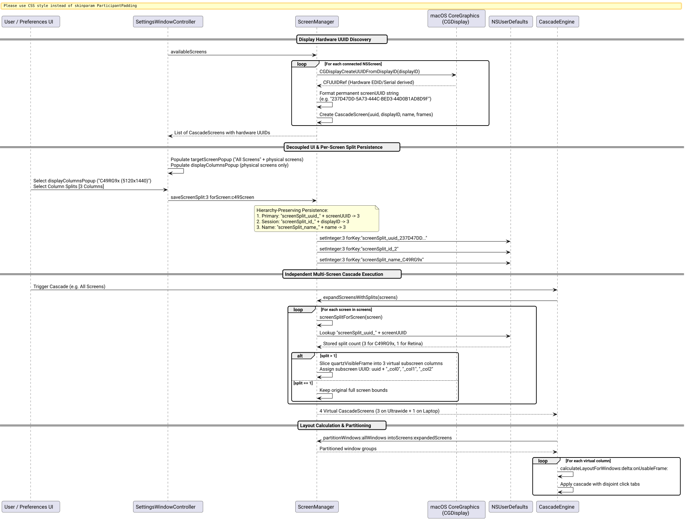

# Per-Screen Unique Hardware ID Column Splitting & UI Decoupling Success Story

## Context

Following the introduction of multi-column virtual subscreen slicing (1, 2, 3, 4 columns), user feedback and an adversarial `/ultrathink` review exposed two critical architectural challenges in multi-display setups:

1. **Ephemeral Display Identification & Name Collisions:**
   - `CGDirectDisplayID` is an ephemeral 32-bit session integer dynamically assigned by macOS Quartz upon boot, wake, or port reconnection. It shifts when swapping Thunderbolt ports or waking from sleep.
   - Screen names (e.g. `"Built-in Retina Display"` or `"Dell U2720Q"`) collide in dual-monitor setups with identical models, preventing independent column configurations.
2. **Coupled Settings Modal UX:**
   - The settings modal previously bound the `Screen Columns` segmented control directly to `targetScreenPopup`.
   - If the user wanted the default cascade behavior to target **All Screens (Independent)**, modifying column splits inadvertently altered the global fallback key rather than their specific ultrawide display!
   - Configuring an ultrawide to 3 columns required selecting that display in `targetScreenPopup`, which unintentionally restricted subsequent cascade triggers to that single monitor.

## The Ultrathink Stress-Test & Architecture

We formulated an end-to-end architecture to guarantee permanent per-screen isolation, hardware-derived persistence, and a decoupled user experience:

| Architecture Layer | Implementation | User Benefit |
| :--- | :--- | :--- |
| **Permanent Hardware UUID** | Extracted via [`CGDisplayCreateUUIDFromDisplayID`](file:///Users/bruno/Code/brunobrise/cascade/src/ScreenManager.m) in [`[ScreenManager availableScreens]`](file:///Users/bruno/Code/brunobrise/cascade/src/ScreenManager.m). Generates stable 128-bit hardware UUIDs derived from monitor EDID (vendor, model, and serial number). | Display settings survive reboots, port swaps, and dock reconnects. Dual identical monitors have distinct UUIDs. |
| **4-Tier Fallback Hierarchy** | Lookup checks: 1) `screenSplit_uuid_<UUID>`, 2) `screenSplit_id_<displayID>`, 3) `screenSplit_name_<name>`, 4) global `screenSplit` (default: 1). | Hardware UUID is authoritative; seamless backward compatibility and headless/CI fallbacks remain intact. |
| **Decoupled Settings Modal UI** | Dedicated `Display Columns:` popup alongside `Target Screen:` in [`SettingsWindowController`](file:///Users/bruno/Code/brunobrise/cascade/src/SettingsWindowController.m). | Users keep **All Screens (Independent)** as their cascade target while independently viewing and setting columns for each physical display. |
| **Zero-Pixel Subscreen Propagation** | Virtual column slicing via [`[ScreenManager subscreensForScreen:splitCount:]`](file:///Users/bruno/Code/brunobrise/cascade/src/ScreenManager.m) propagates subscreen UUIDs (`<UUID>_col0`, `<UUID>_col1`, etc.). | Full layout engine invariance, disjoint click tabs, and boundary preservation. |

The configuration, persistence, and execution lifecycle is shown below:



*Figure 1: Hardware UUID extraction, decoupled preferences UI, and per-screen virtual column expansion.*

## What Worked and Why

### 1. Hardware-Level UUID Extraction ([`src/ScreenManager.m`](file:///Users/bruno/Code/brunobrise/cascade/src/ScreenManager.m))
In `availableScreens`, each connected `NSScreen` is queried for its CoreGraphics display ID and permanent hardware UUID:

```objc
NSNumber *dNum = s.deviceDescription[@"NSScreenNumber"];
cs.displayID = dNum ? [dNum stringValue] : @"";
if (dNum) {
    CFUUIDRef uRef = CGDisplayCreateUUIDFromDisplayID((CGDirectDisplayID)[dNum unsignedIntValue]);
    if (uRef) {
        CFStringRef sRef = CFUUIDCreateString(kCFAllocatorDefault, uRef);
        cs.screenUUID = (__bridge_transfer NSString *)sRef;
        CFRelease(uRef);
    }
}
```

Empirical hardware probing verified permanent stability across connected monitors:
- Samsung 49" Ultrawide (`C49RG9x`, displayID `2`): `237D47DD-5A73-444C-BED3-44D0B1AD8D9F`
- Built-in MacBook Display (`Built-in Retina Display`, displayID `1`): `37D8832A-2D66-02CA-B9F7-8F30A301B230`

### 2. Hierarchical Per-Screen Persistence ([`src/ScreenManager.m`](file:///Users/bruno/Code/brunobrise/cascade/src/ScreenManager.m))
When querying screen splits, the permanent hardware UUID takes highest precedence:

```objc
+ (NSInteger)screenSplitForScreen:(CascadeScreen *)screen {
    if (!screen) return [self savedScreenSplit];
    NSUserDefaults *defaults = [[NSUserDefaults alloc] initWithSuiteName:kScreenDomain];
    NSArray<NSString *> *keys = @[
        screen.screenUUID.length > 0 ? [@"screenSplit_uuid_" stringByAppendingString:screen.screenUUID] : @"",
        screen.displayID.length > 0 ? [@"screenSplit_id_" stringByAppendingString:screen.displayID] : @"",
        screen.name.length > 0 ? [@"screenSplit_name_" stringByAppendingString:screen.name] : @""
    ];
    for (NSString *k in keys) {
        if (k.length == 0) continue;
        id val = [defaults objectForKey:k];
        if (val) {
            NSInteger s = [val integerValue];
            return (s >= 1 && s <= 4) ? s : 1;
        }
    }
    return [self savedScreenSplit];
}
```

Saving via [`[ScreenManager saveScreenSplit:forScreen:]`](file:///Users/bruno/Code/brunobrise/cascade/src/ScreenManager.m) persists to the UUID key, display ID key, and screen name key simultaneously, maintaining complete backward compatibility.

### 3. Decoupled Settings Window Preferences ([`src/SettingsWindowController.m`](file:///Users/bruno/Code/brunobrise/cascade/src/SettingsWindowController.m))
Section 1 of the Settings window was redesigned with dedicated, decoupled controls:
- **Target Screen:** Populated with `All Screens (Independent)` plus individual monitors. Governs cascade execution target.
- **Display Columns:** Populated strictly with connected physical displays. Selecting a display instantly reflects that screen's saved split in `columnsControl`.
- **Column Splits:** Modifying the segmented control immediately persists the chosen split to the selected display's hardware UUID.

```objc
- (void)columnsChanged:(id)sender {
    (void)sender;
    NSInteger split = self.columnsControl.selectedSegment + 1;
    CascadeScreen *s = [self selectedDisplayForColumns];
    [ScreenManager saveScreenSplit:split forScreen:s];
    [self.delegate settingsDidChange];
}
```

## Verification & Key Results

### Automated Test Suite Execution
All 9 test suites passed with 100% success across 31 compiled unit tests and 6 SemVer engine tests:

1. `test_engine`: Layout geometry, mathematical disjointness, sorting modes, resize preservation, diagnostics.
2. `test_login`: ServiceManagement launch-at-login enable/disable round-trip.
3. `test_watcher`: Debounced window lifecycle notifications and suppression.
4. `test_app_order`: Preferred app list ordering and priority.
5. `test_screen_manager`:
   - `testPerScreenSplitPersistence`: Verified UUID-based isolation, precedence, and clamping.
   - `testScreenSplitsAndSubscreens`: Verified subscreen quartz frame subdivision and subscreen UUID tagging.
   - `testWindowPartitioningAcrossColumns`: Verified spatial assignment and auto-rebalancing across virtual columns.
6. `test_settings`:
   - `testSettingsDisplayColumnsDecoupling`: Verified independent display selection and column split updates.
7. `test_icon_generator`: Icon set integrity and SVG branding assets.
8. `test_signing`: Bundle signature verification against persistent signing certificate.
9. `test_semver.py`: Strict sequential conventional commit parsing and SemVer 2.0.0 bumping.

### Empirical CLI & Defaults Verification
Configuring `C49RG9x` to 3 columns and verifying via `cascade --list-screens` and `defaults read`:

```
Connected Displays (2):
  [0] C49RG9x                  | 5120x1440 at (    0,     0) [Primary] [3 cols]
       Usable: 5120x1410 at (    0,    30)
  [1] Built-in Retina Display  | 1800x1169 at ( 2646,  1440)
       Usable: 1800x1131 at ( 2646,  1478)
```

`NSUserDefaults` payload:
```
"screenSplit_uuid_237D47DD-5A73-444C-BED3-44D0B1AD8D9F" = 3;
"screenSplit_uuid_37D8832A-2D66-02CA-B9F7-8F30A301B230" = 1;
```

### Strict Code Size Hygiene
All modified and existing source files remain strictly $\le 420$ lines of code:
- `src/ScreenManager.h`: 47 LOC
- `src/ScreenManager.m`: 404 LOC
- `src/SettingsWindowController.h`: 21 LOC
- `src/SettingsWindowController.m`: 328 LOC
- `src/main_bar.m`: 340 LOC
- `src/main_cli.m`: 406 LOC
- `tests/test_screen_manager.m`: 371 LOC
- `tests/test_settings.m`: 95 LOC
